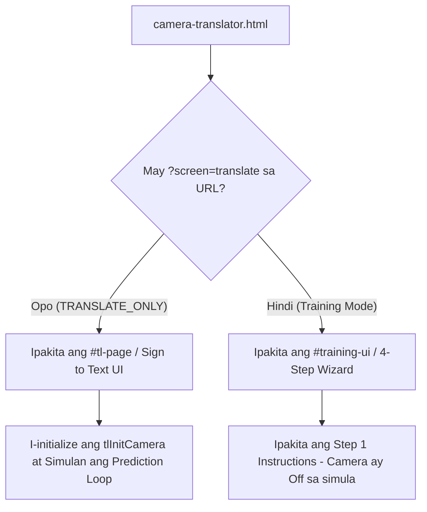

# Pagsusuri ng Proyekto: Sining Kamay (Sign Language System)

Ang ulat na ito ay naglalaman ng pagsusuri sa iyong proyekto—partikular sa mga functions, interface (UI), webcam integration, at kung paano gumagana ang **Sign Language to Text** translation.

---

## 1. Listahan ng mga Files at Kanilang Papel (File Directory & Labels)

Upang mas madali mong maunawaan kung nasaan ang mga logic, narito ang mga pangunahing files sa iyong proyekto at ang kanilang gamit:

| File Path / Link | Label / Uri | Deskripsyon at Papel sa Proyekto |
| :--- | :--- | :--- |
| [index.html](file:///c:/Users/Techlife/OneDrive/Documents/New%20folder%20(5)/Sining_kamay/index.html) | Front-end (HTML) | Ang **Welcome/Dashboard Kiosk** at ang interface para sa **Text to Sign Language** (kung saan ita-type o sasalitain ang salita at ipapakita ang kaukulang sign image/GIF). |
| [camera-translator.html](file:///c:/Users/Techlife/OneDrive/Documents/New%20folder%20(5)/Sining_kamay/camera-translator.html) | Front-end (HTML) | Ang nag-iisang file na naglalaman ng parehong **Training Wizard UI** (Step 1-4) at ng **Sign to Text Translation UI** (pinapagana gamit ang URL query parameter). |
| [js/script.js](file:///c:/Users/Techlife/OneDrive/Documents/New%20folder%20(5)/Sining_kamay/js/script.js) | Client-side (JS) | Logic para sa **Text to Sign** (boses/text translation). Naka-map dito ang listahan ng mga GIF/Larawan sa `assets/signs/` para sa spelling at kilalang parirala. |
| [js/gesture-data.js](file:///c:/Users/Techlife/OneDrive/Documents/New%20folder%20(5)/Sining_kamay/js/gesture-data.js) | Client-side (JS) | Logic para sa pag-record ng hand landmarks gamit ang **MediaPipe Hands**. Kinukuha nito ang x, y, z coordinates ng mga daliri, pina-flatten ito, at ipinapadala sa backend. |
| [js/main.js](file:///c:/Users/Techlife/OneDrive/Documents/New%20folder%20(5)/Sining_kamay/js/main.js) | Client-side (JS) | Logic ng lumang bersyon ng kNN Image Classifier (TensorFlow/Deeplearn.js) na kumukuha ng direct pixels mula sa webcam. |
| [js/db-api.js](file:///c:/Users/Techlife/OneDrive/Documents/New%20folder%20(5)/Sining_kamay/js/db-api.js) | Client-side (JS) | API connector na tumatawag sa mga PHP endpoints para mag-save at kumuha ng translations sa database. |
| [js/db-local.js](file:///c:/Users/Techlife/OneDrive/Documents/New%20folder%20(5)/Sining_kamay/js/db-local.js) | Client-side (JS) | Backup o fallback local database simulator sakaling walang aktibong koneksyon sa server. |
| [php/api/save_gesture.php](file:///c:/Users/Techlife/OneDrive/Documents/New%20folder%20(5)/Sining_kamay/php/api/save_gesture.php) | Server-side (PHP) | Endpoint para i-save ang narekord na gesture landmarks bilang JSON file sa folder na `saved_gestures/` at i-log ang mga ito sa MySQL database (`gestures`, `gesture_recordings`). |
| [php/api/save_translation.php](file:///c:/Users/Techlife/OneDrive/Documents/New%20folder%20(5)/Sining_kamay/php/api/save_translation.php) | Server-side (PHP) | Endpoint para i-save ang kasaysayan (history) ng mga matagumpay na na-translate na sign o text sa MySQL table na `translations`. |
| [db-schema/database_setup.sql](file:///c:/Users/Techlife/OneDrive/Documents/New%20folder%20(5)/Sining_kamay/db-schema/database_setup.sql) | Database (SQL) | SQL script para i-set up ang XAMPP/MySQL database at mga tables (`esl_signs`, `fsl_signs`, `gestures`, `gesture_recordings`, `translations`). |

---

## 2. Pagsusuri sa Camera UI at Functions (Webcam & UI Architecture)

### Single-File Routing (`camera-translator.html`)
Napansin mo na parang isang file lang ang ginagamit para sa camera at naka-`if` statement lang depende sa kung saan pinindot. **Tama ang iyong obserbasyon.**

Sa loob ng [camera-translator.html](file:///c:/Users/Techlife/OneDrive/Documents/New%20folder%20(5)/Sining_kamay/camera-translator.html), ginagamit ang URL parameters upang matukoy ang ipapakitang UI:
- Kapag ang URL ay may `?screen=translate` (hal. `camera-translator.html?screen=translate`), ipinapakita ang `#tl-page` (Sign-to-Text translator).
- Kapag walang parameter (hal. `camera-translator.html`), ipinapakita ang `#training-ui` (Step 1 to 4 training dashboard).



### Bakit Hindi Ito Magandang Practice?
Bagaman gumagana ito, may ilang isyu sa ganitong setup:
1. **Code Duplication (Pagdoble ng Code)**: May mga duplicate functions sa loob ng iisang file. Halimbawa, ang `speakAll()` ay idineklara nang dalawang beses (isang pang-kiosk sa linya 1471 at isang pang-standalone sa linya 1731). Gayundin ang `tlSetLang` / `setLang` at ang kopya ng translation states.
2. **Spaghetti at Mahabang Code**: Dahil pinagsama ang HTML, CSS, at mabigat na JavaScript (TensorFlow.js, MediaPipe, UI states) sa iisang file, umabot ito ng **1,762 lines**. Napakahirap nitong i-debug o baguhin.
3. **Mabigat na Pag-load**: Kahit na nais mo lang mag-translate, kailangan pa ring i-load ng browser ang lahat ng markup at logic para sa training (at vice versa).

### Naka-bukod ba ang Camera Function sa Sign Language?
**Sa aspeto ng UI (DOM):**
Oo, magkahiwalay ang mga `<video>` tag sa HTML:
- Para sa Translator UI: Ginigising ang `#tlVideo1` at `#tlVideo2` gamit ang `tlInitCamera()`.
- Para sa Training UI: Ginigising ang `#videoFeed` gamit ang `enableCamBtn` click event.

**Sa aspeto ng Logic (Landmark Extraction & AI):**
Hindi sila lubusang nakabukod. Pareho silang umaasa sa global state ng `js/gesture-data.js` at ng library na **MediaPipe Hands** (`hands.js`).
- Kapag aktibo ang camera, ang MediaPipe ay patuloy na nagde-detect ng kamay at nag-a-update sa global variable na `state.latestLandmarks`.
- Ang function na `extractFeatures()` ay kumukuha ng landmarks na ito para sa neural network, anuman ang aktibong video element sa screen.

---

## 3. Pagsusuri: Kaya ba Talaga ng Code Ngayon na Mag-translate ng Sign Language?

### Maikling Sagot
**Oo, may kakayahan ang code sa kasalukuyan na mag-translate ng Sign Language papuntang Text**, ngunit may malaking babala (caveat) sa kung paano ito gumagana.

### Detalyadong Paliwanag kung Paano Ito Gumagana:
1. **Pangongolekta ng Landmarks (Feature Extraction)**:
   Sa tulong ng MediaPipe Hands, kinukuha ng system ang 21 points ng kamay. Ang distansya ng bawat point ay sinusukat mula sa **wrist (pulso)** upang kahit malapit o malayo ang kamay sa camera, normalized pa rin ang coordinates. Ang 21 points na may `x, y, z` coordinates ay ginagawang isang patag na array na may **63 numbers**.
2. **Pag-save sa Server**:
   Ang 30 frames ng coordinates na ito ay ipinapadala sa [php/api/save_gesture.php](file:///c:/Users/Techlife/OneDrive/Documents/New%20folder%20(5)/Sining_kamay/php/api/save_gesture.php) na nagse-save nito bilang `.json` file sa `saved_gestures/` at nagrerehistro sa database.
3. **Training sa Browser**:
   Sa Step 2 ng Training, kinukuha ng [camera-translator.html](file:///c:/Users/Techlife/OneDrive/Documents/New%20folder%20(5)/Sining_kamay/camera-translator.html) ang lahat ng `.json` files mula sa server, pinagsasama-sama sila, at nagti-train ng isang Sequential Neural Network gamit ang TensorFlow.js mismo sa browser ng user.
4. **Ang Prediksyon at Pagsasalin (Prediction & Translation)**:
   Dito may kritikal na pagkakaiba:
   - **Custom Gestures (Tunay na Pagsasalin)**: Kung nag-train ka ng sarili mong gesture sa Step 1 at pinangalanan mo itong `"hello"` o `"thank_you"`, kapag nakita ito ng camera at lumampas sa 65% ang confidence, hahanapin ito sa listahan ng translations at isusulat ang salitang `"Hello"` o `"Salamat"`. **Ito ay totoong translation.**
   - **Start Gesture (Sequential/Dummy Cycler)**: Kung ang nakitang gesture ay ang basic na `"start"`, **hindi** nito tina-translate ang mismong galaw ng kamay bilang isang partikular na salita. Sa halip, kumukuha ito ng salita mula sa isang fixed word bank (tulad ng "Hello", "Thank you", "Yes", "No") sa pamamagitan ng pag-ikot sa index (`wordIndex % words.length`). Kada gawa mo ng "Start" sign, iluluwa lang nito ang susunod na salita sa listahan sequentially.

> [!IMPORTANT]
> Utang ipaalala na upang mapagana ang totoong **Sign Language to Text** para sa mga tiyak na salita, **huwag umasa sa "Start" at "Stop" gestures lamang**. Kailangan mong mag-add ng bagong gesture sa Step 1 gamit ang eksaktong pangalan ng salita (halimbawa: `hello` o `water`), kumuha ng sample, i-train ang AI sa Step 2, at saka ito gagana nang tama sa Step 4 o sa Translate page.

---

## 4. Format ng Data at Pag-save ng Sign Language

Kung nais mong magdagdag ng data para sa sign language upang gumana ito, narito ang format at proseso:

### A. Format ng Bawat Sample (JSON format)
Kapag nag-capture ka ng gesture, sine-save ito ng backend sa folder na `saved_gestures/<label>/sample_*.json` gamit ang ganitong estruktura:

```json
{
  "label": "hello",
  "createdAt": "2026-06-25T13:00:00Z",
  "frameCount": 30,
  "format": "mediapipe_hands_landmarks_v1",
  "signLanguage": "ESL",
  "frames": [
    {
      "index": 0,
      "timestamp": 1785934020123,
      "landmarks": [
        {"x": 0.0, "y": 0.0, "z": 0.0}, 
        {"x": 0.05, "y": -0.12, "z": -0.02},
        ...
      ]
    },
    ...
  ]
}
```

### B. Paano Magdagdag ng Data (Step-by-Step)
1. **Buksan ang Kiosk Training UI** (i-load ang `camera-translator.html` nang walang parameter).
2. **Pumunta sa Step 1 (Add Data)**:
   - Sa input box, i-type ang pangalan ng gesture (halimbawa: `hello`).
   - Piliin ang Sign Set (`ESL` o `FSL`).
   - I-click ang **Start Capture** habang nakatutok ang kamay sa camera. Gagawa ito ng 30 frames sa loob ng 2.7 segundo (1 frame kada 90ms).
   - Awtomatiko itong magse-save sa database at sa iyong disk pagkatapos ng 30 frames.
3. **Pumunta sa Step 2 (Train AI)**:
   - I-click ang **Train Gesture** upang i-load ang bagong data at i-compile ang bagong modelo gamit ang TensorFlow.js.
4. **I-export ang Data (Opsyonal)**:
   - Maaari mong i-click ang **Export Data** sa ibaba upang i-download ang `.json` file ng iyong training data para magsilbing backup.

### C. Database Tables na Apektado:
Kapag matagumpay na na-save ang gesture sample, ang mga sumusunod na tables sa iyong MySQL database ay malalagyan ng record:
1. `gestures` - Naglalaman ng ugnayan ng word label at ng sign language system (`ESL`/`FSL`).
2. `gesture_recordings` - Naglalaman ng kabuuang bilang ng frames, lokasyon ng file (`sample_path`), at ang buong landmark JSON string.
3. `esl_signs` / `fsl_signs` - Nagse-save ng metadata ng sign language word para sa diksyunaryo.

---

## 5. Mga Rekomendasyon para sa Refactoring (Architectural Refactoring)

Upang maiwasan ang mga isyu sa "spaghetti code" at code duplication, narito ang mga hakbang na iminumungkahi naming gawin sa hinaharap (nang hindi binabago ang code ngayon):

1. **Paghiwalayin ang HTML Files**:
   - Gumawa ng `gesture-training.html` na nakatutok lamang sa 4-step training walkthrough.
   - Gumawa ng `sign-to-text.html` na nakatutok lamang sa aktwal na pagsasalin ng sign language papuntang text.
2. **I-externalize ang Shared JS Code**:
   - Kunin ang mga duplicate functions tulad ng `speakWord()`, `initCameraWithFallback()`, at translation render helpers, at ilagay ang mga ito sa isang shared helper file tulad ng `js/camera-helper.js`.
3. **Tanggalin ang Sequential Dummy Word Cycler**:
   - Baguhin ang prediction logic sa `tlStartPredLoop` at `startLivePrediction` upang kapag nakita ang `"start"` gesture, hindi ito magdudulot ng sequential na pag-ikot sa word bank. Sa halip, maaari itong magsilbing trigger para simulan/tapusin ang pakikinig (voice control) o panatilihin itong idle state, at hayaan lamang ang mga custom gestures ang mag-output ng kani-kanilang mga salita.
