Phase: capture UI layout fix (gesture-training Step 1)
Date: 2026-09-27
Status: DONE
Decision needed from owner: none. Two small choices are listed under "Notes for the owner" to confirm or overrule.

# Capture UI layout fix — final report

Scope: the owner's two changes, run with no Step 1 stop because the owner's decisions were
already settled.
- **A.** The recording overlay becomes a true full-viewport landscape layout.
- **B.** Step 1 loses its camera feed; the camera starts inside the overlay.

The overlay's logic is unchanged: the same states, segmenter, extraction, v3 format and saves.
Nothing is pushed or merged.

Commits:
- `af370ac`: code and tests.
- The commit after it: docs, this report and the screenshots.

## What changed

### A. The recording overlay (`#gcMode`)

- **Full viewport.** `position:fixed`, 100vw × 100vh, no margin or radius. It is a CSS grid
  with three rows: top bar (`auto`), media (`minmax(0,1fr)`), bottom bar (`auto`). See
  `css/gesture-training.css:958-962`.
- **Top bar, left:** the label chip, e.g. "hi · ESL · Word". It wraps to two lines instead of
  truncating.
- **Top bar, centre:** the state title. The texts are:
  - Starting camera…
  - READY
  - GET READY
  - REST
  - SIGN n of 3, with the three progress dots
  - REVIEW · 3 signs found
  - PROCESSING NN%
  - SAVING n of 3
  - or the error text
- **Top bar, right:** Cancel, hidden while saving, as before. The bar keeps a 72 px minimum
  height, so the media row does not jump when Cancel hides.
- **Media:** the live feed or the review loop fills the whole middle row, full width,
  `object-fit: contain` (never cropped). There is no pixel height anywhere on the video.
  - The "Hand visible / No hand" pill is overlaid in the top-left corner.
  - Hints are a banner over the bottom of the video.
- **Bottom bar:** the state's buttons in one row, each `flex: 1`, at least 56 px tall:
  - Ready: START
  - Review: Save | Redo
  - Errors: Redo | Cancel
  - Save failure: Retry save | Cancel

  Countdown and recording show a status line only ("Recording starts in 3…" / "● REC 0:07
  Sign on SIGN, lower your hands on REST"). Processing shows the progress bar.
- **START moved** from the centre of the video into the bottom bar, following the owner's rule
  that each state's buttons sit there. The video is no longer covered in Ready.

### B. Step 1 without a camera feed

- **Camera panel hidden.** In Step 1 the camera panel (`#cameraFrame`, `#videoFeed`, the
  Camera Ready / Searching badges, Enable Camera) is moved off-screen, not set to
  `display:none`. The live MediaPipe loop keeps reading `#videoFeed` while the overlay is open,
  and a `display:none` video freezes Chromium on the Pi. Step 2 already hides the same panel
  this way (`css/gesture-training.css:1058-1068`).
- **Two columns, no scroll, at 1024×600.**
  - Left: Gesture Name, Sign Set, Type (48 px controls).
  - Right: Record 3 samples (72 px), the saved-status line, View Active Gesture Dataset,
    Export Data / Load Saved, Next: Train AI.
  - Back to Instructions stays along the bottom.
  - See `gesture-training.html:198-250` and `css/gesture-training.css:1069-1089`.
- **The overlay starts the camera.** The overlay opens in **Starting camera**. It calls the
  page's `acquireCaptureCamera()`, which reuses a live stream or starts one through the new
  shared `startPageCamera()` (`js/gesture-training-ui.js:1064-1140`).
  - START stays disabled, labelled "Starting camera…", until the first live hand-tracking
    result arrives. That is the "detector ready" moment.
  - This wait has its own bound, `READY_TIMEOUT_MS` 30000 (`js/gesture-capture-ui.js:40`).
  - `RESULTS_WATCHDOG_MS` in `capture-core.js` is unchanged.
- **Camera errors show inside the overlay,** in English (e.g. "No camera found. Connect a
  camera and try again."), with Redo (try again) / Cancel.
- **Closing stops the camera, but only one the overlay started.** On close,
  `releaseCaptureCamera()` stops the tracks and pauses the live loop, but only for a camera
  the overlay started itself (`:1117-1155`). A camera the user already enabled in Step 3/4 is
  left running.
- **Steps 2–4 unchanged.** They keep their camera panel, Enable Camera button and behaviour.
  Enable Camera now goes through the same `startPageCamera()`, with the same badge and toast
  results as before.

Must-not-change list: untouched. That covers `capture-core.js`, `video-landmarks.js`, the v3
format, `save_gesture.php`, `knnPredict` / `trainModel` / `mergeSavedGestureSamples`,
`talk.html`, `reports.html`, and your uncommitted `docs/revision/MEMORY.md` and
`docs/system/MANUAL-CHECKS.md`.

## Screenshots (headless Chrome 153, fake camera fed from `assets/signs/en/hello.webm`)

The fake camera is a 320×240 file with black gaps between the signs. That's why the signer
looks small and why REST shows a black frame. A real 4:3 camera fills the contained area:
600×450 at 1024×600.

| State | 1024×600 | 1280×720 |
|---|---|---|
| Step 1 form | 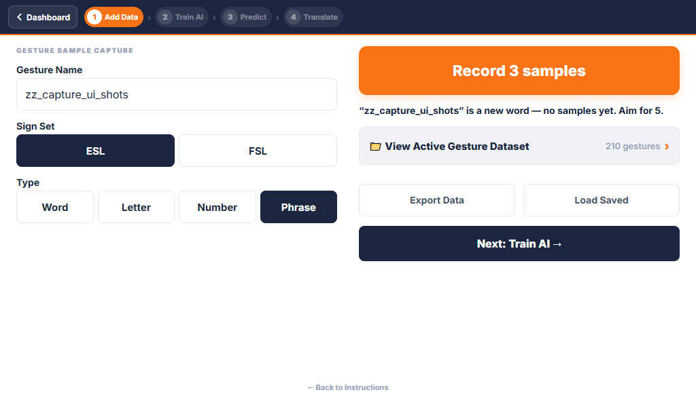 | 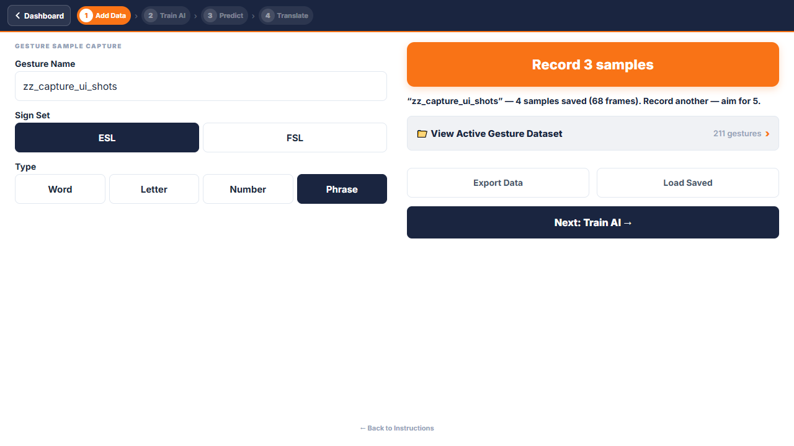 |
| Overlay: Starting camera | 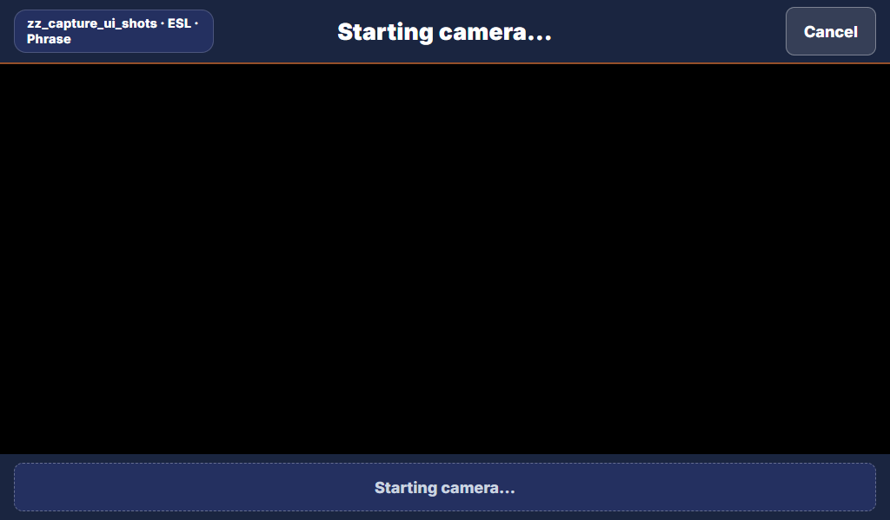 | 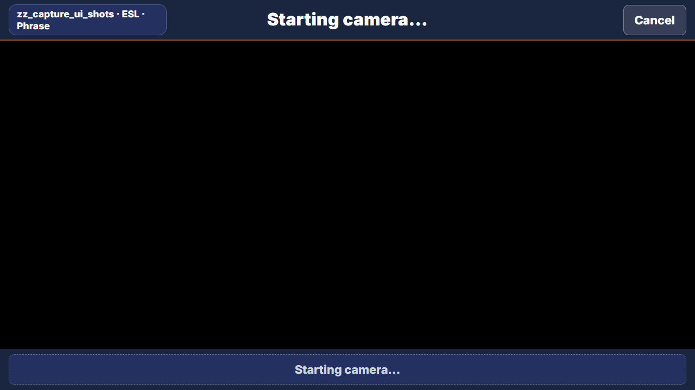 |
| REST | 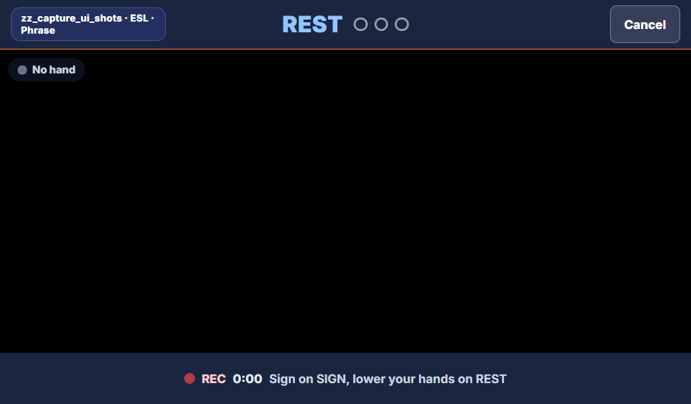 | 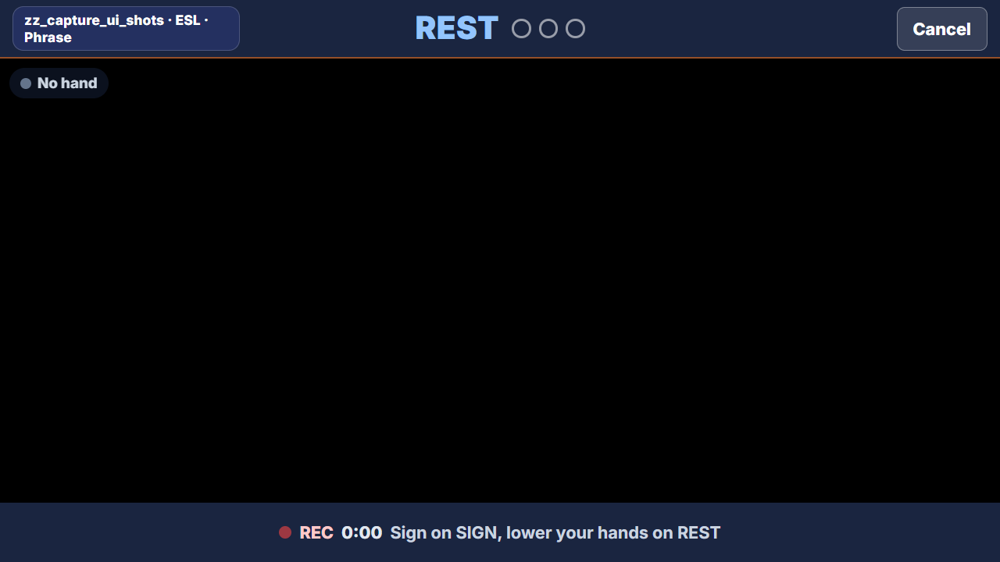 |
| SIGN 2 of 3 | 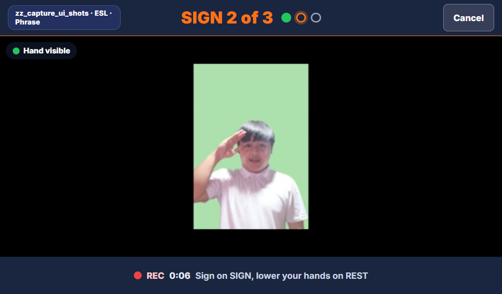 | 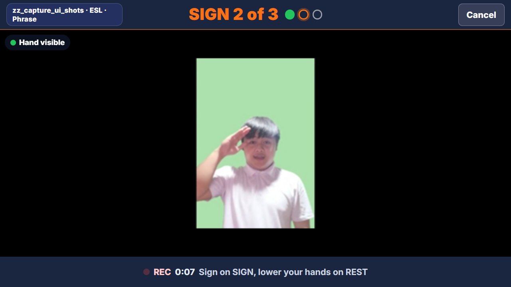 |
| Review | 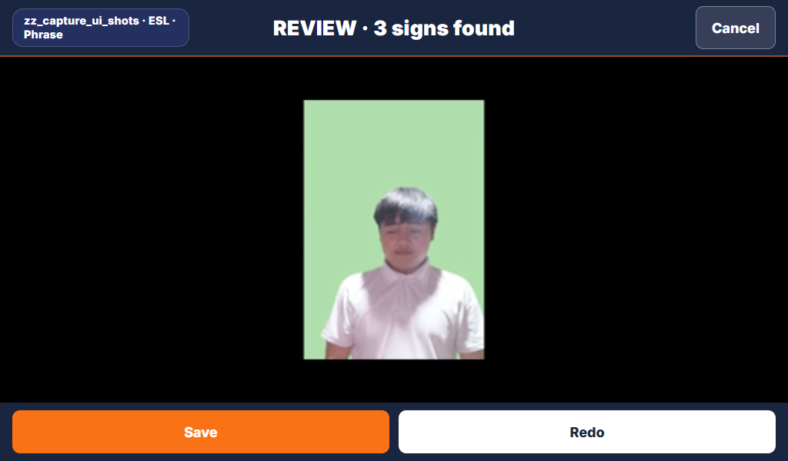 | 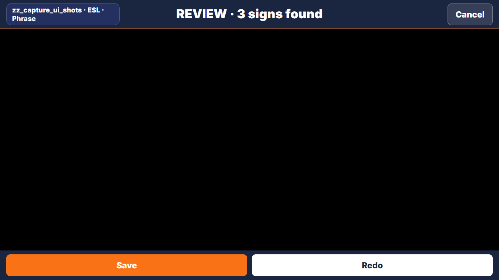 |
| Processing | 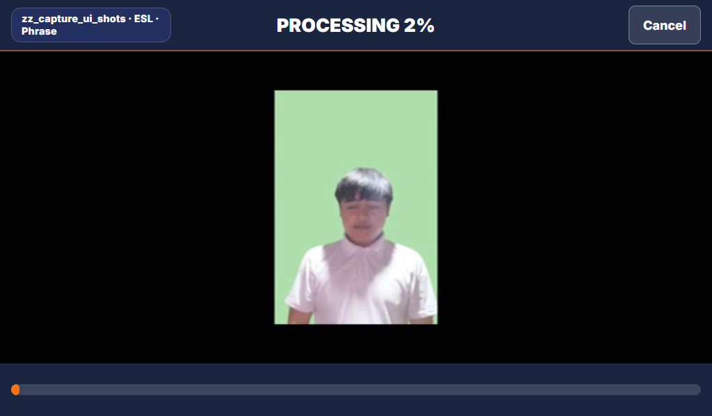 | 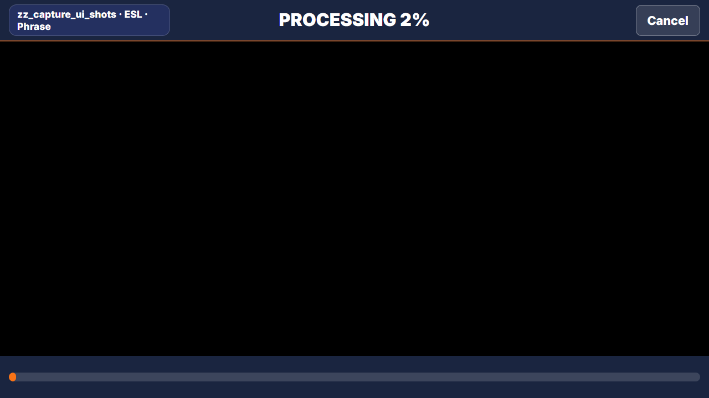 |
| Saving | 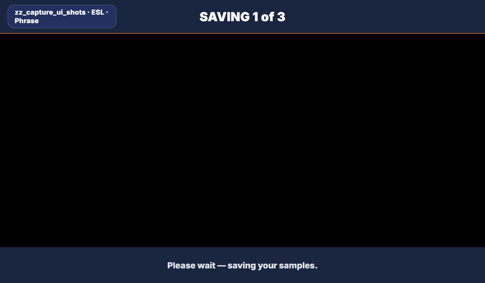 | 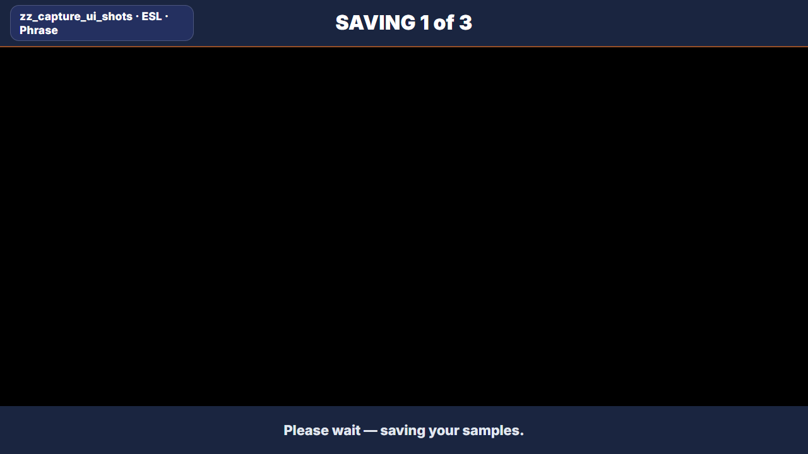 |
| Error (save failed) | 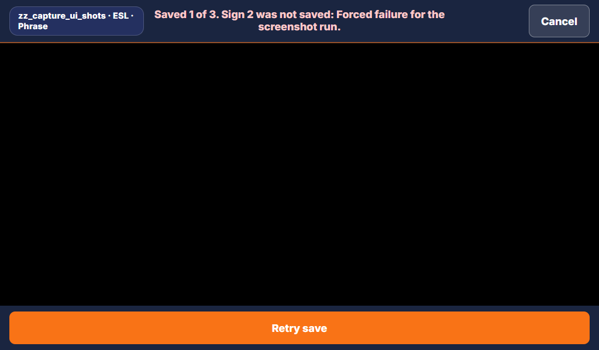 | 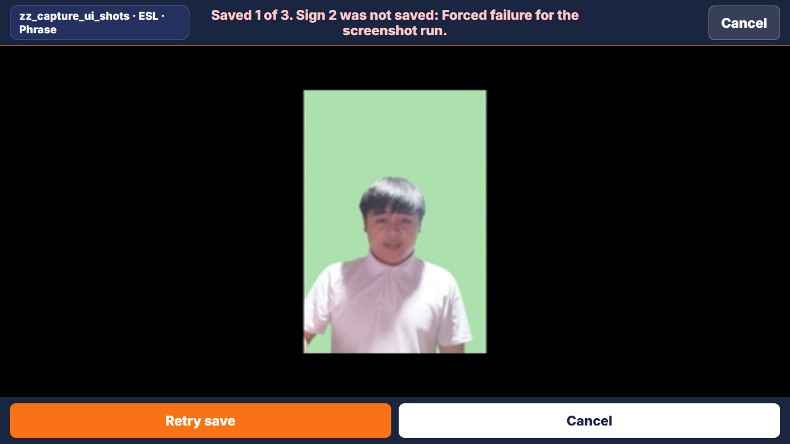 |

These are produced by `tests/video-capture/screenshots.mjs`. It delays the save requests by
1.5 s in-page so Saving can be captured, and forces save 2 to fail for the error state. The
test label is deleted afterwards.

## Verification (measured)

| Check | Result |
|---|---|
| No scrollbar in any state, at both sizes | **Pass**, 16 of 16 states. The scroll sizes of `documentElement`, `body`, `#gcMode` and `#leftStep1` all equal the viewport or client size: 1024×600 / 1280×720, and `#leftStep1` 548/548 at 1024×600, 668/668 at 1280×720. |
| Buttons ≥ 44×44 (overlay bottom bar ≥ 56 tall), none off-screen; top bar parts don't overlap | **Pass** in every overlay state and in Step 1's own controls, at both sizes. |
| Media row fills the middle | 1024×450 at 1024×600; 1280×570 at 1280×720. The video is `object-fit: contain`. |
| Starting camera → START enabled (camera + first MediaPipe load) | 11,055 ms / 10,963 ms (screenshots run) and 11,138 ms (e2e run), on this laptop. The Pi is not measured. |
| Step 1 camera not started before the overlay opens; the overlay stops the camera it started on close | **Pass** (screenshots and e2e). |
| `node --test --test-concurrency=1 tests/video-capture/*.test.mjs` | **49/49**. See the golden-test note below. |
| `capture-ui-check.mjs` | **ALL CHECKS PASSED** (77). It covers both camera paths: started by the overlay, and already running before it opened. |
| `e2e.mjs` (fake camera) | **ALL CHECKS PASSED** (53). See the breakdown below. |
| Steps 2–4: Train, then Predict with the camera | Train AI: "Complete! — 121 gestures ready". Step 3 Enable Camera: hand results flowing in 471 ms (e2e). An extra 25 s Predict run (below) predicted "hello" 9 times and showed "Show your sign" 38 times. |
| 0 console errors | **Pass**: screenshots (both sizes), capture-ui-check, e2e, and the 25 s Predict run. |
| `extractor-check.mjs` | **2 checks fail**: "segmentFrames(result) is ok with 3 reps" returns `too-few-reps`. This is the known fixture problem documented in `docs/reports/2026-09-26-video-capture-final.md` ("Owner follow-up"): its in-page synthetic recording is timing-sensitive on this machine. This phase changed none of the files it exercises. |

What the e2e run covered:
- Ready reached in 11,138 ms, with the camera started by the overlay.
- Review showed "REVIEW · 3 signs found".
- 3 v3 samples were saved, with 3 matching `gesture_recordings` rows.
- 0 of 31 requests carried video.
- `assets/signs/` was unchanged.
- Redo and Cancel sent no requests.
- After Cancel during Processing, the overlay-started camera was stopped (no more hand
  results).
- Processing took 12,320 ms.

About the 25 s Predict run:
- It is a one-off script, not committed: after training, open Step 3, Enable Camera, then poll
  the prediction every 250 ms.
- The fake camera plays the "hello" sign with black gaps. Predict named it when the signer was
  on screen and showed "Show your sign" in the gaps.
- The e2e's own 5 s Predict window happened to fall in black frames. Its check only asserts
  that the prediction fields are populated.

**Golden test change:**
- `feature-rows.test.mjs` failed once because your real recording test left 3 v3 samples in
  `saved_gestures/hi/`: 87 frames, recorded at 480×360.
- The phase-base code (`813bfbe`) predates v3, so those rows differ by design.
- The test now compares v2 files only and reports how many v3 files it skipped: 210 v2 files,
  3,232 rows, all identical, 3 v3 files skipped. v3 loading keeps its own tests.
- `saved_gestures/hi/` is your data. It is untracked and was left untouched, not committed.

## Found along the way

- **DEBT 91 partly addressed.** Redo now goes back through Starting camera, which resumes a
  paused live loop. `capture-ui-check`'s watchdog run now asserts recovery without the test
  resuming the loop. A truly wedged detector send still needs a page reload; the overlay then
  shows "Hand tracking is not ready. Please try again." after 30 s.
- **Page nav pills are under 44 px (pre-existing).** The pills are 76–88 × 30 px and the
  Dashboard link is 102 × 34 px. They sit above Step 1 and were outside this change;
  `screenshots.mjs` logs them.

## Notes for the owner

1. **Cancel appears twice in error states.** It shows at the top right and in the bottom bar
   ("Redo | Cancel"), because your layout lists both. Say so if you'd rather keep only one.
2. **After the overlay closes, Steps 3/4 show "Camera Off".** If the overlay started the
   camera, closing it stops the camera, so Steps 3/4 show "Camera Off" and the Enable Camera
   button, the same as a first visit. This follows "stop when it closes". A camera you
   already enabled in Step 3/4 before recording is left running.

## `git diff --stat`

Code and tests (`af370ac`):
```
 css/gesture-training.css                  | 165 +++++++++++++++--------
 gesture-training.html                     | 106 ++++++++-------
 js/gesture-capture-ui.js                  | 127 ++++++++++++++----
 js/gesture-training-ui.js                 | 115 +++++++++++-----
 tests/video-capture/README.md             |  18 +++
 tests/video-capture/capture-ui-check.mjs  |  56 +++++---
 tests/video-capture/e2e.mjs               |  64 ++++-----
 tests/video-capture/fake-camera.mjs       |  37 ++++++
 tests/video-capture/feature-rows.test.mjs |  13 +-
 tests/video-capture/screenshots.mjs       | 210 ++++++++++++++++++++++++++++++
 10 files changed, 687 insertions(+), 224 deletions(-)
```

Docs (the next commit):
- `docs/system/UI.md`, `DECISIONS.md`, `DEBT.md`, `INVENTORY.md`, `BACKEND.md`.
- This report.
- 16 screenshots under `docs/reports/img/`.
- Line citations into the four changed files were re-mapped. Stale historical citations were
  restored or corrected by hand.

## Owner follow-up (2026-09-27)

Owner review: approved, plus two small changes. Both are done. Code is `1015556`, docs are in
the commit after it.

### 1. Cancel only top-right

- Error states show **Redo** alone in the bottom bar, full width.
- A failed save shows **Retry save** alone.
- Cancel is only ever the top-right button. `#gcCancelBottom` is removed.
- `capture-ui-check.mjs` now asserts the bottom bar contents: `gcRedo` in the camera-stopped
  error, `gcRetrySave` in the save failure.

Updated screenshots, 1024×600:

| Ready | Error (save failed) |
|---|---|
| 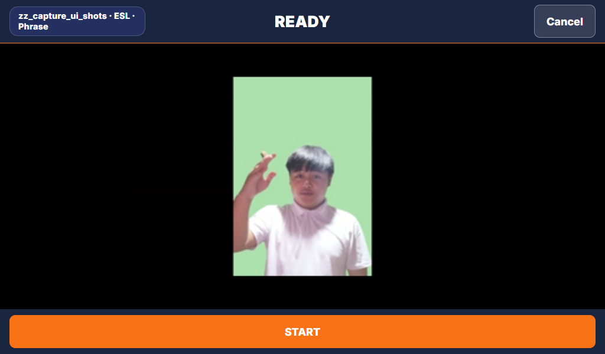 |  |

### 2. Start-up time

- **`READY_TIMEOUT_MS` = 60000** (was 30000), `js/gesture-capture-ui.js:41`.
- **Warm-up at page load, one instance reused.** `warmUpHandTracking()` runs at the start of
  `gesture-training.html`'s `DOMContentLoaded` handler (`js/gesture-training-ui.js:1223`,
  `:1237-1264`). It loads the ONE Hands instance with `preloadMediaPipe()` (WASM + model +
  `initialize()`, results loop paused, no camera).
- **Every later use reuses that instance:** every overlay open and Steps 3/4's Enable Camera.
  `setupMediaPipe()` returns early for the same `<video>`, and the camera start resumes the
  loop.
- **Addition: the warm-up also runs one detection on a blank 320×240 frame** (through
  `createVideoDetector()`; loop still paused, no camera). The brief said "model init only",
  but that alone did not help. The model init finished in 763 ms, before the first open, yet
  the first open still took **11,157 ms**. The ~11 s is MediaPipe's **first inference**, not
  the model load: measured as one main-thread long task of 11,574–11,785 ms.

**Measured on the laptop** (`tests/video-capture/startup-check.mjs`, headless Chrome 153,
fake camera, 1024×600). Each run loads the page, waits for the dataset, idles 2 s, opens the
mode twice (Cancel between), then runs Train AI and Step 3. Starting camera → START enabled:

| Variant | First open | Second open | Train AI | Step 3 camera → first result | Dataset count shown (after navigation) | Console errors |
|---|---|---|---|---|---|---|
| Before (no warm-up), run 1 / run 2 | 15,410 / 12,929 ms | 131 / 148 ms | 4,084 / 3,993 ms | 148 / 174 ms | 8,334 / 18,529 ms | 0 / 0 |
| Model init only (the brief's wording), 1 run | 11,157 ms | 142 ms | 3,353 ms | 271 ms | 9,854 ms | 0 |
| Init + blank-frame detection, started after the dataset load, run 1 / run 2 | 1,981 / 1,209 ms | 139 / 131 ms | 6,095 / 3,270 ms | 279 / 175 ms | 22,054 / 22,394 ms | 0 / 0 |
| **Shipped:** init + blank-frame detection, started first thing on page load, run 1 / run 2 | **1,858 / 1,505 ms** | **278 / 176 ms** | **4,049 / 4,593 ms** | **184 / 178 ms** | **16,808 / 15,825 ms** | **0 / 0** |

- **First open drops from about 13–15 s to about 1.5–1.9 s.** What remains is the camera
  start plus the first live frames.
- **Second open stays around 0.2 s.** The mode starts and stops its own camera each time, so
  this includes a camera restart.
- **Steps 2–4 are unchanged within run-to-run noise.** Train AI is 4.0–4.6 s against a
  4.0–4.1 s baseline. Step 3's camera delivers its first hand result in under 0.2 s. Predict
  named "hello" in 14/33 and 15/34 polls, against 17/36 and 13/34 in the baseline. There were
  0 console errors in every run.
- **Why "started first thing" was chosen.** Started after the startup dataset load, the
  warm-up's long task overlapped the page's second dataset fetch, and the dataset count
  appeared about 22 s after navigation. Started at the beginning of `DOMContentLoaded`, the
  long task runs while the PIN screen is up (it began 1.3 s after navigation). The count then
  appeared at 15.8–16.8 s, inside the baseline's 8.3–18.5 s range.

**Cost of the blank-frame detection — please confirm:**
- The page does not respond for about 12 s once, shortly after it loads. Taps are queued, not
  lost.
- Before this follow-up, the same block happened after tapping Record 3 samples, while
  "Starting camera…" was showing.
- On the Pi both the block and the start-up times are expected to be longer. **Pi timing is
  not measured.** `startup-check.mjs` is committed so it can be run there.
- If you would rather keep the page responsive at load, and accept the ~11 s wait on the
  first open instead, the fix is to drop the blank-frame detection and keep model init only.

### Verification

| Check | Result |
|---|---|
| `node --test --test-concurrency=1 tests/video-capture/*.test.mjs` | **49/49** |
| `capture-ui-check.mjs` | **ALL CHECKS PASSED**, including the two new bottom-bar assertions |
| `e2e.mjs` (fake camera) | **ALL CHECKS PASSED**. Ready was reached **1,865 ms** after opening (was 11,138 ms in the previous run) |
| `screenshots.mjs`, 1024×600, Ready + error images rewritten | **ALL CHECKS PASSED**: no scrollbar, targets ≥ 44 (bottom bar ≥ 56), no overlap, 0 console errors |
| Warm-up console errors | 0 in every run above. A warm-up failure would log `console.warn`, not an error. |

Also found:
- **Temp folders left behind.** `startup-check.mjs` left its temp folder behind 4 times:
  Windows still held the fake-camera file when the script deleted it. The folders were removed
  by hand, and none were committed.
- **Timing risk on the Pi.** `createVideoDetector()`'s `detect()` has a 10 s timeout. The
  blank-frame detection only succeeds because the timer cannot fire during the 11.6 s main-thread
  block. On a slower device the timeout could win: the warm-up would then log a warning, but
  the instance still ends up warmed. This is untested on the Pi.

`git diff --stat` for the code commit `1015556`:
```
 gesture-training.html                    |  1 -
 js/gesture-capture-ui.js                 | 20 +++----
 js/gesture-training-ui.js                | 38 +++++++++++++
 tests/video-capture/capture-ui-check.mjs |  4 ++
 tests/video-capture/screenshots.mjs      | 30 +++++++---
 tests/video-capture/startup-check.mjs    | 94 ++++++++++++++++++++++++++++++++
 6 files changed, 166 insertions(+), 21 deletions(-)
```
Docs commit: `docs/system/UI.md`, `DECISIONS.md`, `DEBT.md`, `INVENTORY.md`,
`tests/video-capture/README.md`, this report, and 2 images (`02b-ready` new, `08-error` updated).
