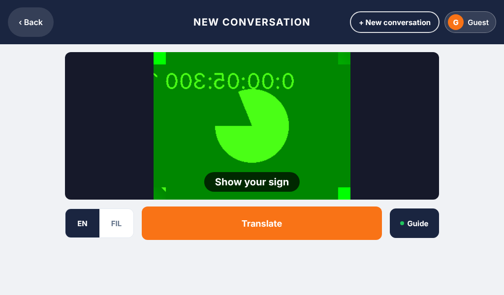
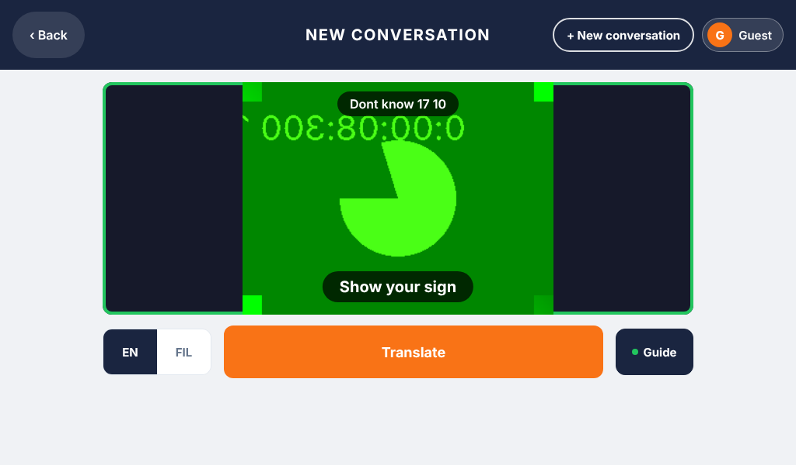
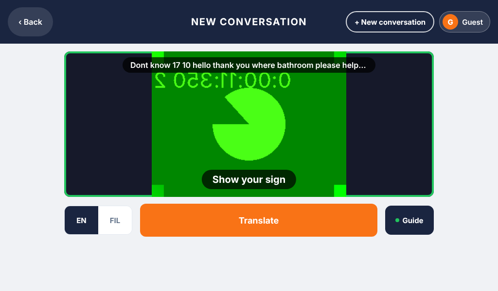
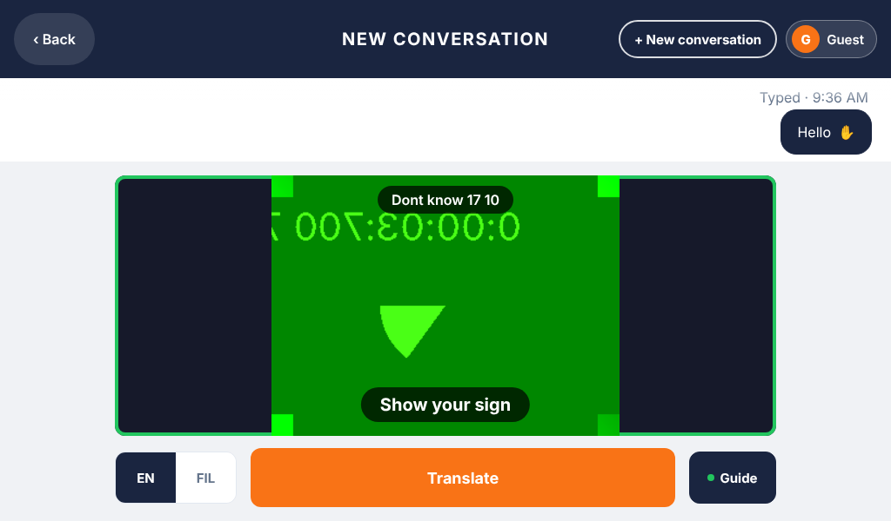
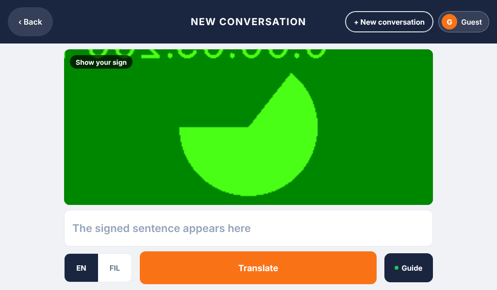
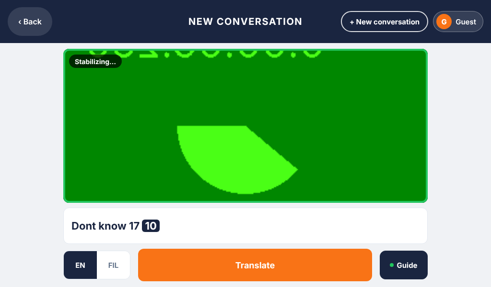
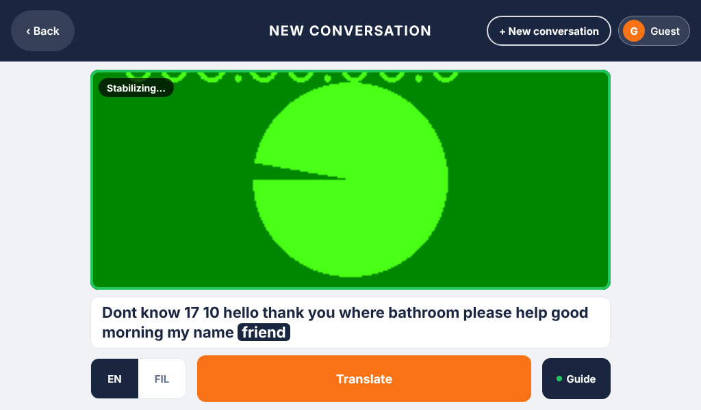
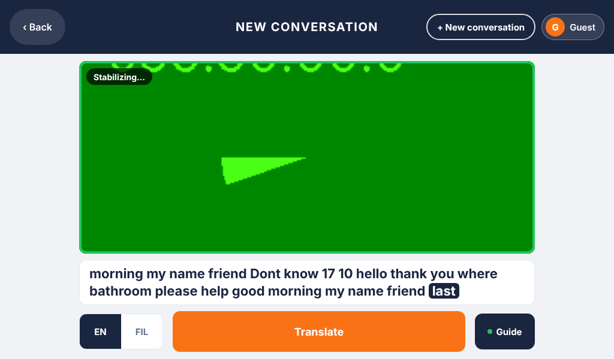
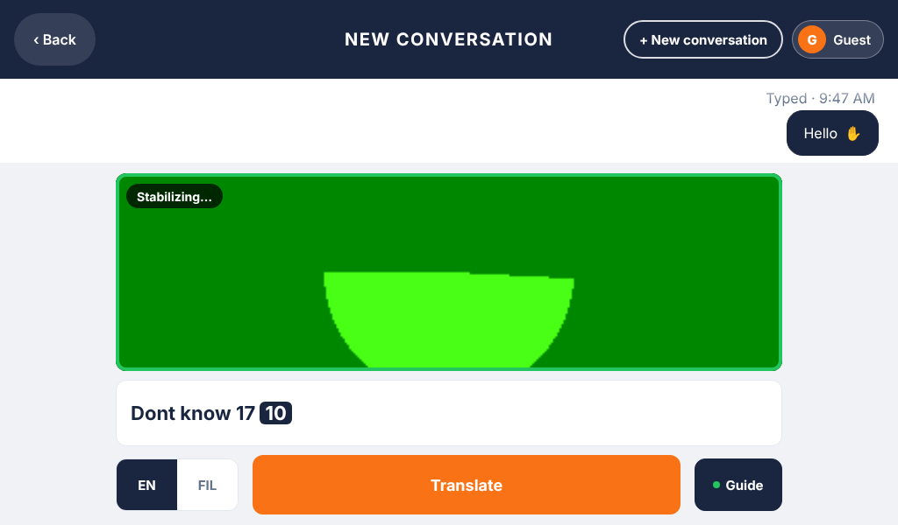

Phase: Let's Talk signing screen layout at 1024x600 (talk-camera-layout)
Date: 2026-10-18
Status: DONE
Decision needed from owner: none. One trade-off to look at on the Pi: the 4:3 camera is cropped top and bottom by object-fit: cover (section 3).

# Let's Talk signing screen — camera fills its panel, sentence bar under it

Branch `accounts-quiz` (owner: commit there, code and docs separately, no merge). Layout only: recognition
(knnPredict, the model, the start/stop/word flow), the buttons' actions, the avatar side (Speak or Type) and the
conversation save are unchanged.

## 1. What changed (owner feedback 1-3)

| # | Owner ask | Done |
|---|---|---|
| 1 | Camera fills the whole green-bordered panel, `object-fit: cover`, mirror kept | `.camera-video` is `object-fit: cover` with `transform: scaleX(-1)` (`talk.html`). The video box equals the panel box (measured, section 2). The hand-landmark canvas `#tlCanvas1` is stretched over the same box with `object-fit: cover` (CSS only, `#camera-box #tlCanvas1`): `js/gesture-data.js` keeps sizing its drawing buffer to the video's aspect ratio, so cover crops it exactly like the video and the skeleton stays on the hands; the shared drawing code is not changed. The green "recording" frame is now also drawn by `.camera-box.recording::after` above the video (the full-size video/canvas would paint over the old outline). |
| 2 | Use the empty space; page fills 600 px, no scroll | `.signing-live` is a 760 px column (12 px top/bottom padding, 10 px gaps) that takes the screen's remaining height; the camera panel is `flex: 1`. Was a fixed 760x300 box with 112 px empty below the controls. |
| 3 | Sentence in its own bar under the camera: full width, white, >= 22 px bold, wraps to 2 lines, newest word highlighted; "Stabilizing…" stays a small chip on the video | `#signing-draft` moved out of the video into a 760x76 white bar under it: 22 px bold, line-height 1.3, a clip box exactly two lines tall and bottom-aligned (a longer sentence keeps its newest words; the oldest leave at the top), the newest word on a navy highlight. A muted "The signed sentence appears here" while empty, so the camera never moves when words arrive. The live status (`#signing-caption`: "Show your sign" / "Searching…" / "Stabilizing…" / the word) is a 14 px chip in the video's top-left corner (was a 20 px pill at the bottom). |

Files: `talk.html` (CSS for `.camera-box`, `.signing-live`, `.signing-row`, `.signing-controls-row`, `.camera-video`,
`#tlCanvas1`, `.signing-caption-pill`, `.signing-draft`; the `#signing-draft` element moved under the camera),
`js/talk-signing.js` (`renderDraft()`: one span per word, the newest one marked, `textContent` still exactly
`words.join(' ')`; exposed as `TalkSigning.renderDraft` for the layout check; `showDraft()` calls it — display only),
new `tests/accounts-quiz/talk-layout-check.mjs`.

## 2. Measured at 1024x600 (Playwright Chromium, fake camera 320x240)

| | Before | After (first turn) | After (later turn, 96 px thread strip above) |
|---|---|---|---|
| Camera panel (x, y, w, h) | 132, 106, 760, 300 | 132, 102, 760, 322 | 132, 198, 760, 226 |
| Video box / object-fit | 760x300, `contain` (picture 400x300 with dark bars both sides) | = panel, `cover` | = panel, `cover` |
| Landmark canvas | 400x300 at x 312 | = panel | = panel |
| Sentence | 16 px / 600 pill on the video at y 118, one line, ellipsis | 760x76 bar at y 434, 22 px / 700 | same bar at y 434 |
| Status | 20 px pill, bottom centre of the video | 14 px chip at (144, 114) | at (144, 210) |
| Controls row | y 420-488 (112 px empty below) | y 520-588 (12 px margin) | y 520-588 |
| Page scroll | none (600 x 1024) | none (600 x 1024) | none |

`tests/accounts-quiz/talk-layout-check.mjs`: 34/34 checks pass (the table above on the first and a later turn,
3, 12 and 25 words, textContent, newest word visible and highlighted, two-line clip, chip size, 0 console errors).
Also run after the change: `tests/accounts-quiz/e2e-check.mjs` 87/87, `tests/sign-texts/talk-check.mjs` ALL CHECKS
PASSED, `tests/sign-texts/reports-keyboard-check.mjs` ALL PASS (Let's Talk keyboard layout), all `node --test`
suites 387 pass / 5 fail (the same 5 Windows-only failures as before this change: `multi-sample/save-endpoint` 4,
`bulk-import/save-import` 1). `tests/sign-texts/verify-e2e.mjs` reads `#signing-draft`'s `textContent`; it is
unchanged (`words.join(' ')`), but that check cannot run here (it needs `E:/ACADSS/...`).

## 3. Trade-off: the cover crop

The page asks the camera for 320x240 (`js/talk-signing.js:302`, `initCameraWithFallback(320, 240, …)`), a 4:3
picture. Covering a 760 px wide panel scales it to 760x570, so the panel shows the middle **322 / 570 = 56 %** of the
frame height on the first turn (22 % cut at the top and at the bottom) and **226 / 570 = 40 %** on later turns, when
the thread strip takes 96 px. Recognition is not affected (MediaPipe reads the whole frame, not the panel), but a hand
raised high or held low can be outside the picture the signer sees. If that is a problem on the Pi, the one knob is
the column width (`.signing-live` `width: 760px`): e.g. 640 px shows 322 / 480 = 67 % on the first turn. Not changed
without the owner (DEBT 166).

## 4. Screenshots (1024x600)

Before (the sentence and status were put in by the check, as while recording; the fake camera shows a test pattern):

| | |
|---|---|
| Live, before |  |
| Sentence, before |  |
| Long sentence, before |  |
| Later turn, before |  |

After:

| | |
|---|---|
| Live, empty sentence bar |  |
| Sentence (3 words), "Stabilizing…" chip, recording frame |  |
| Two lines (12 words) |  |
| Longer than two lines (25 words): newest kept |  |
| Later turn (thread strip above) |  |

## 5. OWNER CHECKLIST

1. `git pull` on `accounts-quiz`, Ctrl+F5 on `http://localhost/SKR/talk.html` (on the Pi too after copying).
2. Sign -> Start Translating: the camera fills the whole panel edge to edge, mirrored; the panel reaches down to the
   white sentence bar; the EN/FIL, Translate and Guide buttons sit at the bottom with no empty band below.
3. Show "start", sign a few words: the words appear in the white bar under the camera, the newest one highlighted;
   after two lines the oldest words leave at the top. The small chip on the video shows Searching… / Stabilizing… /
   the word. With Guide on, the hand skeleton should sit on your hands.
4. Stop & Add to Conversation, then Sign again: same layout under the conversation strip (the panel is shorter).
5. Check whether your hands stay in the picture when raised or low (section 3); tell me if the panel should be
   narrower.
