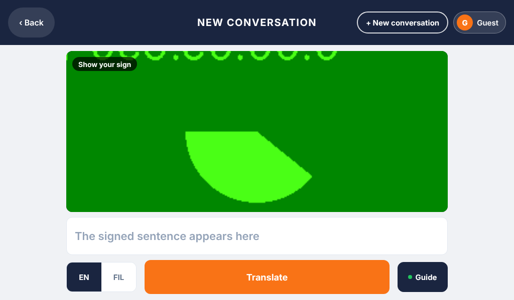
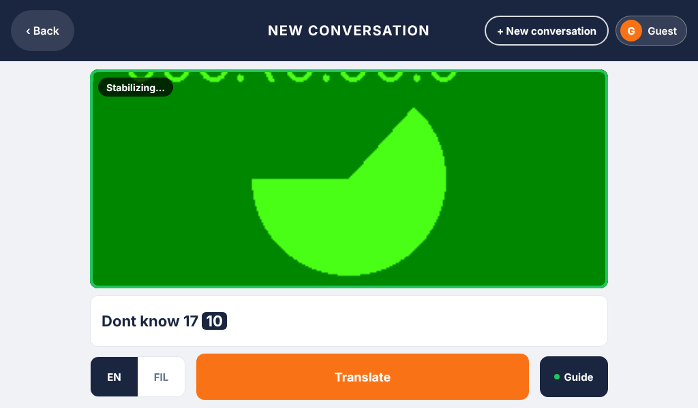
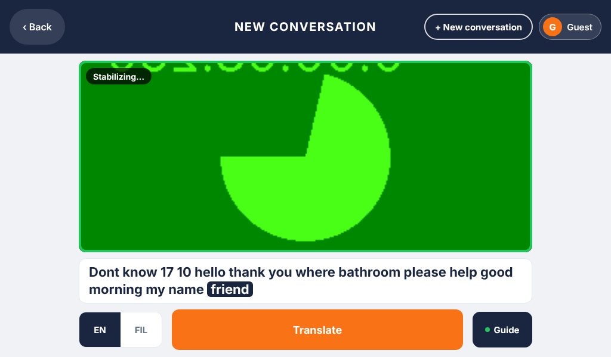
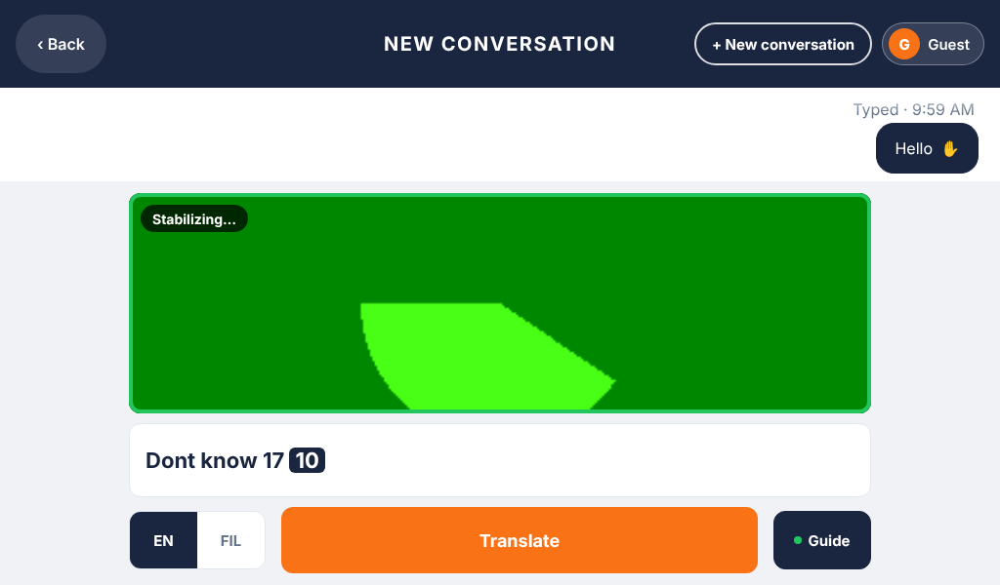
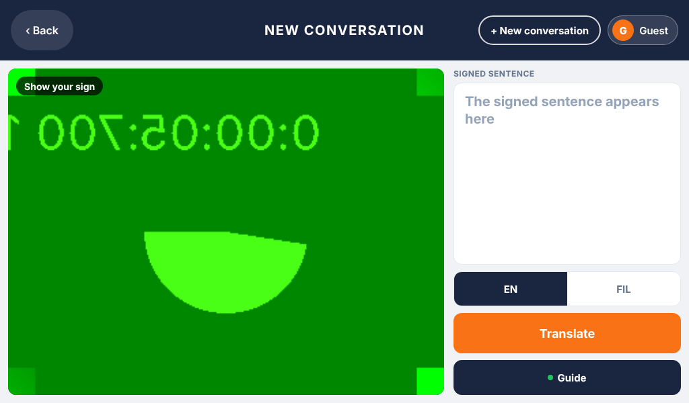
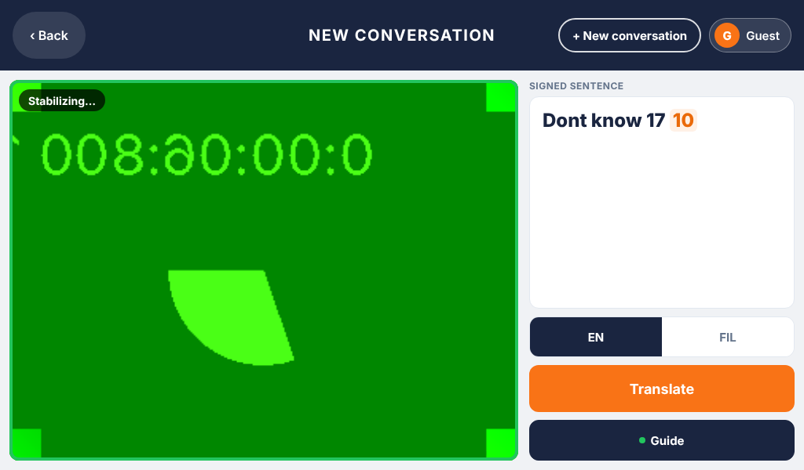
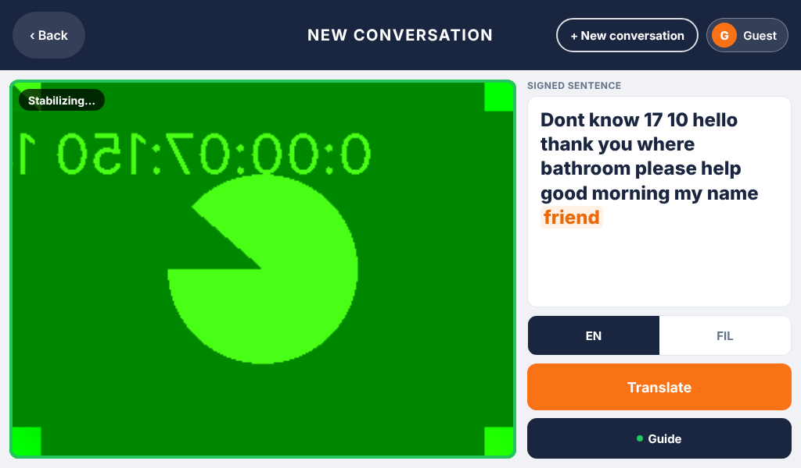
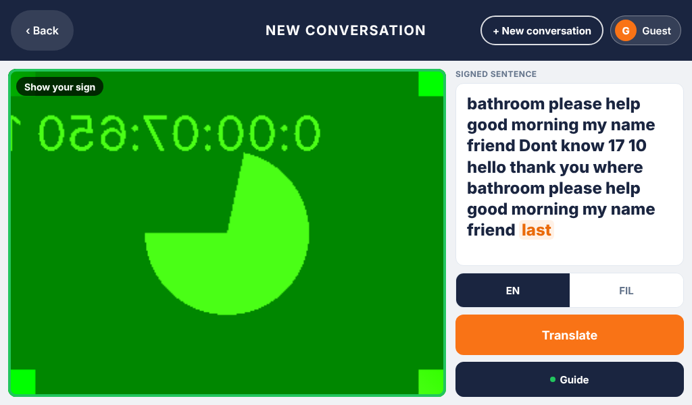
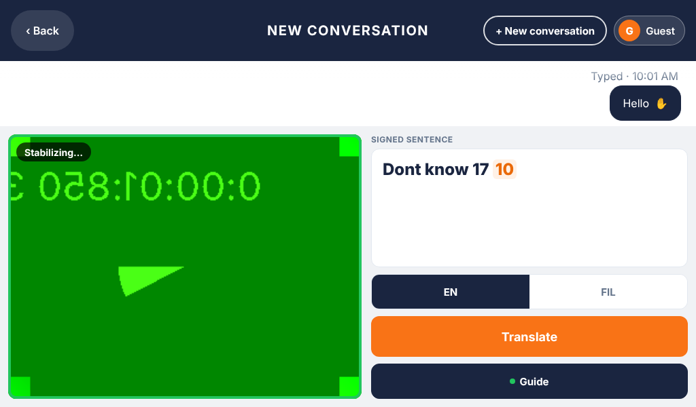
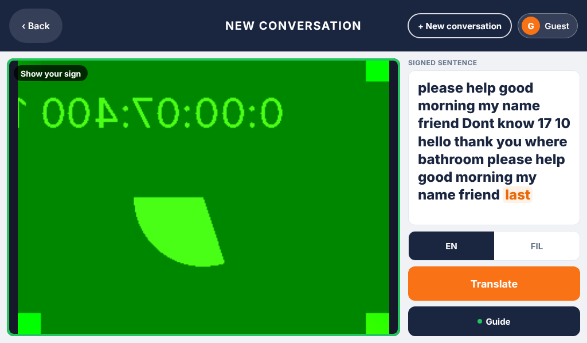

Phase: Let's Talk signing screen, side-by-side camera (talk-camera-side)
Date: 2026-10-18
Status: DONE
Decision needed from owner: none.

# Let's Talk signing screen — camera left at its own ratio, controls right

Follows `docs/design/talk-camera-wireframe.html` (screens A and B + Rules), pulled from `accounts-quiz` (`83caec4`).
Replaces the full-width layout of `docs/reports/2026-10-18-talk-camera-layout-final.md`, whose `object-fit: cover`
panel (~2.4:1) cropped the 4:3 webcam to the face. Layout only: recognition, the buttons' actions, the avatar side
(Speak or Type) and the conversation save are unchanged; `js/talk-signing.js` is not touched this time (the
sentence still renders through `TalkSigning.renderDraft`, `textContent` = the words joined by spaces).

## 1. What changed

| Owner ask | Done (`talk.html`) |
|---|---|
| 1. Camera left, own aspect ratio (videoWidth/videoHeight, default 4:3), full height under the top bar, `object-fit: contain`, no crop; mirror and landmarks aligned; status chip on the video | `.camera-box` is `height: 100%; aspect-ratio: var(--cam-ar, 4 / 3)`. A small script sets `--cam-ar` to `videoWidth / videoHeight` on the video's `loadedmetadata` / `resize` (`talk.html:2218-2224`). The video is `object-fit: contain`, `transform: scaleX(-1)`. The cover override of the landmark canvas from the previous round is removed: `js/gesture-data.js` again places the canvas over the video's contain box, which is now the whole panel. The status chip (14 px) stays at the video's top-left. If a camera is wider than about 3:2, `max-width` keeps the right column >= 300 px and the picture letterboxes inside the panel (still uncropped). |
| 2. Right column: sentence box (>= 24 px bold, wraps 4-5 lines, newest word orange), EN\|FIL, main action 60 px, Guide 52 px, stacked full width | `.signing-side` (338 px on the first turn): a "SIGNED SENTENCE" label, the sentence box (24 px, weight 800, line-height 1.3, takes the free height), EN\|FIL (52 px), Translate / Stop & Add to Conversation (60 px), Guide (52 px). The box shows whole lines only (`--draft-max`, a ResizeObserver: as many 31.2 px lines as fit — 7 on the first turn, 4 on a later turn), bottom-aligned clip so a longer sentence keeps its newest words; the newest word is orange (`#ea6a0a`, `--orange-dark`, on `#fff1e6`). Same element ids and click wiring as before. |
| 3. Fits 1024x600, no scroll | Measured below. |

The top bar of `talk.html` is 90 px (the wireframe's is 64), so the full height under it is 600 − 90 − 2×12 = 486 px:
the 4:3 camera is 648×486 (the wireframe's ~688×512 at 64 px).

## 2. Measured at 1024x600 (Playwright Chromium, fake camera 320x240)

| | Before (full-width, cover) | After, first turn | After, later turn (96 px thread strip above) |
|---|---|---|---|
| Camera panel (x, y, w, h) | 132, 102, 760, 322 | 12, 102, 648, 486 | 12, 198, 520, 390 |
| Panel ratio / camera ratio | 2.36 / 1.33 (`cover`: 56 % of the frame height shown; 40 % on later turns) | 1.333 / 1.333, `contain`: 100 % shown | 1.333 / 1.333: 100 % shown |
| Landmark canvas | = panel (cover override) | = panel (gesture-data's own contain placement) | = panel |
| Sentence | 760×76 bar under the camera, 22 px, 2 lines | 338×271 box at (674, 123), 24 px / 800, 7 lines | 466×175 box, 4 lines |
| EN\|FIL / main / Guide | 140×60 / 488×68 / 100×60 in one row | 338×52 at y 404 / 338×60 at y 466 / 338×52 at y 536-588 | 466 wide, same heights |
| Scroll | none | none (600×1024) | none |

`tests/accounts-quiz/talk-layout-check.mjs` (rewritten for this layout): 47/47 checks pass — the table above on the
first turn (3, 12 and 37 words) and a later turn: camera at the camera's ratio and full height, contain + mirror,
whole picture shown (picture = panel), canvas = panel, right column 14 px from the camera to x 1012, 52/60/52 px
controls at full column width, sentence >= 24 px bold, whole-line clip >= 4 lines, newest word orange and visible,
textContent, chip size, no scroll, 0 console errors; plus a simulated 16:9 ratio: the right column keeps >= 300 px
and nothing scrolls.

Also run: `tests/accounts-quiz/e2e-check.mjs` 87/87, `tests/sign-texts/talk-check.mjs` ALL CHECKS PASSED,
`tests/sign-texts/reports-keyboard-check.mjs` ALL PASS, all `node --test` suites 387 pass / 5 fail (the same 5
Windows-only failures as before: `multi-sample/save-endpoint` 4, `bulk-import/save-import` 1).

DEBT 166 (the cover crop) is resolved by this layout.

## 3. Screenshots (1024x600)

Before (the current full-width layout; sentence and "Stabilizing…" put in by the check as while recording; the fake
camera shows Chromium's test pattern — its corner squares mark the frame's edges):

| | |
|---|---|
| Live |  |
| Sentence |  |
| Long sentence |  |
| Later turn |  |

After (all four corner squares visible = the whole frame is shown):

| | |
|---|---|
| A. Ready (empty sentence box) |  |
| B. Signing, "Stabilizing…", newest word orange |  |
| 12 words |  |
| Longer than the box (37 words): newest kept |  |
| Later turn (thread strip above) |  |
| 16:9 ratio simulated (the fake camera stays 4:3, hence its side bars) |  |

## 4. OWNER CHECKLIST

1. `git pull` on `accounts-quiz`; Ctrl+F5 on `http://localhost/SKR/talk.html` (and on the Pi after copying).
2. Sign -> Start Translating: the camera is on the left, the full height under the top bar, mirrored, and you see
   yourself from head to waist with nothing cut off; the right column shows SIGNED SENTENCE, EN|FIL, Translate, Guide.
3. Show "start" and sign a few words: the sentence fills the white box on the right, the newest word in orange;
   when it is longer than the box the oldest words leave at the top. "Stabilizing…" stays the small chip on the
   video. With Guide on, the skeleton sits on your hands.
4. Stop & Add to Conversation, then Sign again: same layout under the conversation strip (camera 520×390).
