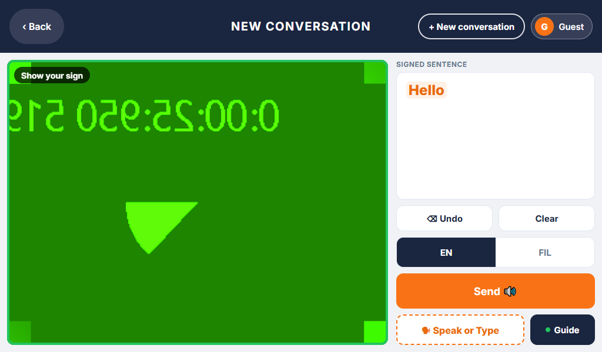
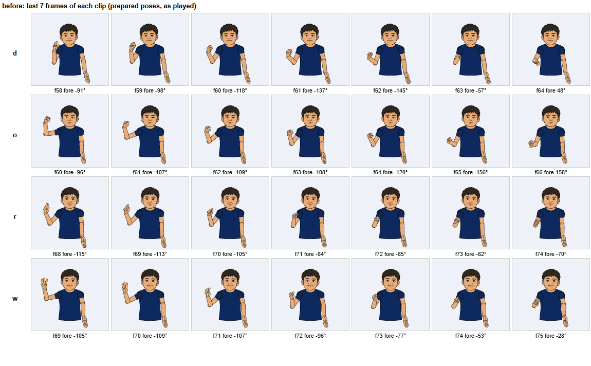
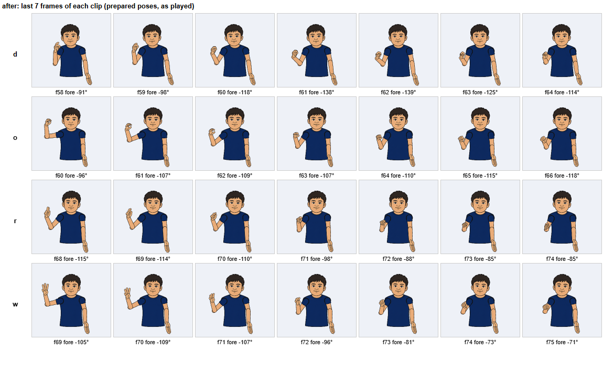

Phase: cleanup (backup, Undo/Clear, avatar fixes, my_name merge, failing tests, data commit)
Date: 2026-10-20
Status: DONE
Decision needed from owner: compile ESL and FSL (Train Gestures Step 2) after the my_name merge; see the checklist.

# Cleanup — report

Branch `accounts-quiz`, laptop (XAMPP `http://localhost/SKR/`, MariaDB 10.4). Commits: `cca01d7` (Step 1), `8273f0c`
(Step 2), `4c2c13f` (Step 4), `172da5b` (Step 5, data), then this report. Pushed, not merged.
`docs/revision/MEMORY.md`, `docs/system/MANUAL-CHECKS.md` and every video were left alone. Browser checks: headless
Chrome at 1024x600 with a fake camera, driven over the DevTools protocol by scratch scripts (Playwright is not installed
on this laptop).

## Step 0 — Backup

| File | Size | Content |
|---|---|---|
| `E:\ACADSS\IOT\backups\2026-10-20-before-cleanup.sql` | 60,314,124 bytes | `mysqldump --routines --triggers --single-transaction sining_kamay_db`: the 7 tables (structure + data), exit 0, empty stderr, "Dump completed" |
| `E:\ACADSS\IOT\backups\2026-10-20-saved_gestures.zip` | 16,357,018 bytes | `saved_gestures\`, 1,899 files (the zip lists 1,899 entries) |

## Step 1 — Undo and Clear on the Sign screen (`cca01d7`)

`talk.html` (a row under the sentence box) and `js/talk-signing.js` (`undoLast()`, `clearAll()`).
- **⌫ Undo** drops the last recognized sign (word or phrase). **Clear** empties the sentence. Both are disabled while
  the sentence is empty.
- Size and style: 164x44 each, white with the outline of the EN|FIL toggle and Guide.
- Both reset the recognizer buffer (rolling window, debounce, hold timer). The dropped sign stays the "current
  gesture", so a hand still holding it does not add it again. It can be signed again after another sign, or once the
  hand is lowered: the existing no-hand reset after 300 ms clears it.
- Send, turn switch, audio and save are unchanged.

Measured with the recognition stand-in the repo's checks use (`window.knnPredict` and friends replaced in the page):

| Step | Signed sentence |
|---|---|
| hello, good, where signed | "Hello Good Where" |
| Undo while still holding "where" (1.6 s) | "Hello Good" (not re-added) |
| hand lowered, "where" signed again | "Hello Good Where" |
| Clear while holding "where" (1.6 s) | "" (Undo / Clear disabled) |
| a different sign ("hello") | "Hello", still recording |

Layout: sentence box 338x217, Undo/Clear row at y 350, Send at y 466, camera 648x486 unchanged. No scroll,
**0 console errors**.

## Step 2 — Avatar fixes (`8273f0c`, `js/avatar-retarget.js`)

**a) Forearm spin.**
- Cause, measured on the real clips: at the clip ends the forearm points at the camera. Its 2D length (kf) drops to
  0.10-0.20 of the bone and its angle flips in one frame:
  - d: 179° (kf 0.15)
  - o: 107°
  - p: 116°
  - u: 99-175°
  - y: 135-175°
- The 5-tap smoothing then spread that flip into the frames that play.
- New `stabilizeForearms()`, run in `prepare()` before the hand fill and the smoothing:
  - Below kf 0.3 the previous direction is kept. From 0.3 to 0.5 the measured direction is blended in.
  - A turn of more than 90° on a forearm shorter than 0.5 takes the opposite direction (the 180° ambiguity is
    resolved toward the previous frame).
  - Every turn is capped at 45° per 40 ms.
  - It runs forward and backward from the frame with the longest forearm, so both ends are anchored.
  - The forearm-local hand is turned back by the same angle, so the hand stays where it was drawn.
- The hand model's wrist already wins over the pose wrist when the hand is detected. A frame without its hand now keeps
  the hand-wrist offset of the nearest frame (at most 8 away) that has the hand.

**b) Left/right hands.**
- The mapping is already consistent in the shared code. Arm 0 is the signer's right (pose 12, Holistic's
  `rightHandLandmarks`) and is drawn on the viewer's left: the avatar's own right arm, as
  `docs/reports/2026-10-05-avatar-step1.md` ("No mirroring") and `js/avatar-rig.js` state.
- In the 46 clips checked, 3,977 of 3,983 hand frames sit on their own pose wrist.
- The 6 that do not (good_morning 4, help 2) are frames where Holistic labelled two close hands the other way round.
- New `handsOf()` gives a hand to the arm whose pose wrist it is at, when that is clearly so (the sum of distances
  less than half).
- **I could not reproduce a whole sign with swapped arms.** If you see one, tell me which sign: it would be in that
  clip's data (for example a mirrored source video), not in the mapping.

**Measured** on the real `saved_gestures/*/avatar.json`: the 26 letters plus 20 words (hello, good, bad, bathroom,
day, deaf, dont_know, go, good_morning, goodbye, hearing, help, how, how_are_you, know, late, later, month, more,
my_name_is).

| | Before | After |
|---|---|---|
| Forearm jumps > 90° between played frames (both arms) | **21** (b 1, i 2, m 2, u 3, deaf 1, hearing 1, how_are_you 1, late 2, later 5, month 1, my_name_is 2) | **0** |
| Largest forearm turn between frames, d / o / p / u / y (whole clip, as played, after smoothing) | 105° / 46° / 35° / 95° / 109° | 23° / 15° / 12° / 44° / 35° |
| Clips over 60 px per 40 ms anywhere in the played clip + rest transitions (signer's own fast moves included) | 31 | 26 |
| Clips that newly went over 60 px | — | **0** (e 49 -> 59 and bad 50 -> 55 stay under) |
| `tests/avatar/avatar-edges.test.mjs` (the repo's continuity check, 60 px per 40 ms) | 8/8 | 8/8 |
| `tests/avatar/avatar-math.test.mjs` (incl. the owner's sample clip) | 16/16 | 16/16 |
| `tests/avatar/avatar-import.test.mjs` | 7/7 | 7/7 |
| `tests/avatar/avatar-forearm.test.mjs` (new: hold, 180° flip, hand kept in place, swapped labels) | — | 4/4 |

Some clips got worse on the 60 px measure while staying over it:
- f 147 -> 161, go 139 -> 160, how_are_you 155 -> 162, j 82 -> 87, v 81 -> 91, good_morning 119 -> 129 px.
- In these clips the hand wrist and the pose wrist disagree, and the hand-wrist offset now carries over frames without
  a hand.
- These are inside the signer's own movement, not at sign boundaries; the edges test still passes.

Last 7 frames of d, o, r, w, before (the forearm swings out and flips at the end: d −145° -> −57° -> 48°,
o −156° -> 158°) and after:

## Step 3 — my_name merged into my_name_is

Done with the app's own endpoints, called through php-cgi as the tests call them.
1. Each my_name sample was posted to `save_gesture.php` with label `my_name_is` and the sign's set (`BOTH`). The first
   try without the set was refused with 409, writing nothing.
2. `sign_audio.php` delete, en and fil (admin session).
3. `avatar_clip.php` delete (admin session).
4. `save_gesture.php` `delete_gesture`.

`delete_gesture` only removes `*.json`, so the audio had to go first or the folder would have stayed.

| | Before | After |
|---|---|---|
| my_name folder | 3 samples + sign.json, avatar.json, audio_en/fil.mp3 | **absent** |
| my_name `gestures` row / recordings | 1 (id 1174) / 3 | **none / 0** |
| my_name_is samples / recordings | 6 / 6 | **9 / 9** (the 3 moved keep their signer P01, importId, repIndex, frames) |
| my_name_is texts | EN "My name is", FIL "Ang pangalan ko ay" | unchanged (only `updatedAt` changed) |
| my_name_is avatar.json, audio_en.mp3, audio_fil.mp3 | present | unchanged |
| `gestures` rows / `gesture_recordings` rows | 165 / 1,267 | 164 / 1,267 |
| Recordings without a gesture / recordings pointing into my_name/ | 0 / 3 | **0 / 0** |
| Sign folders in `saved_gestures/` | 165 | 164 |

**Not done, for you:** compile ESL and FSL (Train Gestures, Step 2, Compile, once per language). Until then the model
files still contain `my_name`.

## Step 4 — The 15 failing PHP/DB tests (`4c2c13f`)

| Tests | Reason | Fix |
|---|---|---|
| 13 tests in `avatar-clip-endpoint` 1, `list-categories` 5, `save-category` 2, `multi-sample/save-endpoint` 1, `normalization/schema-guard` 1, `sign-texts/save-sign` 2, `sign-texts/signs-endpoint` 1 | **Real bug.** `GET save_gesture.php` without `summary`/`labels` built the whole listing, every sample's frames included, before `json_encode`. At 1,267 samples this ran out of PHP's 512 MB `memory_limit` (`save_gesture.php:360` in the old file), so the request returned a PHP "Fatal error" HTML page instead of JSON. | The listing is now streamed one sample at a time. The `summary=1`, `labels=a,b,hello,my_name_is` and empty-`labels` answers were compared byte for byte before and after: identical. The full listing that failed now returns 51,147,765 bytes of valid JSON. |
| `talk-turns-audio/sign-audio-endpoint` 1 | **Stale test.** It checked that `hello` has no audio. Since 2026-10-19 `hello` has your real recordings. | The test now checks that `hello`'s audio is unchanged by the test. |
| `video-capture/feature-rows` "golden" 1 | **Missing fixture.** It compares every v2 sample on disk, and there is none left: the dataset is v3 imports only. | Skipped, with that reason, when no v2 sample is on disk. The 8 v3 tests in the file still run. |

`tests/talk-turns-audio/sign-audio.test.mjs` also failed (3 of 5) after the female-voice commit `a9cd2a1`. The test
loaded `js/sign-audio.js` without `js/sk-voice.js`; it now loads both, as `talk.html` does: 5/5.

**Node suites, each file run alone** (`node --test <file>`; run together they share the live DB):

| | Tests | Pass | Fail | Skipped |
|---|---|---|---|---|
| Before (2026-10-20 talk-turns-audio 2c) | 440 | 425 | 15 | 0 |
| After | 445 | **443** | **0** | 2 |

The 2 skips:
1. `feature-rows` golden (above).
2. `conversations-admin` `clear_all`. It skips itself on purpose: it deletes every conversation, and needs
   `SK_ALLOW_CLEAR_ALL=1` and no real conversations.

The probe data the tests create was cleaned up: no `zz*` folder, no `zz*` gestures row; 164 / 1,267 rows as after
Step 3.

## Step 5 — Data commit (`172da5b`, "data: Filipino texts, audio, cleanup")

Your choice: "Everything", so git matches the dataset on disk.

| | Files |
|---|---|
| sign.json changed (Filipino texts) | 64 |
| sign.json added (new signs, incl. numbers 1-10) | 100 |
| sign.json removed (old signs incl. one..ten; my_name) | 58 |
| audio_en.mp3 / audio_fil.mp3 added | 163 / 137 |
| avatar.json added (tracked per `docs/system/BACKEND.md`, but never committed before) | 164 |
| old tracked v2 live-capture samples removed | 127 |
| imported `sample_i*.json`, videos | 0 (git-ignored / not in `saved_gestures`) |

**Numbers 11-100** were never in git, and they are already gone from disk and the DB (0 rows). This commit therefore
does not remove them; the commit message says so.

## OWNER CHECKLIST

1. `git pull` on `accounts-quiz`; Ctrl+F5.
2. **Compile:** Train Gestures -> Step 2 -> Compile **ESL**, then **FSL**. The status line should no longer say "Model
   out of date". Then sign "my name is" in Let's Talk.
3. Let's Talk -> Sign: sign two words, tap **⌫ Undo**. The last word goes and does not come back while your hand stays
   up. Lower your hand and sign it again: it is added. Tap **Clear**: the sentence is empty and recording goes on.
4. Avatar: in Speak or Type, type **d o r w** (and **u**, **y**), Translate. At the end of each letter the forearm
   should lower without spinning.
5. If a sign still shows the wrong arm, tell me which one (see Step 2 b).
6. Train Gestures -> View Active Gesture Dataset loads (the full listing no longer runs out of memory).
7. The backups are in `E:\ACADSS\IOT\backups\` (2026-10-20-*). Restore the DB with
   `C:\xampp\mysql\bin\mysql -u root sining_kamay_db < 2026-10-20-before-cleanup.sql` if ever needed.
8. On the Pi: `git pull` brings `avatar.json` and the audio now. Copy `models/knn_*.bin` after step 2 as before.
