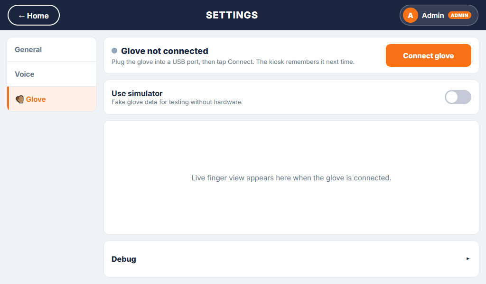
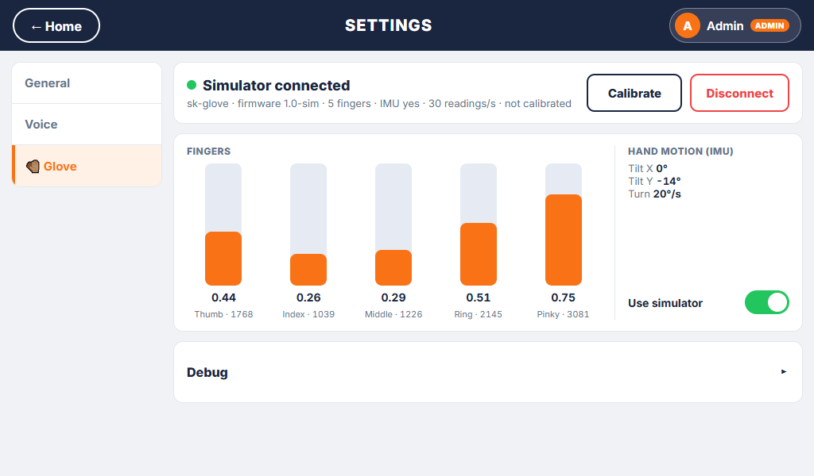
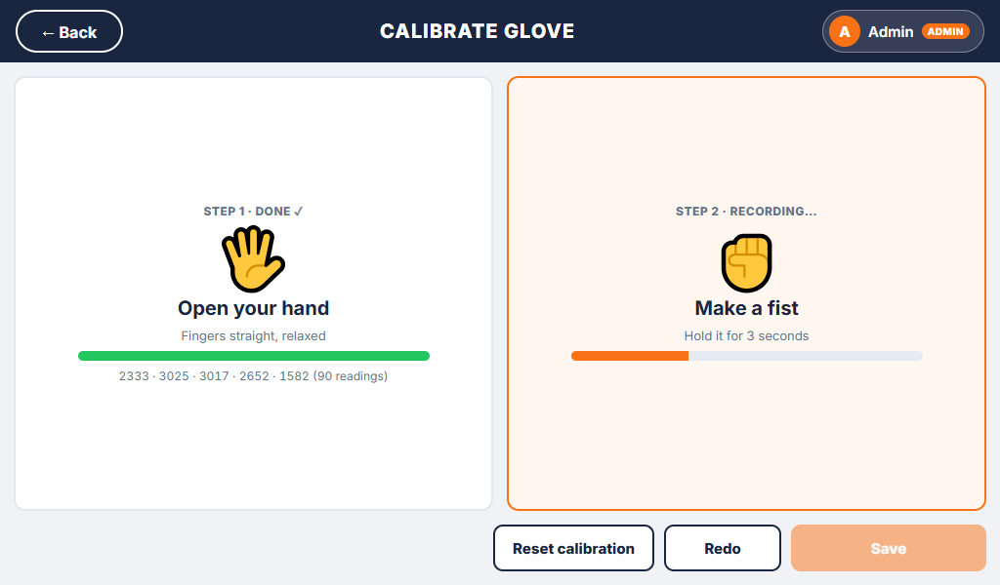
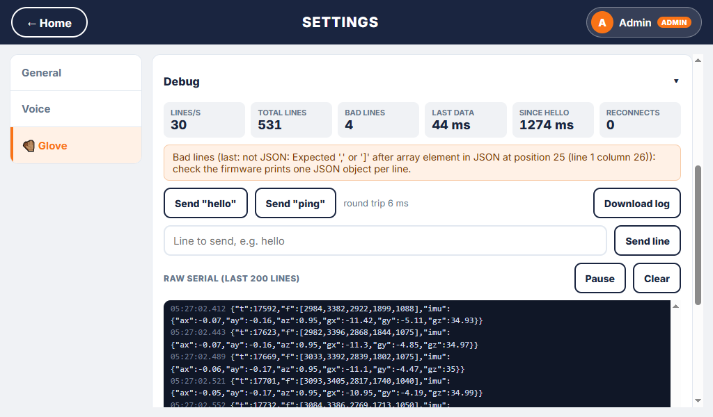
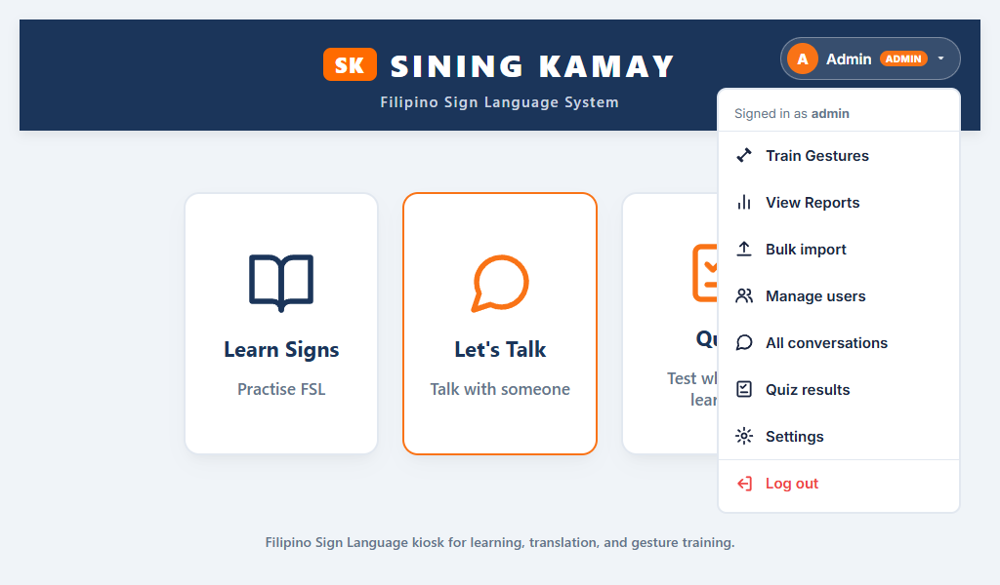

Phase: glove-serial (optional wired data glove, system side)
Date: 2026-10-20
Status: DONE
Decision needed from owner: none; test with the real glove (checklist step 2), which was not possible here.

# Glove serial — report

Branch `glove-serial`, made from `revision` (local). The wireframe was committed first (`0db5e51`), then the code, then
these docs. Pushed, not merged. Recognition, Let's Talk and every other page are unchanged; the only edit outside the
new files is one admin-menu item.

## What was built

| File | What |
|---|---|
| `docs/system/GLOVE.md` | the protocol: 115200 baud, JSON lines, hello / data / pong, the `hello` and `ping` commands, bad lines, secure context; plus `window.SKGlove`, calibration, simulator and debugger hints |
| `js/glove.js` | `window.SKGlove`: Web Serial with no libraries; one parser for the serial port and the simulator; normalized 0-1 per finger from this kiosk's calibration (clamped, moving average of 3); unplug -> `reconnecting` with `getPorts()` every 3 s; `autoReconnect()` on page load; counters, min/max and a 2,000-line log |
| `settings.html` | Admin -> Settings: General · Voice (placeholders) · Glove, per the wireframe's 4 screens; full-screen Calibrate (2 x 3 s, median per finger, Save / Redo / Reset); collapsible **Debug** panel (details below) |
| `js/sk-account.js` | admin menu: **Settings** (last item, gear icon) |
| `tools/glove-firmware/sk_glove/sk_glove.ino` | ESP32 starter: ADC1 GPIO 32-36 (divider wiring in a comment), MPU6050 on I2C 21/22 found automatically (WHO_AM_I), hello on boot, answers `hello` / `ping`, data every 33 ms exactly per the protocol, no extra libraries |
| `tools/glove-firmware/README.md` | text wiring diagram, Arduino IDE board and libraries, Serial Monitor check, then Settings -> Glove -> Debug check |
| `tests/glove/settings-check.mjs` | the simulator check below |

The Debug panel holds:
- the raw console: last 200 lines, newest at the bottom, Pause / Clear, bad lines in red with the parse error;
- 6 counters: lines/s, total lines, bad lines, last data age, time since hello, reconnect count;
- Send "hello" and Send "ping" (with the round trip), a free-text Send line, and Download log (.txt);
- per-finger min / max / range with a Reset;
- hints (no hello, a finger stuck at 0 or 4095, too few lines/s, bad lines).

Two small test-tool fixes came out of the check:
- **`tests/video-capture/cdp.mjs`** (the shared headless-Chrome driver):
  - It took the **first** `SKSESSID` cookie from the login answer. Login regenerates the session, so that first cookie
    is already dead: every admin page opened through this driver was sent to the dashboard. It now takes the last
    one.
  - `settings` was added to its admin-page list.
- **`tests/accounts-quiz/e2e-check.mjs`**: the expected admin menu now ends with Settings. That check uses Playwright,
  which is not installed here, so it was **not run**.

## Check (simulator only, as asked)

`node tests/glove/settings-check.mjs`: headless Chrome, 1024x600, logged in as the seeded admin. **25/25 PASS.**

| Check | Result |
|---|---|
| Not connected: "Glove not connected", Connect glove, simulator off; no page scroll; every control >= 44 px | PASS |
| Simulator: connected; hello parsed (`sk-glove`, 5 fingers, IMU); device line "sk-glove · firmware 1.0-sim · 5 fingers · IMU yes · 30 readings/s · not calibrated" | PASS |
| Bars move (heights differ 0.8 s apart); raw values shown; IMU tilt X / tilt Y / turn shown | PASS |
| Calibrate: full screen, both 3 s steps recorded (~90 readings each), Save stores 5 open + 5 fist values on this kiosk; back on Settings it says "calibrated today …"; normalized values stay in 0..1 | PASS |
| Debug console: lines (<= 200) and a red bad line with "✖ not JSON: …" | PASS |
| Counters: 30 lines/s, totals grow, bad lines >= 1, last data age in ms, since hello | PASS |
| Send "ping": "round trip 6 ms" (simulator); Send "hello" logged as sent; Pause freezes the console | PASS |
| Min/max per finger (range > 0 on all 5); hints: bad lines reported, no false alarms | PASS |
| Download log: `glove-log-<time>.txt`, timestamped lines (<= 2,000) including the hello and the bad line | PASS |
| Admin menu lists Settings and fits on the 600 px screen | PASS |
| **0 console errors** | PASS |

**Not checked here (no glove, no ESP32 on this laptop):**
- the real serial port: the port picker, `autoReconnect()` with a granted port, unplug -> "reconnecting…" -> replug
  with no prompt;
- the "no hello" and "stuck at 0/4095" hints on real faults (the logic runs on the same counters the simulator fills);
- the firmware itself: there is no Arduino toolchain here, so `sk_glove.ino` was **not compiled**.

## Screenshots (1024x600, simulator)

| | |
|---|---|
| Not connected |  |
| Connected: fingers, IMU, simulator switch |  |
| Calibrate, step 2 recording |  |
| Debug: counters, hint, commands, console |  |
| Admin menu with Settings |  |

## OWNER CHECKLIST

1. `git switch glove-serial` (or pull it); Ctrl+F5. Name chip -> **Settings** -> Glove. Turn on **Use simulator**: the
   bars move. Open **Debug**: a red bad line about every 5 s.
2. **With the glove:**
   - Flash `tools/glove-firmware/sk_glove/sk_glove.ino` (README: board "ESP32 Dev Module").
   - Check the Serial Monitor at 115200, then close it.
   - In Settings: turn the simulator off, tap **Connect glove**, pick the ESP32's port.
   - Expect "Glove connected", the device line, about 30 lines/s, and ping in a few ms.
3. Bend each finger and watch Debug -> min/max. A range under ~300 means the divider resistor is wrong (README).
4. **Calibrate** (open 3 s, fist 3 s, Save): the bars read ~0 open and ~1 fist.
5. **Unplug** the cable: "Glove disconnected — reconnecting…". **Plug it back**: connected again within 3 s, with
   no prompt, and RECONNECTS goes up.
6. Reload the page: it reconnects to the same glove by itself.
7. On the Pi, use only `http://localhost/SKR/settings.html` in Chromium. A LAN address shows "This browser can't use
   the glove." Should the glove not appear, tap Debug -> **Download log** and send me the file.
