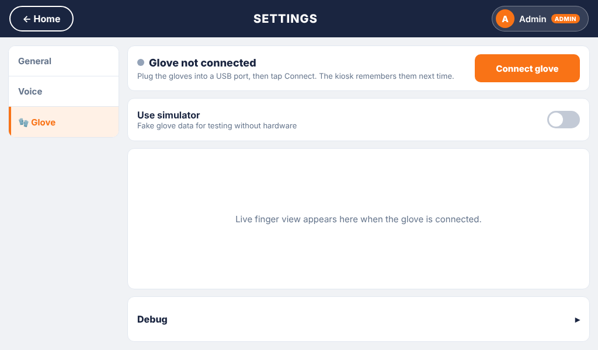
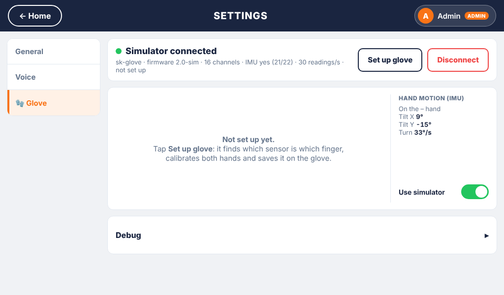
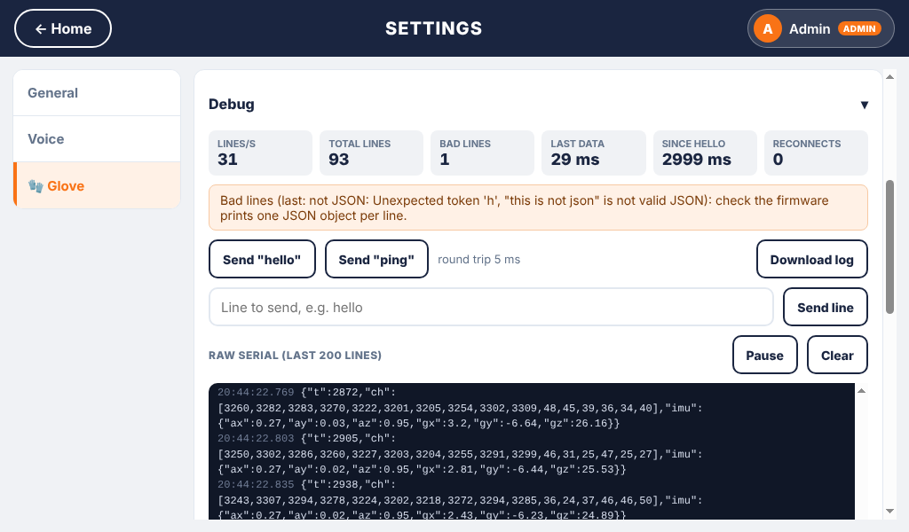
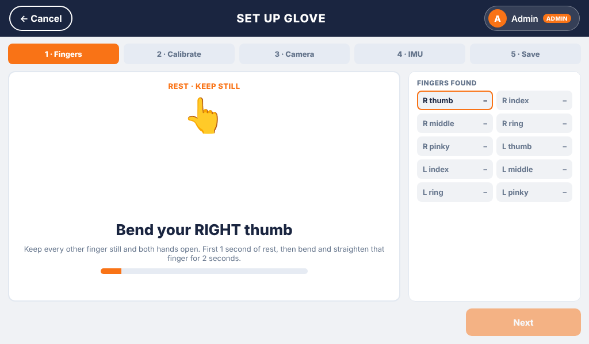
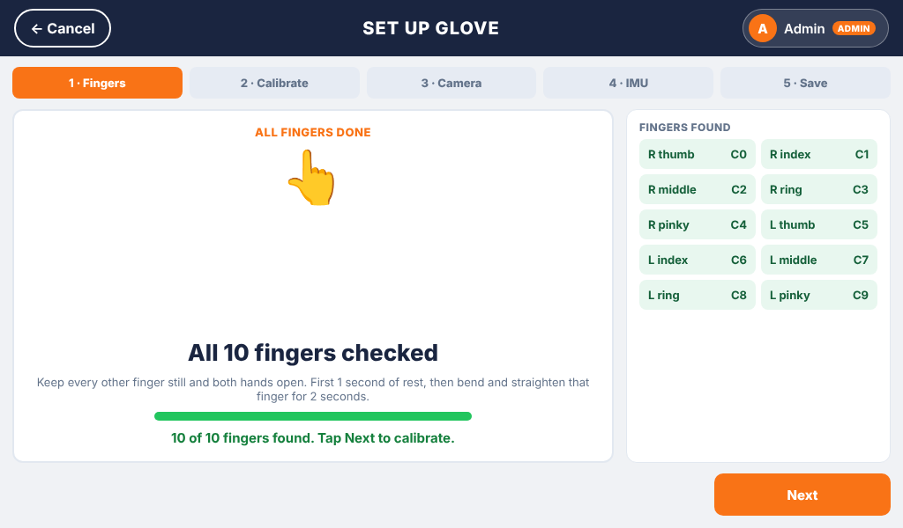
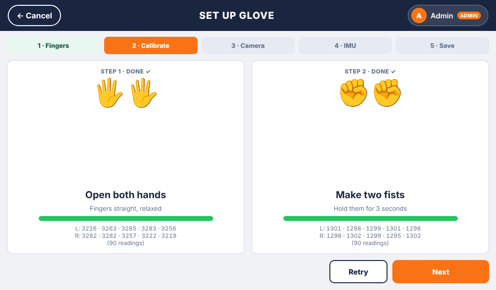
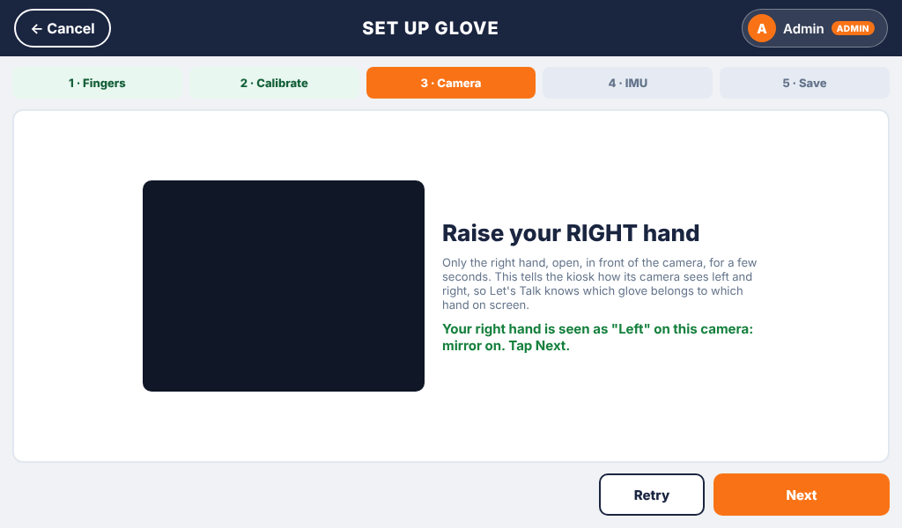
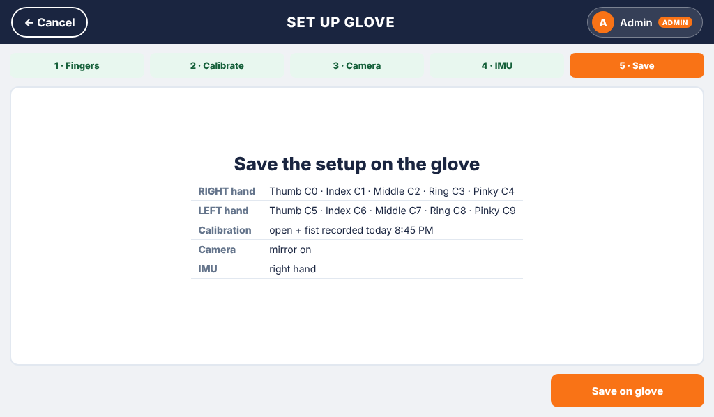
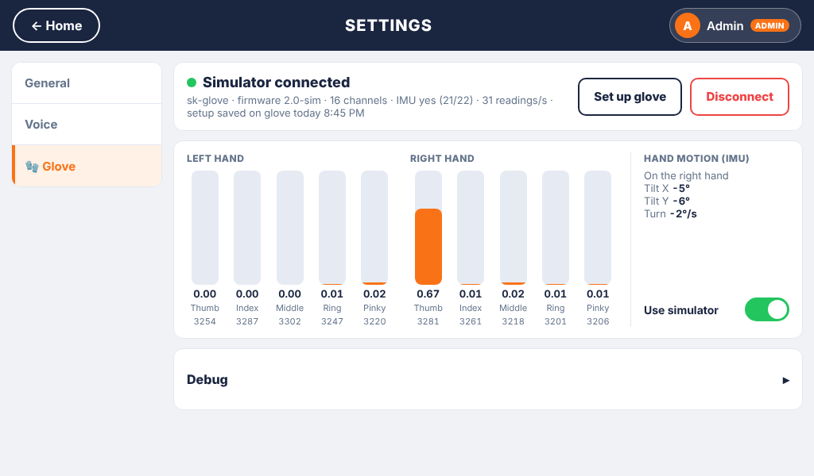

Phase: glove-hw (Phase 1: hardware bring-up)
Date: 2026-10-21
Status: DONE
Decision needed from owner: none; run the OWNER CHECKLIST below with the real gloves, then say go for Phase 2.

# Glove hardware bring-up — report

Branch `glove-hw`, made from `pi-fixes`. Design: `docs/superpowers/specs/2026-10-21-glove-hardware-design.md`;
plan: `docs/superpowers/plans/2026-10-21-glove-hw-phase1.md`. Recognition, Let's Talk and every other page are
unchanged (Phase 2 adds the glove to recognition and the 🧤 button).

## Why

The glove-serial phase (2026-10-20) was built for one glove with 5 sensors on GPIO 32-36. The group's real hardware
(owner's circuit diagram) is **two gloves, 10 flex sensors on a CD74HC4067 16-channel mux, one ESP32**, an MPU6050,
and USB power. Owner decisions: follow the diagram but let the code discover the real wiring; no battery; the glove
stays plugged into the Pi, so its setup is saved **on the glove** (set up once on the laptop, plug and play on the Pi).

## What was built

| File | What |
|---|---|
| `tools/glove-firmware/sk_glove/sk_glove.ino` | firmware 2.0: mux S0-S3 = GPIO 14/27/26/25, SIG = GPIO 34; all 16 channels (one discarded conversion after each switch) ~30 times/s; MPU6050 on 21/22, then 22/21; setup stored in flash (`Preferences`) with `cfg-get` / `cfg-set` / `cfg-clear` |
| `tools/glove-firmware/README.md` | wiring = the diagram, "SW1 OFF while USB is plugged in", Windows driver (CP210x / CH340), first upload, Serial Monitor check, Settings check |
| `js/glove.js` | protocol v2 parser (16 channels, old-firmware and damaged-setup detection), `validateConfig` / `saveConfig` / `clearConfig` / `ready()`, left/right finger values from the setup, simulator v2 with its own "flash" |
| `settings.html` | two hands of bars; **Set up glove**: 1 Fingers, 2 Calibrate, 3 Camera, 4 IMU, 5 Save on glove; Debug: 16-channel table (used by, min, max, range, now), the stored setup with Clear setup on glove, new hints |
| `tests/glove/glove-core-check.mjs` | node checks of `js/glove.js`, no browser |
| `tests/glove/settings-check.mjs` | headless Chrome check of Settings with the simulator (rewritten for v2) |
| `tests/glove/no-db-router.php` | runs the browser check on a machine without MySQL (test only) |
| `docs/system/GLOVE.md` | protocol v2, the setup, `window.SKGlove`, the wizard, hints |
| `docs/system/UI.md` Part 5, `docs/system/PI-SETUP.md`, `CLAUDE.md` | docs; the Pi needs nothing new (`pi-setup.sh` already sets `SerialAllowAllPortsForUrls` and `dialout`) |

How Set up glove finds a finger (`settings.html`, `judgeFinger`): 1 s rest, then 2 s bending. Per channel, move =
the largest distance from its resting median while bending, minus how far it wandered at rest. The largest move
wins if it is over 150 **and** at least 2x the next channel's; otherwise "No sensor moved" or "moved about the
same", with Retry / Skip. A channel already given to another finger is refused. The 2x rule was added while
testing: with only the 150 rule, a finger that was not bent at all was "found" on a channel that drifted by 245.

## Checks run here

Cloud container: node 22.22.0, PHP 8.3 built-in server with `tests/glove/no-db-router.php` (no MySQL here),
Playwright's Chromium 1194 headless at 1024x600.

| Check | Result |
|---|---|
| `node tests/glove/glove-core-check.mjs` | **27/27 PASS** (failed first against the old `js/glove.js`: `G.configState is not a function`) |
| `node tests/glove/settings-check.mjs` | **34/34 PASS**, run twice (failed first against the old `settings.html`) |
| Firmware compile | `arduino-cli` 1.1.1, ESP32 Arduino core **3.0.7** (from GitHub; the Arduino and Espressif index sites are blocked here), FQBN `espressif:esp32:esp32` (ESP32 Dev Module), `--warnings all`: **no errors, no warnings in the sketch**; "Sketch uses 317061 bytes (24%) of program storage space"; "Global variables use 21752 bytes (6%) of dynamic memory". The `ctags` prototype step was stubbed out (every function is defined before use) |

The browser check covers: not connected; simulator hello v2 and the device line; "Not set up yet"; Debug console
with a red bad line, ~30 lines/s, ping, 16-channel table, Download log; Set up glove with all 10 fingers on the right
channels, one "already R thumb" retry and one "No sensor moved" retry; calibrate both hands; the camera step
(MediaPipe's results injected: right hand seen as "Left" -> mirror on); IMU hand; Save on glove -> stored map,
calibration, `mirror: true`, `imuHand: "R"`, `w: 0.3`; bars (right thumb bent 100 %, right index low); reload ->
the setup read back from the glove; "used by" in Debug; Clear setup on glove; admin menu; no page scroll and
every control >= 44 px on each screen; 0 console errors.

| | |
|---|---|
| Not connected |  |
| Connected, not set up |  |
| Debug |  |
| Set up glove: fingers |  |
| All 10 fingers found |  |
| Calibrate both hands |  |
| Camera step |  |
| Save on glove |  |
| Two hands after setup |  |

## Not checked here

- The real gloves and the soldered wiring (whether it follows the diagram).
- The firmware running on a board (it compiles; it was never uploaded).
- A real hand in the camera step (MediaPipe's handedness was injected; the fake camera has no hand).
- The Pi.

## OWNER CHECKLIST (laptop, real gloves)

1. **SW1 OFF.** Plug the ESP32 into the laptop with a **data** USB cable. Device Manager -> Ports: a "CP210x" or
   "CH340" COM port (install that driver if nothing shows; README).
2. Arduino IDE: install the **esp32 by Espressif** board package, Board **ESP32 Dev Module**, the COM port, open
   `tools/glove-firmware/sk_glove/sk_glove.ino`, **Upload** (hold BOOT if it stops at "Connecting…").
3. Serial Monitor 115200, Newline: the hello shows `"fw":"2.0"` and `"imu":true/false`. Bend each finger, one at a
   time: one of the first 10 numbers drops by hundreds. Write down any finger whose number does not move. **Close
   the Serial Monitor.**
4. XAMPP on, Chrome, Ctrl+F5 on `http://localhost/SKR/`, admin -> Settings -> Glove -> **Connect glove** -> the
   ESP32's port: "16 channels · IMU yes/no · ~30 readings/s · not set up".
5. **Set up glove**: all 10 fingers (write down any "No sensor moved" / "moved about the same"), calibrate, camera
   (raise only the right hand), IMU hand, **Save on glove**.
6. The bars: each finger ~0 open and ~1 bent, on the correct hand.
7. Unplug the cable, plug it back: it reconnects with no prompt and the setup is still there.
8. If anything fails: Debug -> **Download log**, and send me the file with what you wrote down in steps 3 and 5.
