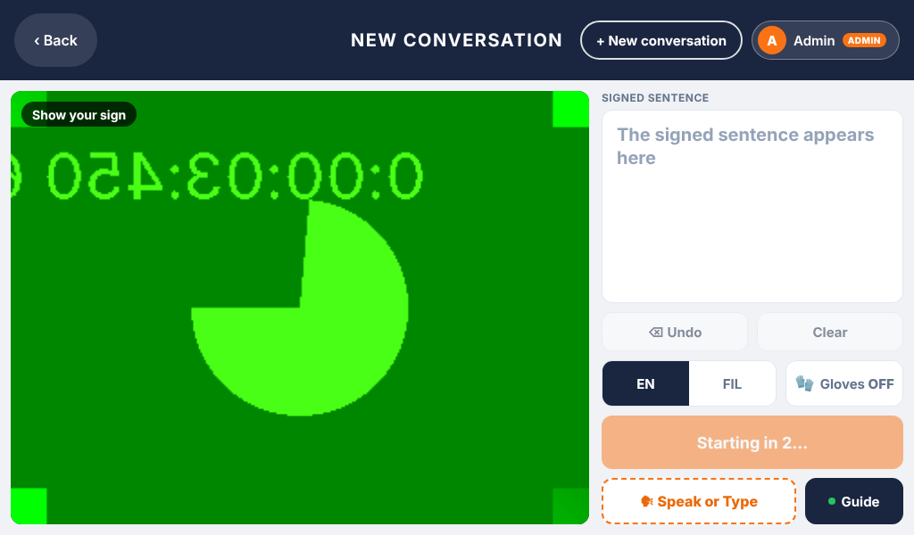
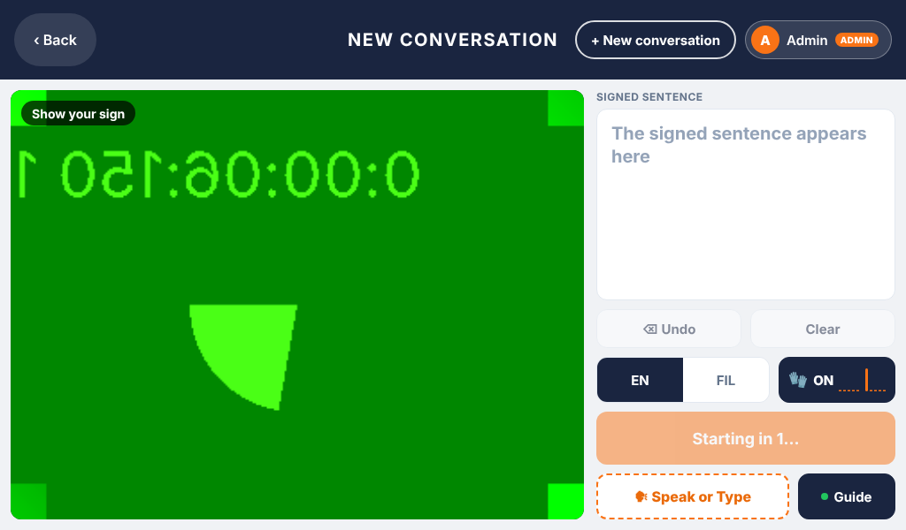
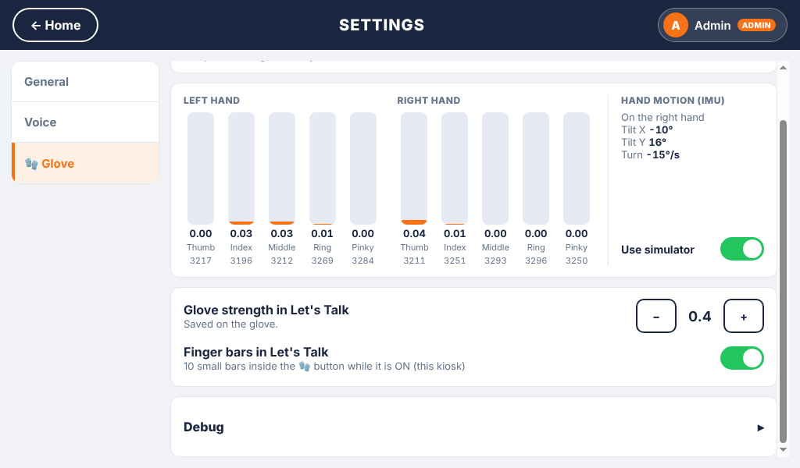

Phase: glove-hw Phase 2 (glove in recognition, the 🧤 button)
Date: 2026-10-21
Status: DONE
Decision needed from owner: none; after Phase 1's checklist passes with the real gloves, run the OWNER CHECKLIST below.

# Glove in recognition — report

Branch `glove-hw` (after Phase 1, `docs/reports/2026-10-21-glove-hw-final.md`). Design:
`docs/superpowers/specs/2026-10-21-glove-hardware-design.md` Phase 2, with the owner's choices of 2026-10-21 (below).
Built and checked with the glove simulator; the real gloves were not available. `knnPredict`, the model files,
Compile, Speak or Type, Learn Signs and Quiz are unchanged.

## Owner choices this phase

| Question | Answer |
|---|---|
| Where is the 🧤 button? | First "the bottom row, nothing may overlap". The check showed it does not fit: the side column is 338 px and Speak or Type (218) + Guide (110) fill it; the first try pushed Guide 92 px off screen. Second answer: **beside EN \| FIL**. |
| What shows while ON? | 10 small finger bars inside the button, if they do not slow the kiosk: drawn at most 10 times a second with `transform` only, measured, and a Settings switch to turn them off. |

## What was built

| File | What |
|---|---|
| `js/glove-bend.js` (new) | `GloveBend`: finger bend 0..1 from a model row's landmarks (joint-angle sums scaled by ranges measured on the ESL model), cached per row; `rerank()` of the top 5 labels by `w x` glove distance (both slot orders, one-hand rows, null fingers) |
| `js/glove-assist.js` (new) | `GloveAssist`: the 🧤 button (shown only while `SKGlove.ready()`, OFF on every page load, `reset()`), finger bars, and `apply(scores, model)` with the five conditions (ON + ready, camera step done, data < 1 s old, gloves worn, 1-2 hands with handedness >= 0.8) |
| `talk.html`, `js/talk-signing.js` | button beside EN \| FIL (`.signing-lang-row`); `apply()` right after `knnPredict` in `tick()`; `reset()` on "+ New conversation" with an empty thread and in `onEndConversation`; `SKGlove.autoReconnect()` on load |
| `gesture-training.html`, `js/gesture-training-ui.js` | the same button in Step 3; `apply()` in Step 3 only |
| `js/glove.js` | `window.SK_GLOVE_URL_SIM_ONLY`: Let's Talk and Train Gestures use the simulator only with `?glove=sim` |
| `settings.html` | "Glove strength in Let's Talk" (− 0.3 +, saved on the glove) and "Finger bars in Let's Talk" (switch, this kiosk) |
| `tests/glove/glove-bend-check.mjs` (new), `tests/glove/talk-glove-check.mjs` (new), `tests/glove/settings-check.mjs` | checks below |
| `docs/system/GLOVE.md`, `ML.md`, `UI.md` (3i, Part 5), `CLAUDE.md`, the spec | docs |

## Checks run here

Cloud container: node 22.22.0; PHP 8.3 built-in server with `tests/glove/no-db-router.php` (no MySQL here);
Chromium 1194 headless (CDP checks) and Playwright Chromium, 1024x600, fake camera.

| Check | Result |
|---|---|
| `node tests/glove/glove-bend-check.mjs` | **17/17 PASS** |
| `node tests/glove/talk-glove-check.mjs` | **22/22 PASS** |
| `node tests/glove/settings-check.mjs` | **38/38 PASS** (Phase 1's 34 + strength, bars switch, layout) |
| `node tests/glove/glove-core-check.mjs` | **27/27 PASS** (unchanged) |
| `tests/talk-turns-audio/talk-check.mjs` (existing Let's Talk check, run without MySQL by a temporary copy that answers signs.php from `saved_gestures/*/sign.json`) | the same 5 FAILs on this branch and on `pi-fixes` (number-sign avatars, "My Name" text, 500s from `save_conversation.php`: all need the database), every other check PASS on both: no regression from this phase. On the laptop with XAMPP it runs as before. |

What the checks show:
- **Bend from the model's own rows** (median, thumb..pinky): s 0.73 0.75 0.69 0.67 0.68; a 0.14 0.76 0.69 0.68 0.70;
  e 0.92 0.73 0.64 0.60 0.59; m 0.52 0.72 0.65 0.63 0.67; b 0.26 0.02 0 0 0; 5 0.11 0 0 0 0. "s" and "a" differ almost
  only in the thumb, which is where the glove can help the camera.
- **Re-ranking:** camera scores b 0.80 > s 0.78; a right glove bent like "s" -> "s" ahead. The same glove on the hand
  the camera calls "Left" (open glove) -> "b" stays ahead. Unsure hand (0.6), not worn (3.5 s still), OFF -> scores
  unchanged. No score below 0; only the top 5 touched; the input object untouched.
- **Cost:** first re-rank over 5 labels (90 rows each) 11.0 ms (bends computed and cached), then 1.2 ms; 0.4 ms per call
  in the bend check (node, this machine; not measured on the Pi).
- **Finger bars:** detection rate with bars ON 1.0 fps (983 ms/frame) vs OFF 1.0 fps (983 ms/frame) in this container.
  This container runs MediaPipe at about 1 frame per second, so the number says the bars cost nothing measurable
  here, not what the Pi does. On the Pi: `talk.html?devperf` with the button ON and OFF (checklist step 5).
- **Layout:** without a glove the Sign screen is exactly as before; with one, the button sits beside EN | FIL, same
  height, nothing overlapping, EN and FIL still >= 44 px wide, Send / Speak or Type / Guide unmoved, no scroll; ON
  does not move or resize it.

| | |
|---|---|
| Let's Talk, glove connected, OFF |  |
| ON, finger bars (right thumb bent) |  |
| Settings: strength and finger bars |  |

## Found and changed while checking

- **Button placement** (above): moved beside EN | FIL with the owner's OK.
- **Fresh-data limit 200 ms -> 1 s.** In the browser check the glove data was always older than 200 ms: MediaPipe
  holds the page's only thread about 1 s per frame here, and glove lines wait behind it. 1 s still drops a frozen
  glove; an unplugged one is caught at once by its status.

## Not checked here

- Real gloves, a real hand in front of the camera, the real handedness labels and `cam.mirror`.
- Whether the glove raises accuracy, and the right strength: the leave-one-signer-out test at the end of the project.
- The Pi (detection rate with the bars, the 1 s limit under the Pi's real load).

## OWNER CHECKLIST (after Phase 1's checklist passed)

1. Laptop, Ctrl+F5, Let's Talk -> Sign. With the glove set up and plugged in: "🧤 Gloves OFF" beside EN | FIL.
   Without the glove: no button, the screen as before.
2. Tap it: ON, bars move with your fingers (both hands).
3. Wear both gloves, sign a few look-alike letters (a / s / e / m / n / t) with ON and with OFF; note which comes
   out better. Settings -> Glove -> strength 0.3 to 0.5 if the glove seems to do nothing.
4. "+ New conversation" or End Conversation: back to OFF.
5. On the Pi: `talk.html?devperf`, Sign screen, ON vs OFF for 10 s each: write down the "detect fps". If ON is
   clearly lower, turn off "Finger bars in Let's Talk" in Settings.
