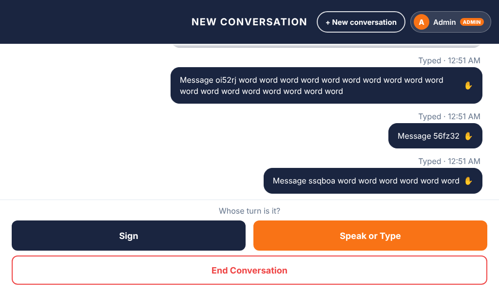
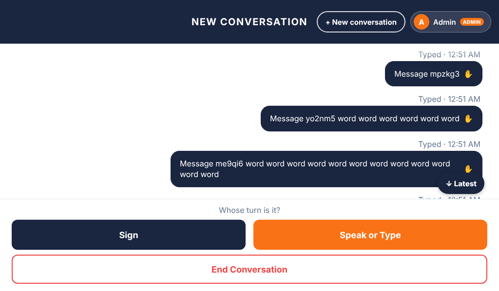

Phase: touch-ux (Let's Talk conversation scrolling; no text selection on the kiosk)
Date: 2026-11-12
Status: DONE
Decision needed from owner: none; check on the Pi touchscreen (checklist below) and merge this branch into the kiosk's branch.

# Touch usability — report

Branch `touch-ux`, made from `glove-static` (the newest branch on GitHub on 2026-11-12). Owner's three problems on
the 7" touchscreen, where a finger acts as a mouse (holding it down = a held left click):
1. the conversation's scrollbar is too thin to grab;
2. the conversation is often not at the newest message (you have to scroll down);
3. holding a finger on the screen highlights text.

## What changed

| # | Where | Change |
|---|---|---|
| 1 | `talk.html` CSS `#thread-list` | scrollbar 18 px wide (was 6 px), thumb drawn 12 px wide, darker (`--muted`), at least 48 px tall; `touch-action: pan-y` and `overscroll-behavior: contain` so a vertical finger drag on the list scrolls it |
| 2 | `talk.html` script | the thread **follows the newest message**: `appendBubble()` calls `scrollThreadToLatest()` (scroll now and again after layout); a `ResizeObserver` on the list and on every bubble scrolls to the end again whenever something changes size while following (another screen collapsing / re-opening the thread, the keyboard, a bubble growing). Cause found: the old single `scrollTop = scrollHeight` did nothing while the thread was hidden or collapsed on another screen, and was undone by later size changes. A user who scrolls up to read stops following and gets a **"↓ Latest"** button (44 px, bottom right of the thread, clear of the scrollbar); tapping it, or sending a message, goes back to the end |
| 3 | new `css/kiosk-touch.css` + `js/kiosk-touch.js`, linked on index, talk, learn-signs, quiz, quiz-scores, login, conversations, settings, gesture-training, users, reports | `user-select: none` and `-webkit-touch-callout: none` on the page; **text inside inputs, textareas and editable fields stays selectable** (typing, caret, the on-screen keyboard); no long-press / right-click menu outside fields; no dragging images or links; a selection started outside a field anyway is dropped |

Not changed: anything inside `learn-signs.html`'s embedded external website (`docs/system/DEBT.md` item 29) — the
page around it is covered, the iframe's content is not.

## Checks run here

Cloud container (no MySQL): PHP 8.3 built-in server with `tests/glove/no-db-router.php`, Playwright Chromium at
1024x600.

| Check | Result |
|---|---|
| `node tests/touch-ux/touch-check.mjs` (new) | **14/14 PASS** |
| `node tests/glove/talk-glove-check.mjs` (Let's Talk with the 🧤 chip, existing) | ALL PASS |

`touch-check.mjs` covers: scrollbar 18 px; 14 messages -> newest fully visible; a message added on Speak or Type
(collapsed strip) is at the end there too; back to the conversation -> still at the newest; the newest bubble
growing -> still at the end; scrolled up -> "↓ Latest" shows (44 px, clear of the scrollbar) and the list is not
pulled down; tapping it goes to the end; scrolled up + a new message -> the end; `touch-action: pan-y`; on all 11
pages body `user-select` none, fields `text`, the context menu blocked outside fields and not inside the Speak or
Type field; a selection outside a field is dropped; no console errors apart from `quiz-scores.html` and
`conversations.html` failing to read their PHP answers here (they need MySQL; not related).

Note: Playwright hides scrollbars in its screenshots, so the 18 px bar is measured (`offsetWidth - clientWidth`),
not visible in the pictures.

| | |
|---|---|
| 14 messages, at the newest |  |
| Scrolled up: "↓ Latest" |  |

## OWNER CHECKLIST (on the Pi touchscreen)

1. Let's Talk: send several messages; the newest is always visible without scrolling, also after Sign / Speak or
   Type and back.
2. Drag the conversation up with a finger (or the wider scrollbar): "↓ Latest" appears; tap it.
3. Hold a finger on any text (titles, bubbles, buttons) for 2 s on several pages: nothing highlights, no menu.
4. Tap into the Speak or Type field and the login fields: typing and the on-screen keyboard still work.
