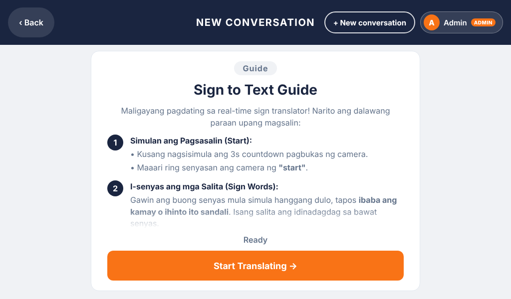
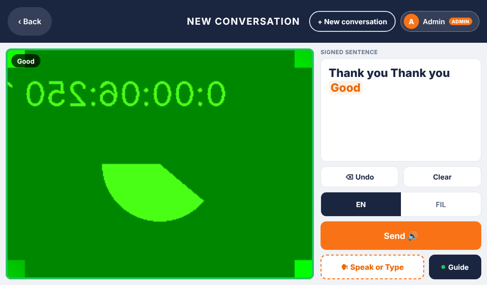

Phase: seq-recognition (whole-sign recognition in Let's Talk and Train Gestures)
Date: 2026-11-15
Status: DONE
Decision needed from owner: none; try it on the Pi with the OWNER CHECKLIST below, and go back to `touch-ux` if it is not better.

# Whole-sign recognition — report

Branch `seq-recognition` (made from `touch-ux`, so going back is one `git checkout touch-ux`). Owner request,
2026-11-15: recognition should stop guessing from a small movement or from the last hand position; the sign's
start and end should both have to match. Owner choice the same day: a sign ends when the hand is **lowered or held
still**.

## What changed, in short

| Before | Now (when `models/seq_<LANG>.bin` is loaded) |
|---|---|
| An answer for every camera frame (one hand position); a word is added when the same answer holds 0.5 s | One answer per sign, from its start to its end: the start, the middle and the end of the movement must all match a recorded sample |
| The best match is always taken (above a 0.45 score) | The answer is given only when it is clearly closer than the next sign; otherwise "Not sure. Sign again" and nothing is added |
| The hand passing through another sign's shape can add that word | A sign shorter than 0.35 s, and the hand going down after a hold, are ignored |

The frame k-NN is still in the code and still used when the new file is missing or with `?seq=off` in the address.

## Measured on the owner's samples

1,357 samples, 164 signs (the tar sent 2026-11-15). "Same signers": 5 folds, whole videos held out. "New signer":
P01, P03, P05 held out in turn (1,132 samples). Run again with `node tools/seq_eval/eval.mjs <saved_gestures>`
and `node tools/seq_eval/stream.mjs <saved_gestures> [--new-signer] [--fps 6]`.

**One recorded sign, start to end** (`eval.mjs`):

| | Correct | With "not sure" below ratio 0.90 |
|---|---|---|
| Same signers | 92.5 % of 1,357 (letter 94.8, number 98.9, word 89.9, phrase 93.3) | answers 89.5 % of signs, 96.8 % of the answers correct |
| New signer | 68.1 % of 1,132 (letter 77.4, number 92.2, word 57.9, phrase 73.7) | answers 67.3 %, 80.7 % of the answers correct |
| Same signers at 6 frames per second | 91.4 % | |
| New signer at 6 frames per second | 66.5 % | |

**As on the kiosk: the samples played as a camera stream, cut by the live rules** (`stream.mjs`):

| | Exactly the right word, nothing else | A wrong word shown | Nothing shown | More than one word |
|---|---|---|---|---|
| Same signers | 84.4 % | 4.6 % | 10.9 % | 1.5 % |
| Same signers, 6 fps | 81.4 % | 4.3 % | 14.1 % | 0.5 % |
| New signer | 49.5 % | 13.9 % | 36.6 % | 0.7 % |

**The frame k-NN on the same test** (its rolling window 4, stability 2, hold 500 ms, floor 0.45, simulated in
Python during this phase; that script is not in the repo, so these two rows cannot be re-run from it): same
signers 77.6 % exactly right, 0.12 wrong words per sign, 10.9 % nothing; new signer 38.4 %, 0.41 wrong words per
sign, 23.6 % nothing.

So for the people who recorded the samples, exactly-right goes from 77.6 % to 84.4 % and wrong words drop to
about a third; for a person the system has never seen it goes from 38.4 % to 49.5 %, wrong words from 0.41 per
sign to 13.9 % of signs, and it says "not sure" much more often (36.6 %) instead of guessing.

Tried and dropped: comparing the whole movement frame by frame (DTW) was worse than the frame k-NN for a new
signer (31-49 % against 40-55 %) and no better for the same signers.

**The limit that is left:** only 3 main signers recorded the samples. A new person is right about half the time.
More people recording each sign is the biggest thing that would raise this; no setting in the code will.

## What was built

| File | What |
|---|---|
| `js/seq-features.js` (new) | the sign's 258 numbers, the nearest-sample search and ratio, the file format |
| `js/seq-recognizer.js` (new) | where a sign starts and ends; one event per sign (`sign` / `unsure` / `ignored`) |
| `js/seq-live.js` (new) | loads `models/seq_<LANG>.bin`, feeds MediaPipe's results; `?seq=off` |
| `js/talk-signing.js`, `js/talk-loader.js`, `talk.html` | Let's Talk uses the sign events (start / stop / word flow unchanged); the answer stays 1.5 s in the caption; Guide step 2 text |
| `js/gesture-training-ui.js`, `gesture-training.html` | Steps 3 / 4 show and use one answer per sign ("Clearness", "Not sure"); Compile also builds and saves the seq file |
| `php/api/compile_seq_model.php` (new) | stores the file (checked, laptop only, 403 on the Pi) |
| `models/seq_ESL.bin`, `models/seq_FSL.bin` (new, tracked) | built from the 1,357 samples: ESL 164 signs, 5,506 rows, 5,696,776 bytes; FSL 137 signs, 3,912 rows, 4,048,452 bytes |
| `tools/seq_eval/build.mjs`, `eval.mjs`, `stream.mjs` (new) | build the files with node; the two measurements above |
| `tests/seq/talk-seq-check.mjs` (new) | the browser check below |
| `docs/system/ML.md`, `UI.md` (3j), `INVENTORY.md`, `CLAUDE.md` | docs |

Settings (`js/seq-recognizer.js:23-32`): hands gone 400 ms or still 600 ms ends a sign; shortest sign 4 frames
and 350 ms; longest 6 s; ratio 0.90 (0.80 for a piece from a hold that ends with the hands going down).

## Checks run here

Cloud container: node 22.22.0, PHP built-in server with `tests/glove/no-db-router.php` (no MySQL), Playwright
Chromium at 1024x600 with a fake camera. No real hand: recorded samples' frames were pushed into the recognizer.

| Check | Result |
|---|---|
| `node tests/seq/talk-seq-check.mjs` (with `SK_SAMPLES`, `SK_MODELS_DIR`) | **22/22 PASS** |
| `node tests/glove/talk-glove-check.mjs` | ALL PASS (unchanged) |
| `node tests/touch-ux/touch-check.mjs` | ALL PASS (unchanged) |

What the new check shows: the model is loaded before the Guide opens; one recorded "thank you" adds exactly one
word; the same sign after the hands went down adds a second; a 3-frame flash adds nothing; Undo works; the
recorded "stop" sign sends the message; `?seq=off` runs the frame k-NN; no scroll at 1024x600 on the Guide and
the Sign screen; Train Gestures loads the model and shows a clear sign and a "Not sure" one; the endpoint writes
the file byte for byte and refuses a wrong language, a cut file, a non-model file and GET; 0 console errors.

Found and fixed while checking: with the glove code in the path, a perfect match (distance 0) made every score 0
and the sign "4" was taken; scores now start at 1 for the best sign and another sign is taken only when the glove
put it ahead.

| | |
|---|---|
| Guide, new step 2 text |  |
| Sign screen after three signs |  |

One classification costs 1.75 ms in node here (mean of 200, ESL file), once per sign.

## Not checked here

- A real hand in front of the camera, and the Pi (frame rate, how the 0.6 s hold feels, classification time).
- Compile in the browser end to end (it needs the database and the samples on the laptop); its parts were
  checked: the builder (the same code built the tracked files with node) and the endpoint.
- Whether the gloves help with whole signs.

## Known gaps

- No `start` sign in the samples (0 files), so recording starts only by the countdown in this mode. `stop` works.
- The tracked seq files hold the samples of the tar of 2026-11-15. Samples recorded later are not in them until
  Compile is run on the laptop with those samples (or `node tools/seq_eval/build.mjs <saved_gestures>`).
- `model_status.php` does not watch the seq file; it is rebuilt by every Compile.

## OWNER CHECKLIST

On the Pi (SSH):

```
cd ~/SKv2
git fetch
git checkout seq-recognition
git pull
sudo reboot
```

Back to the old one: `cd ~/SKv2 && git checkout touch-ux && sudo reboot`.

1. Let's Talk -> Sign. Guide step 2 has the new text. Start.
2. After the countdown, do one whole sign, then **lower your hand**. One word appears; the caption shows it.
3. Do a sign and **hold the end still** (about half a second), then the next sign without lowering: one word each.
4. Wave a hand through the picture quickly: nothing is added.
5. Do a sign badly on purpose: "Not sure. Sign again", nothing added.
6. Try 10 signs you recorded and 10 with another person; count right / wrong / not sure. Compare with
   `talk.html?seq=off` (the old way) for the same signs.
7. Train Gestures -> Step 3: each sign's answer appears when the sign ends, with "Clearness".
8. If the hold feels too long or too short, say so: it is one number (`STILL_MS`).
