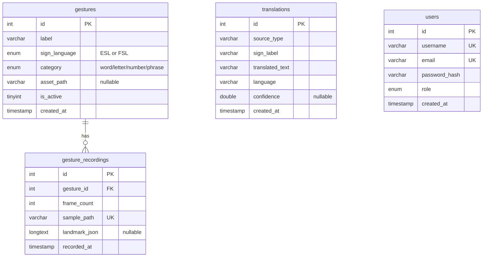

# Backend Layer (PHP + MySQL)

## 1. Owns these files

- `php/connect.php` (13 lines)
- `php/auth.php` (95 lines)
- `php/admin_api.php` (196 lines)
- `php/api/core_api.php` (177 lines) (**deleted 2026-09-24**, DB
  normalization — see "DB normalization" below)
- `php/api/save_gesture.php` (702 lines, was 585 before the
  2026-09-23 gesture-categorization phase; further edited 2026-09-24 for the
  normalized schema, see below)
- `php/api/gesture_category.php` (44 lines, new in the gesture-categorization
  phase)
- `php/api/save_translation.php` (99 lines)
- `php/api/get_translations.php` (65 lines)
- `php/api/save_history.php` (24 lines) (**deleted 2026-09-24**, DB cleanup)
- `php/api/get_history.php` (14 lines) (**deleted 2026-09-24**, DB cleanup)
- `php/api/reports.php` (80 lines)
- `scratch/trigger_sync.php` (170 lines) (**deleted 2026-09-24**, DB
  normalization)
- `db-schema/database_setup.sql`
- `db-schema/sining_kamay_db_backup.sql`
- `sining_kamay_db.sql`
- `db-schema/migrations/2026-09-24-normalize.php` (new 2026-09-24, DB
  normalization)
- `db-schema/migrations/2026-09-24-backfill-asset-path.php` (new 2026-09-24)

## 2. What it does

PHP 8 + MySQL (actual server per dump headers: **MariaDB 10.4.32**, `db-schema/sining_kamay_db_backup.sql:5`, `sining_kamay_db.sql:5` — "MySQL" in the brief is imprecise) endpoints for: user auth (`auth.php`), admin CRUD over users/history/gestures (`admin_api.php`), a "unified" data router for recordings/translations/gesture words (`core_api.php`), gesture-sample persistence including video transcoding (`save_gesture.php`), translation logging (`save_translation.php`, `get_translations.php`, `save_history.php`, `get_history.php`), and a read-only dictionary/report dump (`reports.php`).

Confirmed data-persistence/admin-only: no PHP file here touches MediaPipe/TensorFlow.js or the frame-classification loop. All are reached via `fetch()` from front-end JS/HTML after inference already happened client-side (see Section 6 for exact callers). This matches the brief's claim that PHP/MySQL is never in the live translation path.

## 3. How it works

**connect.php** (`php/connect.php:2-7`): hardcoded `$host="localhost"`, `$user="root"`, `$pass=""`, `$db="sining_kamay_db"`; opens `mysqli_connect`. No port specified in code (mysqli default 3306 — not specified in code).

**auth.php** — POST only (`php/auth.php:1-7`, OPTIONS short-circuited line 7). Body JSON `{action, ...}`. Actions: `register` (username/email/password, bcrypt via `password_hash`, line 54), `login` (identifier = username or email, `password_verify`, line 85). On every request it also runs `CREATE TABLE IF NOT EXISTS users` (lines 15-24) and seeds a default admin `admin`/`admin123` if none exists (lines 27-31).

**admin_api.php** — POST only. Body JSON `{action, requester_id, ...}`. Auth model: re-queries `users.role` for `requester_id` on every call (`php/admin_api.php:16-21`), no session/token. Actions: `get_users`, `create_user`, `update_user`, `delete_user` (users table), `get_history`/`delete_history`/`clear_history` (`translation_history`), `get_gestures`/`delete_gesture`/`clear_gestures` (`gestures`), `get_stats` (counts across `users`, `translation_history`, `gestures`).

**core_api.php** — **deleted 2026-09-24** (DB normalization, Task 4). Was:
POST only, 405 otherwise (`php/api/core_api.php:14`). Comment at line 2-6
self-describes as "Single entry-point for all Sining Kamay DB operations."
Actions via `switch($action)` (line 49): `save_recording`/`get_recordings`/`delete_recording` → `gesture_recordings` (columns `gesture_type`, `sample_count`, `thumbnail` — all three dropped by the normalization, see below); `save_translation`/`get_translations`/`delete_translation` → `translations` using columns **`detected_word`, `language`, `full_sentence`** (lines 101, 110-111) — see Problem #1, these columns do not exist in any of the 3 SQL sources; `save_gesture_word` → `gesture_words`; `clear_store` → truncates one of `gesture_recordings`/`translations`/`gesture_words` by name map (line 149); `get_stats` → row counts of those 3 tables. Deleted rather than fixed: it had no live caller (`js/db-local.js`'s only confirmed caller had no callers of its own, `DEBT.md` items 6/8), and it referenced columns/tables the normalization removes outright — repointing it would have kept dead code alive for no reader. `js/db-local.js` (its only caller) and its `<script>` tag in `gesture-training.html` were deleted in the same commit; `scratch/trigger_sync.php` was deleted too, since running it would have recreated `esl_signs`/`fsl_signs` and the old columns.

**save_gesture.php** — GET or POST (`php/api/save_gesture.php:440-446`; line numbers shifted from the earlier `386-392` cited elsewhere by the 2026-09-23 gesture-categorization phase). GET (no `action`) lists samples from disk (`list_samples`, line 385), and unless `?no_sync` is set, first runs `sync_disk_to_db` (line 390) which walks `saved_gestures/` and `saved_gestures_fsl/` JSON sample files and reconciles them into `gestures` and `gesture_recordings` (2026-09-24: no longer touches `esl_signs`/`fsl_signs` — those tables are gone; the `ensure_language_dataset_table()`/`save_gesture_to_language_dataset()` functions and the `*_signs` cascade deletes were removed in the same phase). A `?no_sync` GET still runs `ensure_gestures_columns()` (line 394, defined in `php/api/gesture_category.php:58`) so the `category` column exists before the response is built even on a not-yet-migrated DB. Both GET forms return a top-level `categories` key — `{"ESL": {label: category}, "FSL": {label: category}}` — built by `build_categories_map()` (lines 356-383; the SELECT is wrapped in `try/catch (Throwable)` at line 360 so a PHP 8.1+ `mysqli_sql_exception` also falls back instead of failing the request) from one `SELECT label, sign_language, category FROM gestures` query (was `SELECT word, ...` before the rename), falling back to the `gesture_category()` heuristic per label when a label has no DB row or the query itself fails. POST body JSON: `action="delete_gesture"` (label-based delete across disk + `gestures`/`gesture_recordings`, lines 455-491 — the `esl_signs`/`fsl_signs` deletes are gone with the tables; selects `SELECT id FROM gestures WHERE label = ? LIMIT 1`, recordings deleted before the gesture row, required now that the FK is `ON DELETE RESTRICT`) or default path: `{label|word, sign_language|dataset, frames[], video_base64?, video_path?, category?}` — frames capped `1..120` (error message says "expected 20-40 frames" though the actual code-enforced max is 120). `category` (line 501, `valid_gesture_category($body['category'] ?? null)`) is optional: invalid or missing means "use the heuristic on insert, leave an existing row's category alone on update" (`save_gesture_word_to_db()`, lines 71-122 — the `ON DUPLICATE KEY UPDATE ... category = IF(?, ?, category)` clause at line 85 only overwrites when the caller passed an explicit, non-null category; `word` → `label` in the INSERT and the fallback SELECT since the rename). The response echoes the stored category back as `category` (line 648), read back from the DB (line 113) rather than recomputed, so it reflects the update-or-leave-alone rule exactly. Saves a JSON landmark sample file to `saved_gestures/<label>/sample_<ms>_<hex>.json` or the `_fsl` variant, format tag `mediapipe_hands_landmarks_v2`. If `video_base64` present, decodes and shells out to **ffmpeg** (see below) to produce `assets/signs/<en|fil>/<label>.mp4`, falling back to raw `.webm` if ffmpeg is unavailable or fails; after `save_gesture_word_to_db`, `$assetUpdate` (`save_gesture.php:520`) runs `UPDATE gestures SET asset_path = COALESCE(?, asset_path) WHERE id = ?` with the produced asset path — "never overwrite with something if nothing new was produced," the same rule the old `IFNULL`-based `*_signs` write had. `save_gesture_recording_to_db($gestureId, $frameCount, $samplePath, $landmarkJson)` inserts `(gesture_id, frame_count, sample_path, landmark_json)` (was `sample_count`, plus the now-dropped `gesture_type`/`sign_language`/`thumbnail`). The response's `dbDatasetTable`/`dbDatasetId` keys (named the dropped `*_signs` tables) were removed — grep-verified no caller read them. Also has a hardcoded absolute Windows path `C:\Users\Techlife\OneDrive\Documents\New folder (5)\Sining_kamay\assets\signs\<subfolder>` that it copies videos into if that directory exists — developer-machine-specific, not Pi-portable.

**gesture_category.php** — no HTTP entry point of its own; `require_once`'d by `save_gesture.php` (`php/api/save_gesture.php:8`). `ensure_gestures_columns()` (line 58) and `backfill_gesture_categories()` (line 95) operate on `label` and the `sign_language ENUM('ESL','FSL')` since the 2026-09-24 normalization (previously `word` and a plain `VARCHAR(10)`); the `sign_language` ALTER only runs if the column is still missing, and now adds it as `enum('ESL','FSL') NOT NULL DEFAULT 'ESL' AFTER label`. Two pure functions, no DB/side effects: `gesture_category(string $label): string` — the word/letter/number/phrase heuristic (first match wins: all-digit or a closed English/Filipino number-word list → `number`; single `a-z` char → `letter`; contains `_` → `phrase`; else `word` — see `docs/system/DECISIONS.md` for the exact word list and measured counts) — and `valid_gesture_category($value): ?string` — lowercases/trims and returns the value only if it's one of the 4 valid categories, else `null`. Mirrored exactly in `js/gesture-category.js` (browser + Node, no DOM) for the Step 1 UI's Type selector; the two implementations are parity-tested (`tests/categorization/heuristic-parity.test.mjs`).

ffmpeg invocation (`php/api/save_gesture.php:522`):
```
"$ffmpeg -i <tempRawPath> -vf \"scale=360:-2\" -c:v libx264 -pix_fmt yuv420p -profile:v baseline -level 3.0 -r 25 -an -b:v 300k <videoPath> -y 2>&1"
```
ffmpeg lookup order (`get_ffmpeg_path()`, lines 36-52): global `ffmpeg` via `shell_exec('ffmpeg -version 2>&1')`, else `<project root>/ffmpeg.exe`, `<project root>/bin/ffmpeg.exe`, or `C:\ffmpeg\bin\ffmpeg.exe`.

**save_translation.php** — POST only (405 otherwise, line 25). Body JSON: `source_type` (must be `sign_to_text`|`text_to_sign`, line 49-54), `sign_label`, `translated_text`, `language` (default `en-US`), `confidence` (float, nullable). Inserts into `translations(source_type, sign_label, translated_text, language, confidence)` (line 65-67) — matches the actual schema, unlike core_api.php's version of the same table.

**get_translations.php** — GET, query params `?limit=` (default 50, max 200, line 15), `?source_type=`, `?language=`. Parameterized `SELECT ... FROM translations`.

**save_history.php** (deleted 2026-09-24, with the `translation_history` table; record kept for history) — POST. Body JSON `{text, source}` (source default `'sign'`). Directly string-interpolates escaped values into SQL (line 18, see Problems).

**get_history.php** (deleted 2026-09-24) — GET, no params. Returns top 50 `translation_history` rows.

**reports.php** (`php/api/reports.php`, 74 lines, rewritten 2026-09-24) — GET,
no params required. `fetch_gestures($conn, $signLanguage, $subFolder)`
(line 22) runs `SELECT id, label, asset_path, is_active, created_at FROM
gestures WHERE sign_language = ? ORDER BY created_at DESC, id DESC` for `'ESL'`
and `'FSL'` (was two separate `esl_signs`/`fsl_signs` queries before the
normalization); each row also gets a computed `display_label` =
`str_replace('_', ' ', label)` (line 43) so the visible Reports columns
("Key"/"Label"/"Text") stay exactly as before the rename. The empty-`asset_path`
`.mp4`-on-disk backfill (line 30-41) keeps its old logic but now targets
`gestures` directly (`UPDATE gestures SET asset_path = ? WHERE id = ?`,
line 35) — it only fires per-request for a still-NULL row with a `.mp4` on
disk, unlike the one-time `.webm` backfill script (see "Schema migration and
fresh-machine setup" below), so a synced-but-video-less row without a `.mp4`
stays NULL until that script runs (`DEBT.md` new item, below). Response shape:
`{success, summary: {esl, fsl, translations}, data: {esl, fsl, translations}}`
— `translations` (line 51-57, unchanged) is still `SELECT id, source_type,
sign_label, translated_text, language, confidence, created_at FROM
translations ORDER BY created_at DESC, id DESC LIMIT 200`.

**scratch/trigger_sync.php** — **deleted 2026-09-24** (DB normalization,
Task 4). Was: standalone CLI/browser script, requires `php/connect.php`
directly (line 2), duplicates `sync_disk_to_db` logic from an earlier version
of `save_gesture.php` (only scans `saved_gestures/`, not the FSL folder) and
echoes plain-text progress instead of JSON. Deleted rather than fixed: running
it would have recreated `esl_signs`/`fsl_signs` and the `gestures.word`/
`gesture_type` columns the normalization drops, breaking the "nothing recreates
dropped schema" guarantee the migration promises (enforced by
`tests/normalization/schema-guard.test.mjs`, see below); it had no frontend
caller (`DEBT.md` items 8/71).

**Tables — 4 total as of the 2026-09-24 schema-normalization phase** (`esl_signs`/`fsl_signs` dropped, folded into `gestures.asset_path`/`is_active`; `gesture_words` and `translation_history` were already dropped in the earlier 2026-09-24 DB cleanup, see below). Exact `SHOW CREATE TABLE`, taken from `db-schema/database_setup.sql:30-54` (verified live-identical by Task 4's scratch-database comparison, `.git/sdd/progress.md` Task 4):

```sql
CREATE TABLE `gestures` (
  `id` int(11) NOT NULL AUTO_INCREMENT,
  `label` varchar(255) NOT NULL,
  `sign_language` enum('ESL','FSL') NOT NULL DEFAULT 'ESL',
  `category` enum('word','letter','number','phrase') NOT NULL DEFAULT 'word',
  `asset_path` varchar(255) DEFAULT NULL,
  `is_active` tinyint(1) NOT NULL DEFAULT 1,
  `created_at` timestamp NOT NULL DEFAULT current_timestamp(),
  PRIMARY KEY (`id`),
  UNIQUE KEY `uq_gestures_label_language` (`label`,`sign_language`)
) ENGINE=InnoDB DEFAULT CHARSET=utf8mb4 COLLATE=utf8mb4_general_ci;

CREATE TABLE `gesture_recordings` (
  `id` int(11) NOT NULL AUTO_INCREMENT,
  `gesture_id` int(11) NOT NULL,
  `frame_count` int(11) NOT NULL DEFAULT 0,
  `sample_path` varchar(255) NOT NULL,
  `landmark_json` longtext DEFAULT NULL,
  `recorded_at` timestamp NOT NULL DEFAULT current_timestamp(),
  PRIMARY KEY (`id`),
  UNIQUE KEY `uq_gesture_recordings_sample_path` (`sample_path`),
  KEY `idx_gesture_recordings_gesture` (`gesture_id`),
  CONSTRAINT `fk_gesture_recordings_gesture` FOREIGN KEY (`gesture_id`)
    REFERENCES `gestures` (`id`) ON DELETE RESTRICT
) ENGINE=InnoDB DEFAULT CHARSET=utf8mb4 COLLATE=utf8mb4_general_ci;
```

209 `gestures` rows (ESL 67 word/26 letter/10 number/17 phrase; FSL 50/0/10/29),
210 `gesture_recordings` rows (measured pre-migration 2026-09-24, unchanged in
count by the migration — see `docs/reports/2026-09-24-db-normalization-step1.md`).

- `esl_signs` / `fsl_signs` — **dropped 2026-09-24** (schema-normalization
  phase, Task 2). Was: `id INT PK AUTO_INCREMENT`, `sign_key VARCHAR(120)
  UNIQUE`, `sign_label VARCHAR(255)`, `text_value VARCHAR(255)`, `description
  TEXT NULL`, `asset_path VARCHAR(255) NULL`, `is_active TINYINT(1) DEFAULT 1`,
  `created_at TIMESTAMP DEFAULT CURRENT_TIMESTAMP`, `updated_at TIMESTAMP NULL
  ON UPDATE CURRENT_TIMESTAMP`, `INDEX idx_*_text_value(text_value)`. Their
  only real (non-derivable, non-constant) data — `asset_path` and `is_active`
  — was copied into the new `gestures.asset_path`/`is_active` columns by the
  migration script before the tables were dropped (see below); `sign_label`/
  `text_value` (derivable from `label`), `description` (a per-language
  constant), and `updated_at`/`id`/`created_at` (redundant with `gestures`'
  own) were dropped without replacement. The two tracked `.sql` dumps
  (`db-schema/sining_kamay_db_backup.sql`, `sining_kamay_db.sql`) still
  contain them — they are pre-normalization snapshots, not importable as-is
  with the current code (see "Schema migration and fresh-machine setup"
  below).
- `users`: `id PK`, `username VARCHAR(80) UNIQUE`, `email VARCHAR(150) UNIQUE`, `password_hash VARCHAR(255)`, `role ENUM('user','admin') DEFAULT 'user'`, `created_at TIMESTAMP`. Unchanged by this phase.
- `gesture_words`: **dropped 2026-09-24**, in the earlier DB cleanup (not this phase) — see "DB cleanup (2026-09-24)" below.
- `translations`: `id PK`, `source_type VARCHAR(50)`, `sign_label VARCHAR(255)`, `translated_text VARCHAR(255)`, `language VARCHAR(20) DEFAULT 'en-US'`, `confidence DOUBLE NULL`, `created_at TIMESTAMP`. Unchanged by this phase.
- `translation_history`: **dropped 2026-09-24**, in the earlier DB cleanup — see below.


`translations` and `users` have no foreign-key relationship to `gestures` or
to each other — shown standalone above, unchanged by this phase.
`gesture_recordings.gesture_id` is the only foreign key in the schema
(`fk_gesture_recordings_gesture`, `ON DELETE RESTRICT`) — before this phase
there were no `FOREIGN KEY`/`CONSTRAINT` clauses anywhere and referential
integrity was enforced only in application code (`save_gesture.php` deleting
children before parents).

## 4. Key decisions and why

- **core_api.php as "unified router" alongside single-purpose files**: the file's own header comment calls it "Single entry-point for all Sining Kamay DB operations" (`php/api/core_api.php:3`), yet `save_translation.php`/`get_translations.php`/`save_history.php`/`get_history.php`/`save_gesture.php` all exist separately and are what the front-end actually calls for those operations (see Section 6). Reason for the duplication/why core_api.php was never fully adopted: not documented in code — it reads as an incomplete "v2" consolidation attempt within this codebase's own history. (Note: an earlier draft of this document attributed this to "an abandoned earlier revision" per the system brief; that framing has since been corrected — see `docs/system/DEAD_CODE.md` and `archive/old-revision-docs/ORIGIN.md` — the dead build pipeline found elsewhere in this repo came from a separate project, not an earlier revision of this one. Whether core_api.php's abandonment is related is not documented in code.)
- **3 separate SQL sources**: `database_setup.sql` is a hand-written idempotent (`CREATE TABLE IF NOT EXISTS`) setup script with seed data (lines 38-60, 77-79 of that file); `sining_kamay_db_backup.sql` and `sining_kamay_db.sql` are `mysqldump` exports of the live MariaDB database at two points in time (2026-07-11 and 2026-07-15 per their trailing `-- Dump completed on` comments) containing real captured data. Why both dumps are kept / why one is UTF-16LE-encoded: not documented in code.

**Confirmed during Phase 2.5 local setup**: `sining_kamay_db.sql` (root of the
repo) is UTF-16-encoded — MySQL/MariaDB's `mysql`/phpMyAdmin import rejects it
outright without a charset conversion first. `db-schema/sining_kamay_db_backup.sql`
is plain ASCII and imports directly with no conversion step. Anyone setting up
a fresh local environment should import `db-schema/sining_kamay_db_backup.sql`,
not `sining_kamay_db.sql`, or expect to convert the latter's encoding first.
- **Prepared statements vs raw string interpolation coexist** (e.g. `save_translation.php`, `get_translations.php`, `save_gesture.php` use `mysqli_prepare`; `save_history.php`, `admin_api.php`, `auth.php`, `core_api.php`'s `clear_store`/`get_stats` build raw SQL strings, some with escaping and some without): reason not documented in code — looks like incremental authorship rather than a deliberate standard.
- **`sync_db_to_disk` explicitly disabled** (`php/api/save_gesture.php:219-225`): comment states disk is the authoritative source and restoring DB rows to disk caused deleted gestures to resurrect — a documented past bug fix, not a design principle stated up front.

## 5. Constraints

- No Raspberry-Pi-specific PHP/MySQL configuration appears in these files (no SQLite fallback, no explicit `mysqli` connection-pooling/persistent-connection setup, no Apache vhost/config file among owned files). `connect.php` opens a new `mysqli_connect` per request with no pooling (`php/connect.php:7`).
- `connect.php` credentials (`root`/empty password, `localhost`) and the "XAMPP default" comment (`php/connect.php:4`) indicate development targeted at a local XAMPP/Windows stack rather than a hardened Pi Apache/MySQL setup; no evidence in code of production hardening for the Pi deployment.

## 6. Touches

- **connect.php**: required by every other file in this set (`require_once __DIR__ . '/connect.php'` or `'/../connect.php'`). Breaking it (e.g. changing `$db` name) breaks all 10 endpoints at once.
- **auth.php**: touches `users` table only. No caller found in tracked frontend JS/HTML (verified via repo-wide grep for `auth.php`/"auth" endpoint patterns — only `docs/system/INVENTORY.md`, `.planning/...progress.md`, and `admin_api.php` itself reference it). Currently dead code; removing it breaks nothing observable in the frontend as shipped.
- **admin_api.php**: touches `users`, `gestures` (its `translation_history` actions were removed 2026-09-24). Its admin check trusts a client-supplied `requester_id` — see `DEBT.md` item 72. No caller found in tracked frontend (same grep). Dead code as far as the shipped frontend is concerned; presumably meant for an admin dashboard that either was never built against it or was replaced by direct calls elsewhere.
- **core_api.php**: touches `gesture_recordings`, `translations` (its `gesture_words` action and map entries were removed 2026-09-24; `js/db-local.js`'s uncalled `saveGestureWord()` still posts the removed `save_gesture_word` action and would now get "Unknown action"). No auth check at all — see `DEBT.md` item 72. Only confirmed caller is `js/db-local.js:9` ("points to unified api router"). If its `translations` INSERT/SELECT column names (`detected_word`/`full_sentence`) are changed to match the real schema, any code path that actually exercises `db-local.js`'s translation save/get would start working for the first time (currently it fails against schema — see Problems #1); if `core_api.php` is deleted, whatever front-end flow uses `db-local.js` for camera-translator recording/translation storage breaks.
- **save_gesture.php**: touches `gestures`, `esl_signs`/`fsl_signs`, `gesture_recordings`, disk folders `saved_gestures/`, `saved_gestures_fsl/`, `assets/signs/en|fil/`, and shells out to **ffmpeg.exe**. Confirmed callers: `js/script.js:849`, `js/gesture-data.js:7`, `js/gesture-training-ui.js:246`, `diagnostic.html:113`. Changing its request/response JSON shape breaks the gesture-recording UI in all four; removing ffmpeg breaks only the MP4 transcode (falls back to `.webm` automatically, lines 543-556).
- **save_translation.php / get_translations.php**: touch `translations` (real schema columns). Confirmed callers: `js/db-api.js:35` and `:75`.
- **save_history.php / get_history.php**: touched `translation_history`; both deleted 2026-09-24 together with the table. No caller found in tracked frontend JS/HTML (grep-verified) — dead code as shipped.
- **reports.php**: touches `esl_signs`, `fsl_signs`, `translations` (read-only except for opportunistic `asset_path` backfill UPDATEs). Confirmed caller: `reports.html` (per system brief; endpoint itself has no auth/session check — any client can call it).
- **scratch/trigger_sync.php**: touches `gestures`, `esl_signs`, `gesture_recordings`, and `saved_gestures/` only (not the FSL folder) — a one-off/manual migration tool, not wired to any frontend caller.

## Problems found

1. **Schema/query mismatch (functional bug, not just doc drift)**: `php/api/core_api.php:101` and `:110-111` write/read `translations.detected_word`, `translations.full_sentence` — no such columns exist in `translations` in any of the 3 SQL sources (actual columns: `source_type, sign_label, translated_text, language, confidence` — confirmed identical in `db-schema/database_setup.sql:118-126`, `db-schema/sining_kamay_db_backup.sql`, and `sining_kamay_db.sql`). Any call to `core_api.php`'s `save_translation`/`get_translations`/`get_stats`(`translations` count is fine, but the recent-history style column read isn't used there) actions referencing those columns will fail with a MySQL "unknown column" error at `mysqli_stmt_execute`/`prepare` time. Since `js/db-local.js:9` is the only confirmed caller of `core_api.php`, this suggests that code path is currently broken or unexercised.
2. **Dead endpoints** (no caller found anywhere in tracked frontend, verified by repo-wide grep): `php/auth.php`, `php/admin_api.php`, `php/api/save_history.php`, `php/api/get_history.php`. Confirms the prior audit pass's claim.
3. **SQL injection risk** (raw string interpolation of user input into queries):
   - `php/api/save_history.php:18` — `$text`/`$source` are passed through `mysqli_real_escape_string` first (line 15-16), so this is escaped, not truly raw, but still string-built rather than parameterized.
   - `php/auth.php:56,62,64,83` — same pattern: escaped via `mysqli_real_escape_string` then interpolated.
   - `php/admin_api.php:19,56,59,65,83,87,99,106,111,132` — `$requesterId`/`$id` are cast with `intval()` first (safe), but string fields go through `mysqli_real_escape_string` then interpolation (same "escaped-but-not-parameterized" pattern throughout the file).
   - `php/api/save_gesture.php:428-429,432-433` — `$gestureId` is `(int)`-cast (safe) but concatenated directly into `DELETE ... WHERE id = $gestureId`; `$label` is passed through `mysqli_real_escape_string` at line 432-433 only (line 428 area) — consistent with the escape-then-concatenate pattern, not parameterized despite prepared statements being used elsewhere in the same file.
   - No unescaped/unparameterized raw concatenation of unsanitized user input was found in the 10 owned PHP files — all raw-SQL spots use either `intval()`/`(int)` casts or `mysqli_real_escape_string` before interpolation. Risk is inconsistency of style, not a confirmed live injection hole, but it is fragile (a future edit dropping the escape call would reintroduce one).
4. **Hardcoded DB credentials** (flag only, per instructions): `php/connect.php:2-5` — `$host="localhost"`, `$user="root"`, `$pass=""` (empty), `$db="sining_kamay_db"`. Comment marks it "XAMPP default" (line 4).
5. **Hardcoded developer-machine path**: `php/api/save_gesture.php:535,550` — `C:\Users\Techlife\OneDrive\Documents\New folder (5)\Sining_kamay\assets\signs\<subfolder>`. Will silently no-op (`is_dir()` false) on any machine other than the original developer's, including the Raspberry Pi target — dead/unportable code path, not a crash risk, but a leftover of individual dev environment.
6. **Default admin credential auto-seeded on every request**: `php/auth.php:27-31` — `admin`/`admin123` (bcrypt-hashed) inserted whenever no admin row exists; also duplicated as a static bcrypt hash seed in `db-schema/database_setup.sql:77-78`. Anyone reaching `auth.php` (currently unreachable from tracked frontend, see #2) could log in with these known default credentials if never changed.
7. **Inconsistent error-response shape** across endpoints: some return `{"success":false,"message":...}` (`auth.php`, `admin_api.php`, `core_api.php`'s "Unknown action"), others `{"error":...}` (`connect.php`, `save_translation.php`, `get_translations.php`, `save_history.php`), others `{"success":false,"error":...}` (`save_gesture.php`, `reports.php`). No shared contract; a frontend switching between endpoints must special-case each.
8. **Could not determine**: exact MySQL/MariaDB port (not specified anywhere in `connect.php` or the `.sql` files — mysqli default assumed but never stated in code); whether `sining_kamay_db_backup.sql`'s ANSI encoding is intentional or accidental (no code comment explains it); the actual production Apache vhost/config (no `.htaccess` or Apache config file among owned files to cite).

**Resolved in Phase 2** (see `docs/system/DEBT.md` items 3, 15): the two problems formerly numbered 6 and 8 here — the MyMemory network call and the file-wide `error_reporting(0)`/`display_errors=0` suppression — were both in `php/api/bulk_importer_api.php`, which was deleted along with `bulk-importer.html`.

## DB cleanup (2026-09-24)

Owner-approved, after a read-only reference audit. Backup taken beforehand by the owner: phpMyAdmin export of `sining_kamay_db` from MariaDB 10.4.32, `E:\ACADSS\IOT\backups\sining_kamay_db_2026-09-24.sql` (outside the repo). On MariaDB (the only DB server since `MySQL80` was disabled, `DEBT.md` item 68): `DROP TABLE gesture_words`, `DROP TABLE translation_history` (both 0 rows, guarded by a row-count check); `DELETE` of the 5 `translations` test rows from 2026-07-15 (all `confidence = 0.95`, the constant hard-coded by the archived sign-to-text page, `sign-to-text-ui.js:639`). `translations` itself is kept — `reports.php:58-61` reads it for the live Reports page, which returns one JSON for all three tabs, so dropping it would 500 the whole page. Remaining tables at the end of this cleanup: `esl_signs`, `fsl_signs`, `gesture_recordings`, `gestures`, `translations`, `users` (`esl_signs`/`fsl_signs` were dropped in the later schema-normalization phase the same day — see below).

## Schema migration and fresh-machine setup (2026-09-24)

The schema-normalization phase (plan:
`docs/superpowers/plans/2026-09-24-db-normalization.md`; approved proposal:
`docs/reports/2026-09-24-db-normalization-step1.md`; decisions:
`docs/system/DECISIONS.md` "Decisions made during the schema-normalization
phase") took the DB cleanup's 6-table shape down to the 4 tables in the
"Tables" section above, in three separate scripts/commits:

**1. `db-schema/migrations/2026-09-24-normalize.php`** — the one-time
migration. CLI-only guard as its first line
(`if (PHP_SAPI !== 'cli') { http_response_code(403); exit; }`, since it lives
under the web root); run with `C:\xampp\php\php.exe`. Options: `--db=<name>`
(default `sining_kamay_db`), `--snapshot=<path>` (default
`E:\ACADSS\IOT\backups\normalization-snapshot-<db>.json`),
`--stop-after=<N>` (exit after step N, used by the test suite),
`--verify-only` (compare against the snapshot and print `SHOW CREATE TABLE`,
changing nothing). Refuses to run against anything but MariaDB (checks
`SELECT @@version`). Ten ordered, idempotent steps (each checks
`information_schema`/table state before acting, so a resume after an
interruption skips finished steps instead of repeating them): (1) write a
JSON snapshot of every gesture and recording, if one doesn't already exist
and the DB is still pre-migration shape; (2) add `gestures.asset_path`/
`is_active`, copied from `esl_signs`/`fsl_signs`; (3) `sign_language` →
`ENUM('ESL','FSL')`; (4) `gesture_id` → NOT NULL + FK
`fk_gesture_recordings_gesture` ON DELETE RESTRICT; (5) `sample_path` → NOT
NULL + UNIQUE; (6) rename `word`→`label`, `sample_count`→`frame_count`;
(7) re-copy `asset_path`/`is_active` and compare every gesture/recording
against the snapshot — any difference stops the script before anything is
dropped; (8) drop `gesture_type`, `sign_language`, `thumbnail` from
`gesture_recordings`; (9) drop `esl_signs`/`fsl_signs`; (10) compare against
the snapshot again and print `SHOW CREATE TABLE` for all 4 tables.
**Why not one transaction:** MariaDB commits DDL implicitly, so a single
transaction can't span the whole migration — idempotent, checked steps plus
the pre-drop snapshot comparison are the safety net instead. **Resume:**
re-running the script after any interruption picks up at the first
unfinished step and converges on the same end state; `tests/normalization/
migration.test.mjs` verifies this for an interruption after every one of the
10 steps, on a clone database (`sining_kamay_db_migtest`, dropped afterward),
never on live. Run on live in Task 2 (`.git/sdd/progress.md`); its full
output is in that task's history, not reproduced here.

**2. `db-schema/migrations/2026-09-24-backfill-asset-path.php`** — a
separate script and commit (owner addition B: kept out of the migration so
the migration's snapshot comparison stays exact). CLI-only guard, `--db`
option, same MariaDB check. For every `gestures` row with `asset_path IS
NULL`, checks `assets/signs/<en|fil>/<label>.webm` on disk (en for ESL, fil
for FSL) and, if it exists and is non-empty, sets `asset_path` with
`UPDATE ... WHERE id = ? AND asset_path IS NULL` — a non-NULL value is never
touched, and a second run fills 0 (idempotent). Run on live 2026-09-24: 62
filled, 0 left NULL (`.git/sdd/progress.md` Task 3; the reviewer
independently re-verified 147 unchanged + 62 filled + 0 NULL + all 209 rows
non-empty via `reports.php`).

**Backup and snapshot (kept, not deleted):**
- `E:\ACADSS\IOT\backups\sining_kamay_db_before-normalization.sql` —
  `mysqldump.exe --single-transaction` backup taken immediately before the
  live migration ran (Task 2), 9,828,807 bytes (measured 2026-09-24, reported
  in Task 2's output).
- `E:\ACADSS\IOT\backups\normalization-snapshot-sining_kamay_db.json` — the
  migration script's own step-1 snapshot of every pre-migration gesture and
  recording. Keep both: besides the backup, this snapshot is the only other
  pre-migration record, and it's what a `--verify-only` run compares live
  against.
- **`--verify-only` against the live DB now always reports exactly the 62
  `asset_path` differences the backfill script introduced** (live has a
  value where the snapshot recorded NULL) — this is expected, not data loss;
  the snapshot was taken before Task 3's backfill ran and was never meant to
  match after it.

**FRESH MACHINE / PI SETUP — read before importing anything (review
finding, `.git/sdd/progress.md` "Whole-phase review", Important #1):** the
two tracked dumps, `sining_kamay_db.sql` and
`db-schema/sining_kamay_db_backup.sql`, are **pre-normalization snapshots**
(they still have `esl_signs`/`fsl_signs`, `gestures.word`,
`gesture_recordings.sample_count`/`gesture_type`/`thumbnail`) and are **not
importable as-is** with the current code — `save_gesture.php` and the other
endpoints now expect the normalized 4-table shape and will error against the
old one. The migration script **cannot** be pointed at a fresh import of
either dump to fix this: it requires the `category` column added in the
2026-09-23 gesture-categorization phase (neither dump has it), and its
default `--snapshot` path is a hardcoded Windows path
(`E:\ACADSS\IOT\backups\...`), not portable to the Pi's Linux filesystem.

Two ways to bring up a working database on a fresh machine (including the
Pi):
- **Recommended: dump the migrated live DB and import that.**
  `mysqldump.exe` the current, already-normalized `sining_kamay_db` and
  import the result on the new machine. This keeps every manual category
  re-tag (`DEBT.md` item 65) and every `asset_path` value exactly as they are
  now — nothing needs re-deriving.
- **Alternative: run the setup script, then one sync, then the backfill.**
  Run `db-schema/database_setup.sql` (creates the 4 tables directly in their
  final shape, `CREATE TABLE IF NOT EXISTS` throughout so it's safe to
  re-run), do one full-sync GET of `php/api/save_gesture.php` (no `?no_sync`)
  so `sync_disk_to_db` populates `gestures`/`gesture_recordings` from the
  `saved_gestures*/` folders, then run
  `db-schema/migrations/2026-09-24-backfill-asset-path.php` to fill
  `asset_path` from the `.webm` files on disk. **This loses every manual
  category re-tag** — the sync has no re-tag information to offer, so every
  label falls back to the `gesture_category()` heuristic (`DEBT.md` item 65
  already documents this as the accepted cost of category being DB-only).

**Tests:** `tests/normalization/migration.test.mjs` clones from the
pre-normalization backup, not the live DB — env var
`SK_NORMALIZATION_SOURCE_DUMP` (default
`E:\ACADSS\IOT\backups\sining_kamay_db_before-normalization.sql`); if that
file is absent, the file's tests skip with a clear message instead of
failing (added in Task 4's addendum, since after the live cutover the live
DB no longer has the pre-migration shape the clone needs to start from).
`tests/normalization/schema-guard.test.mjs` runs against the **live** DB (a
`zz`-prefixed probe, cleaned up in `beforeEach`/`after`), guarding that a
full sync never recreates `esl_signs`/`fsl_signs` or the dropped columns and
that the FK survives, and that a video POST's `asset_path` survives a
later video-less POST for the same label. Because it needs the live DB, it
belongs in the serial suite alongside the categorization/multi-sample tests,
not in the clone-based `tests/normalization/migration.test.mjs` run:

```
node --test --test-concurrency=1 tests/categorization/*.test.mjs tests/multi-sample/save-endpoint.test.mjs tests/normalization/schema-guard.test.mjs
```
