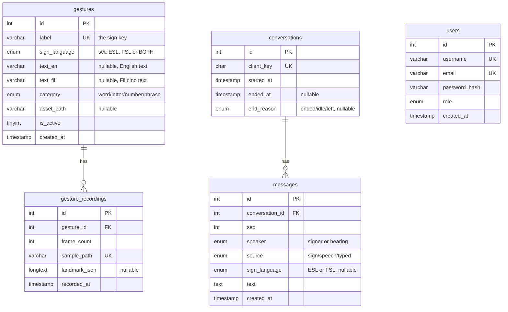

# Backend Layer (PHP + MySQL)

## 1. Owns these files

- `php/connect.php` (13 lines)
- `php/auth.php` (154 lines as of the 2026-10-18 accounts-quiz phase, which rewrote it on a PHP session; 95 lines
  before) — see "Accounts, conversation history and quiz" below
- `php/admin_api.php` (176 lines as of the accounts-quiz phase; 196 lines before)
- `php/session.php` (102 lines, new 2026-10-18) — the PHP session helpers
- `php/api/me.php` (28 lines, new 2026-10-18) — who is logged in, as a script for page `<head>`s
- `php/api/quiz.php` (309 lines, new 2026-10-18) — quiz sign pool, save, scores
- `php/api/core_api.php` (177 lines) (**deleted 2026-09-24**, DB
  normalization — see "DB normalization" below)
- `php/api/save_gesture.php` (806 lines as of the 2026-10-16 compact-model phase, which added the GET options
  `summary` and `labels` — see "Compact recognition model" below; 718 lines as of the 2026-10-04 sign-texts phase —
  604 lines after the 2026-09-26 video-based gesture capture phase, 585 before
  the 2026-09-23 gesture-categorization phase; also edited 2026-09-24 for the
  normalized schema. See "One sign, two texts" below)
- `php/api/gesture_category.php` (179 lines as of the sign-texts phase; 44 lines
  when first added in the gesture-categorization phase)
- `php/api/sign_meta.php` (119 lines, new 2026-10-04, sign-texts phase) — shared
  pure helpers for a sign's set, two texts and `sign.json`
- `php/api/signs.php` (152 lines, new 2026-10-04) — sign list and edit endpoint
- `php/api/save_translation.php` (99 lines) (**deleted 2026-09-25**,
  saved-conversations phase, Task 6 — see "translations dropped" below)
- `php/api/get_translations.php` (65 lines) (**deleted 2026-09-25**, same phase)
- `php/api/save_history.php` (24 lines) (**deleted 2026-09-24**, DB cleanup)
- `php/api/get_history.php` (14 lines) (**deleted 2026-09-24**, DB cleanup)
- `php/api/reports.php` (81 lines as of the sign-texts phase; 63 lines after
  the 2026-09-25 `translations` removal — see below)
- `php/api/save_conversation.php` (154 lines, new 2026-09-25, saved-conversations
  phase) — kiosk-facing, write-only
- `php/api/conversations.php` (180 lines, new 2026-09-25) — admin-facing
  list/detail/delete/clear_all, read by `reports.html`
- `php/api/compile_model.php` (95 lines), `php/api/model_status.php` (99 lines) and
  `php/api/knn_model_lib.php` (305 lines), new 2026-10-15/16 (compact-model phase) — the compiled k-NN
  model files `models/knn_<LANG>.bin`; see "Compact recognition model" below
- `scratch/trigger_sync.php` (170 lines) (**deleted 2026-09-24**, DB
  normalization)
- `db-schema/database_setup.sql` (94 lines; `gestures` DDL re-synced to the migrated live DDL 2026-10-04)
- `db-schema/sining_kamay_db_backup.sql`
- `sining_kamay_db.sql`
- `db-schema/migrations/2026-09-24-normalize.php` (new 2026-09-24, DB
  normalization)
- `db-schema/migrations/2026-09-24-backfill-asset-path.php` (new 2026-09-24)
- `db-schema/migrations/2026-10-04-sign-texts.php` (493 lines, new 2026-10-04,
  sign-texts phase) and its fixture `db-schema/migrations/2026-10-04-sign-texts-pairs.json`
  (723 lines: 89 pairs + 1 stray) — see "The 2026-10-04 sign-texts migration" below

## 2. What it does

PHP 8 + MySQL (actual server per dump headers: **MariaDB 10.4.32**, `db-schema/sining_kamay_db_backup.sql:5`, `sining_kamay_db.sql:5` — "MySQL" in the brief is imprecise) endpoints for: user auth (`auth.php`), admin CRUD over users/history/gestures (`admin_api.php`), a "unified" data router for recordings/translations/gesture words (`core_api.php`), gesture-sample persistence including video transcoding (`save_gesture.php`), translation logging (`save_translation.php`, `get_translations.php`, `save_history.php`, `get_history.php` — all four now deleted; translations logging was never wired to any live UI, see "translations dropped" below), a read-only dictionary/report dump (`reports.php`), and, since the 2026-09-25 saved-conversations phase, `talk.html`'s Let's Talk history: a kiosk-facing write-only save endpoint (`save_conversation.php`) and an admin-facing list/detail/delete endpoint (`conversations.php`). Since the 2026-10-04 sign-texts phase every sign is one folder with a set (`ESL`/`FSL`/`BOTH`) and two texts, mirrored in `gestures`; `signs.php` lists and edits them and `sign_meta.php` holds the helpers `save_gesture.php` and `signs.php` share.

Confirmed data-persistence/admin-only: no PHP file here touches MediaPipe/TensorFlow.js or the frame-classification loop. All are reached via `fetch()` from front-end JS/HTML after inference already happened client-side (see Section 6 for exact callers). This matches the brief's claim that PHP/MySQL is never in the live translation path.

## 3. How it works

**connect.php** (`php/connect.php:2-7`): hardcoded `$host="localhost"`, `$user="root"`, `$pass=""`, `$db="sining_kamay_db"`; opens `mysqli_connect`. No port specified in code (mysqli default 3306 — not specified in code).

**auth.php** — POST only (`php/auth.php:1-7`, OPTIONS short-circuited line 7). Body JSON `{action, ...}`. Actions: `register` (username/email/password, bcrypt via `password_hash`, line 54), `login` (identifier = username or email, `password_verify`, line 85). On every request it also runs `CREATE TABLE IF NOT EXISTS users` (lines 15-24) and seeds a default admin `admin`/`admin123` if none exists (lines 27-31).

**admin_api.php** — POST only. Body JSON `{action, requester_id, ...}`. Auth model: re-queries `users.role` for `requester_id` on every call (`php/admin_api.php:16-21`), no session/token. Actions: `get_users`, `create_user`, `update_user`, `delete_user` (users table), `get_history`/`delete_history`/`clear_history` (`translation_history`), `get_gestures`/`delete_gesture`/`clear_gestures` (`gestures`), `get_stats` (counts across `users`, `translation_history`, `gestures`).

**core_api.php** — **deleted 2026-09-24** (DB normalization, Task 4). Was:
POST only, 405 otherwise (`php/api/core_api.php:14`). Comment at line 2-6
self-describes as "Single entry-point for all Sining Kamay DB operations."
Actions via `switch($action)` (line 49): `save_recording`/`get_recordings`/`delete_recording` → `gesture_recordings` (columns `gesture_type`, `sample_count`, `thumbnail` — all three dropped by the normalization, see below); `save_translation`/`get_translations`/`delete_translation` → `translations` using columns **`detected_word`, `language`, `full_sentence`** (lines 101, 110-111) — see Problem #1, these columns do not exist in any of the 3 SQL sources; `save_gesture_word` → `gesture_words`; `clear_store` → truncates one of `gesture_recordings`/`translations`/`gesture_words` by name map (line 149); `get_stats` → row counts of those 3 tables. Deleted rather than fixed: it had no live caller (`js/db-local.js`'s only confirmed caller had no callers of its own, `DEBT.md` items 6/8), and it referenced columns/tables the normalization removes outright — repointing it would have kept dead code alive for no reader. `js/db-local.js` (its only caller) and its `<script>` tag in `gesture-training.html` were deleted in the same commit; `scratch/trigger_sync.php` was deleted too, since running it would have recreated `esl_signs`/`fsl_signs` and the old columns.

**save_gesture.php** — GET or POST (`php/api/save_gesture.php:361-367`). This file's line numbers have moved at least four times across phases; every citation below was re-measured on 2026-10-05 against the 718-line version (sign-texts phase), so treat any citation into it as due for re-checking after the next edit. It requires `connect.php`, `gesture_category.php` and `sign_meta.php` (`:7-9`).

*GET* (no `action`; dispatch `:361-363`) calls `list_samples()` (`:301-359`). Unless `?no_sync` is set it first runs `sync_disk_to_db()` (called `:306`, defined `:165-269`; semantics in "One sign, two texts" below). Then it runs `ensure_gestures_columns()` (`:310`, defined `php/api/gesture_category.php:58`) so a `?no_sync` GET on a not-yet-upgraded DB still has its columns before `build_categories_map()` reads them. It walks `saved_gestures/` then the legacy `saved_gestures_fsl/` (`:312-315`, `:320-349`) and returns `{success, datasetRoot, gestures, signs, categories}` (`:351-357`):
- `gestures` — label → sample objects `{file, label, frames, frameCount, createdAt, signLanguage}`; `signLanguage` is the sample file's own field (default `ESL`, `:338-345`).
- `signs` — label → `{set, textEn, textFil}` from `derive_sign()` (`:331-333`); the first folder that has the label wins, `saved_gestures/` before the legacy folder. New in the sign-texts phase.
- `categories` — `{"ESL": {label: category}, "FSL": {label: category}}` from `build_categories_map($conn, $signs)` (`:275-299`), one `SELECT label, category FROM gestures` (`:278`) wrapped in `try/catch (Throwable)` (`:277-281`) so a PHP 8.1+ `mysqli_sql_exception` also falls back to the `gesture_category()` heuristic per label (`:290`). A label whose set is `BOTH` appears under **both** `categories.ESL` and `categories.FSL` (`:291-296`) with the same category; the category column is per sign, not per language.

*GET, update 2026-10-16 (compact-model phase):* two more query options, `summary=1` (no `frames`) and
`labels=a,b,...` (only those sign folders), and each decoded sample is freed as soon as its entry is built. A
GET without them is byte-identical to before. Current line numbers and measurements: "Compact recognition model"
below.

*POST* `action="delete_gesture"` (`:376-419`, label-based): `clean_label()` the label (`:377`, 400 if empty), delete every `*.json` (including `sign.json`) and then the folder from **both** `saved_gestures/` and the legacy `saved_gestures_fsl/` (`:380-392`), then `SELECT id FROM gestures WHERE label = ?` (prepared, `:395-398`) and delete recordings before the gesture row (`:405-414`, required since the FK is `ON DELETE RESTRICT`). The label is unique now, so there is at most one `gestures` row (`:394`). All statements are prepared with `bind_param`, none string-interpolated.

*POST* default path — save one sample. Body: `{sign_language|dataset: "ESL"|"FSL"|"BOTH", text_en?, text_fil?, label|word? (legacy), frames[], video_base64?, video_path?, category?, formatVersion?, ...}`.
- **Set** (`:421`): `valid_sign_set($body['sign_language'] ?? $body['dataset'])`, default `ESL` when missing or invalid.
- **Texts** (`:426-430`): `text_en` / `text_fil` go through `sign_text_field()` (`php/api/sign_meta.php:104-119`): trimmed; empty becomes null; a non-string or a value over 255 characters (`SIGN_TEXT_MAX`, `sign_meta.php:7`) is HTTP 400.
- **Key derivation** (`:430-450`). If either text is sent (a "new-style call"), every text the set shows is required (HTTP 400 `English text is required for this sign set` / `Filipino text is required for this sign set`, `:434-439`) and the key is `clean_label(text_fil)` for FSL, `clean_label(text_en)` for ESL and BOTH (`:440`); a key that cleans to empty is 400 `The text must contain at least one letter or number` (`:441-443`). If neither text is sent (a legacy caller sending only `label`/`word`, e.g. `diagnostic.html`) the key is `clean_label(label ?? word)` (`:446`, 400 `Gesture label is required` if empty), and the texts come from the stored sign or a draft (`:509-516`). The key is never typed by the user in the UI; it is derived from the text.
- **Frames** (`:451-459`): `1..301`, over 301 is HTTP 413 `Too many frames in one sample (max 301)`. `MAX_FRAMES_PER_SAMPLE = 301` is `:35` (= `MAX_FRAMES_PER_REP` in `js/capture-core.js`). v3 per-frame validation `:461-470`.
- **Collision** (`:472-505`). An existing sign with this key is looked up in `saved_gestures/<key>/` then the legacy `saved_gestures_fsl/<key>/` (a folder counts if it has `sign.json` or at least one sample, `:475-481`), else by `gestures` row (`:482-496`; an empty folder with neither is not an existing sign). Same set: the save goes ahead (samples are added, texts updated). Different set: HTTP **409** `{success:false, error:"A sign with this key already exists as <SET>.", existingSet:"<SET>"}` and **nothing is written** (`:497-505`, checked before the label folder or any file is created).
- **Final texts** (`:507-523`): sent texts replace stored ones; an unsent text keeps the stored one; a brand-new legacy sign gets `sign_draft_text($label)` for the languages its set shows (`:514-515`); a text the set requires is never left empty (`:522-523`), so `chk_gestures_texts` can never be violated by this path.
- **Disk** (`:525-546`, `:548-598`): always `saved_gestures/<key>/` — `saved_gestures_fsl/` is never written again. `sample_<ms>_<hex>.json` keeps the v2/v3 format unchanged (`format: mediapipe_hands_landmarks_v2`, or `mediapipe_hands_raw_v3` when `formatVersion` is `3`, `$isV3`, `:461-462`; shapes in "v3 raw samples" below). The sample's own `signLanguage` field is `FSL` only for FSL signs and `ESL` for ESL **and** BOTH signs (`$sampleLanguage`, `:546`, used `:562` and `:586`); `sign.json`, not the sample, decides a sign's set.
- **sign.json** is written after the sample file and before any DB write (`:600-603`): disk first.
- **Video** (`:605-675`) is unchanged in behavior: if `video_base64` is present, ffmpeg transcodes to `assets/signs/<sub>/<key>.mp4` (raw `.webm` fallback); `<sub>` is `fil` for an FSL sign and `en` for ESL **and BOTH** (`:614`), so a BOTH sign's one clip lives under `assets/signs/en/`. Samples 2+ of a key with a clip skip the transcode (`$skipVideo`, `:624`). The hardcoded developer-machine OneDrive copy is at `:653` and `:668` (see Problems #5). v3 captures send no video (`docs/system/DEBT.md` item 86).
- **DB**: `save_gesture_word_to_db($label, $set, $textEn, $textFil, $category)` (called `:678`, defined `:75-132`) upserts by label (`:87-92`): `ON DUPLICATE KEY UPDATE id = LAST_INSERT_ID(id), sign_language = VALUES(sign_language), text_en = VALUES(text_en), text_fil = VALUES(text_fil), category = IF(?, ?, category)`. Set and both texts are always overwritten with the final values; `category` (validated by `valid_gesture_category`, `:424`) is only overwritten when the caller sent an explicit one (`$hasExplicitCategory`, `:96`), so a heuristic-only call never changes an existing row's category (unchanged 2026-09-23 rule). `$assetUpdate` (`:681-689`) runs `UPDATE gestures SET asset_path = COALESCE(?, asset_path) WHERE id = ?`. `save_gesture_recording_to_db()` (`:134-155`, called `:691-696`) inserts `(gesture_id, frame_count, sample_path, landmark_json)` with the same JSON string that was written to disk.
- **Response** (`:700-718`): `success`, `label` (the derived key), `signLanguage` (= the set, kept so old callers still read it), `set`, `textEn`, `textFil`, `category` (read back from the DB, `:117-131`), `file`, `videoAsset`, `frameCount`, `dbGestureId`, `dbGestureCreated`, `dbRecordingId`, `labelSampleCount`, `videoSkipped`, `videoTranscoded`, `videoExisting`.

Callers: `js/gesture-data.js` (`SAVE_ENDPOINT` `:5-7`, `saveGestureSample()` `:640`, which sends `text_en`/`text_fil` from `meta.textEn`/`meta.textFil`, and `sign_language` ESL|FSL|BOTH), `js/gesture-capture-ui.js:648`, `js/gesture-training-ui.js:545` (delete), `diagnostic.html:111-112` (legacy label-only caller).

**gesture_category.php** — no HTTP entry point of its own; `require_once`'d by `save_gesture.php` (`:8`) and `signs.php` (`:22`). `column_exists()` is `:49-54`, `ensure_gestures_columns()` `:58-152` and `backfill_gesture_categories()` `:157-179`. As of 2026-10-04 `ensure_gestures_columns()` also upgrades a pre-sign-texts database in place (enum widened to `BOTH`, unique key swapped, `text_en`/`text_fil` added, never the CHECK — see "Upgrade of a pre-phase database" below). Since the 2026-09-24 normalization it operates on `label` and the `sign_language` enum (previously `word` and a plain `VARCHAR(10)`); a missing `sign_language` column is added as `ENUM('ESL','FSL','BOTH') NOT NULL DEFAULT 'ESL' AFTER label` (`:62`; `ENUM('ESL','FSL')` before 2026-10-04). Two pure functions, no DB/side effects: `gesture_category(string $label): string` — the word/letter/number/phrase heuristic (first match wins: all-digit or a closed English/Filipino number-word list → `number`; single `a-z` char → `letter`; contains `_` → `phrase`; else `word` — see `docs/system/DECISIONS.md` for the exact word list and measured counts) — and `valid_gesture_category($value): ?string` (`:41-47`) — lowercases/trims and returns the value only if it's one of the 4 valid categories, else `null`. Mirrored exactly in `js/gesture-category.js` (browser + Node, no DOM) for the Step 1 UI's Type selector; the two implementations are parity-tested (`tests/categorization/heuristic-parity.test.mjs`). The heuristic runs on the **key** (the folder label), never on the display texts.

**One sign, two texts (2026-10-04, sign-texts phase).** Plan and owner decisions: `docs/reports/2026-10-04-sign-texts-step1.md`; design choices in `docs/system/DECISIONS.md` "Decisions made during the sign-texts phase". A *sign* is now one folder `saved_gestures/<key>/` holding its samples **once**, plus `sign.json`; there is no copying between folders. A sign has a **set** — `ESL`, `FSL` or `BOTH` (DB column `gestures.sign_language`, widened to `ENUM('ESL','FSL','BOTH')`, column name kept) — and two texts, English (`gestures.text_en`) and Filipino (`gestures.text_fil`). ESL shows/requires only the English text, FSL only the Filipino text, BOTH both. Texts keep their casing and punctuation (`"How are you?"`, `"Kumusta ka?"`); the key is derived, never typed.

- **`sign.json`** (written by `write_sign_json()`, `sign_meta.php:51-65`): pretty-printed (`JSON_PRETTY_PRINT | JSON_UNESCAPED_UNICODE | JSON_UNESCAPED_SLASHES`), `LOCK_EX`, keys exactly `key`, `set`, `textEn`, `textFil`, `updatedAt` (`gmdate('c')`, ISO 8601 UTC). `textEn`/`textFil` are strings or `null`:
  ```
  {"key":"how_are_you","set":"BOTH","textEn":"How are you","textFil":"Kamusta ka","updatedAt":"<ISO 8601 UTC>"}
  ```
  `read_sign_json()` (`:37-48`) returns null for a missing, unreadable or invalid file. A sign's `sign.json` and a sample's `signLanguage` field can disagree (BOTH signs record samples as `ESL`); `sign.json` wins.
- **Key** = `clean_label(text)` (`sign_meta.php:9-16`: lowercase, whitespace → `_`, strip `[^a-z0-9_-]`, trim `_-`) of the English text for ESL/BOTH, of the Filipino text for FSL; `clean_label` moved into `sign_meta.php` (guarded with `function_exists`). Draft text rule `sign_draft_text()` (`:19-25`): `_` → space, first character upper-cased (`kamusta_ka` → `Kamusta ka`).
- **`derive_sign($folderName, $label, $dir)`** (`sign_meta.php:72-100`) returns `{set, textEn, textFil}`: if `sign.json` exists with a valid set (`valid_sign_set()`, `:28-34`) its set and non-empty string texts are used; otherwise the set is `FSL` for the legacy folder `saved_gestures_fsl` and `ESL` for `saved_gestures`, or the first sample's own `signLanguage` when that is `ESL`/`FSL` (`:79-89`), with the draft text of the label for that language. Whatever the source, a text the set requires and that is still empty gets the draft (`:93-98`), so the result always satisfies `chk_gestures_texts`. A hand-edited `sign.json` missing a required text therefore becomes the draft in the DB; the file itself is not rewritten.
- **Disk is the source of truth.** The DB mirrors it; every full GET reconciles disk to DB (below). `sync_db_to_disk()` stays a no-op (`:157-163`).
- **`saved_gestures_fsl/`** is legacy: still **read** (sync `:170-173`, list `:312-315`, collision check `:475`, delete `:382`) but never written again. A legacy folder without `sign.json` derives as FSL. After the 2026-10-04 migration it holds 0 sample files (`.git/sdd/st-task-8-report.md`, item 1: `"fslSamples":0`).
- **Sync semantics** (`sync_disk_to_db()`, `:165-269`): it walks `saved_gestures/` then the legacy folder (`:170-173`), skips a folder with no sample files (`:198-199`) and, for each label, takes `derive_sign()` (`:202`). **Disk wins:** the `gestures` row is upserted only when it is missing or its `sign_language`/`text_en`/`text_fil` differ from the derived sign (`:203-214`); a label present in both folders keeps the `saved_gestures` sign (the `$upserted` guard `:203`; the legacy folder's samples are still registered). Sync passes no category and skips the category read-back (`save_gesture_word_to_db(..., null, false)`, `:211`, `$readBackCategory` `:117-119`), so a manual re-tag is never overwritten. New recordings are inserted for sample files whose path is unknown (`:226-235`); stale recordings and recording-less gestures are deleted exactly as before (`:242-268`).
- **Sync speed (measured).** The first version of the sync called `save_gesture_word_to_db()` once per label folder, and each call ran `ensure_gestures_columns()` (four `SHOW COLUMNS`) plus a category read-back. A full GET of `save_gesture.php` measured **12.2-14.5 s** (122 labels; `.git/sdd/st-task-2-report.md` fix round 1). Fix commit `78df63d`: one column check per request (`static $columnsEnsured`, `:77-81`), all `gestures` rows loaded once (`:177-181`), all recorded `sample_path`s loaded once (`:183-187`, replacing a SELECT per sample file), upsert only on difference. Interleaved against the pre-phase code (`.git/sdd/progress.md`, Task 2 fix round 1): new 2.30 / 1.88 / 1.86 s vs old 1.75 / 2.10 / 1.85 s; the task report's own noisier run of the fixed code was 1.65-3.05 s against 2.14-2.30 s for the old code. After the whole-phase fix commit `16c15ce`: **0.76 / 0.77 / 0.83 s** (an earlier run 0.90 s; `.git/sdd/st-final-fix-report.md`). All on the dev machine; the Pi was not measured.
- **Counts after the migration** (live, 2026-10-04): 122 `gestures` rows (89 `BOTH`, 33 `ESL`, 0 `FSL`) and 127 `gesture_recordings` (`.git/sdd/st-task-3-migration-output.txt`; re-confirmed by `--verify-only` and the final live check). Before the phase: 211 gestures (122 ESL + 89 FSL) and 216 recordings (`.git/sdd/progress.md`, Task 0).

**signs.php** (`php/api/signs.php`, 152 lines, new 2026-10-04; no auth, same posture as `reports.php`/`conversations.php` — `docs/system/DEBT.md` item 72 stays open). `fail()` at `:10-14`; OPTIONS → 204 (`:16-19`); any method other than GET/POST → 405 `GET or POST only` (`:44-46`); everything runs in `try { ... } catch (Throwable)` → `Database error: ...` 500 (`:150-152`). It calls `ensure_gestures_columns()` first (`:49`).
- `GET` (`:51-70`): one query, `SELECT g.label, g.sign_language, g.text_en, g.text_fil, g.category, g.asset_path, COUNT(r.id) AS samples FROM gestures g LEFT JOIN gesture_recordings r ON r.gesture_id = g.id GROUP BY g.id` → `{success:true, signs:{<key>:{set, textEn, textFil, category, assetPath, samples}}}`. It reads the DB, not the disk (no sync): a sign that exists only on disk is not listed until some full GET of `save_gesture.php` has synced it.
- `POST {"action":"update","key","set","textEn","textFil"}` (`:72-148`): body must be a JSON object (400 `Invalid JSON body`) with `action` = `update` (400 `Unknown action`). `key` must be a string that equals its own `clean_label()` and a folder `saved_gestures/<key>/` with at least one `sample_*.json` must exist inside `saved_gestures` (realpath-checked) or it is **404 `Sign not found`** (`:80-89`). Note this looks only in `saved_gestures/`: a legacy-only FSL folder 404s. `set` must be ESL/FSL/BOTH (400 `set must be ESL, FSL or BOTH`, `:91-94`); `textEn`/`textFil` go through `sign_text_field()` (400 for a non-string or >255 chars, `:95-98`); **the shown texts must be sent non-empty** (400 `English text is required for this sign set` / `Filipino text ...`, `:100-106`) even if a stored value exists. A **hidden** text is stored if sent, else the stored one is kept — `sign.json`'s value first, then the DB row's (`:115-119`), so narrowing a set keeps the now-hidden text stored.
- Write order (`:121-138`): `sign.json` first (500 `Unable to write sign.json`), then `UPDATE gestures SET sign_language = ?, text_en = ?, text_fil = ? WHERE label = ?`, or an `INSERT` (category from `gesture_category($key)`) when the sign had no row yet. It then reads the row back from the DB (`:140-146`) and responds `{success:true, sign:{key, set, textEn, textFil}}` (`:148`). Sample files are never touched; no recording is moved or copied. A moved set changes which model a sign belongs to; the client clears the affected cached models (`docs/system/UI.md` Part 2).

**Upgrade of a pre-phase database** (`ensure_gestures_columns()`, `gesture_category.php:58-152`; added in the whole-phase fix `16c15ce`). On any request, an existing DB that predates this phase is upgraded in place: the `sign_language` column is added if missing (`:60-70`); one `information_schema` UNION query reads its type and which of `uq_gestures_label_language` / `uq_gestures_label` exist (`:74-81`); if the type lacks `'BOTH'`, `ALTER TABLE ... MODIFY sign_language ENUM('ESL','FSL','BOTH') NOT NULL DEFAULT 'ESL'` (`:82-96`, with a concurrent-request re-check); if the old unique key exists and the new does not **and no label appears twice**, `DROP INDEX uq_gestures_label_language, ADD UNIQUE KEY uq_gestures_label (label)` (`:97-117`) — with duplicate labels the old key is kept, no error is raised, and the swap happens on a later request once the duplicates are gone; `text_en` (after `sign_language`) and `text_fil` (after `text_en`) are added as `VARCHAR(255) NULL` (`:120-132`); `category` as before (`:133-151`). It **never adds `chk_gestures_texts`**: an upgraded DB has no CHECK until `database_setup.sql` or the migration is applied, and PHP alone guarantees the required texts (`save_gesture.php:522-523`, `sign_meta.php:93-98`, `signs.php:100-106`). One full sync then fills the texts from disk (drafts where there is no `sign.json`). Tested by `tests/sign-texts/upgrade-path.test.mjs` on a scratch DB cloned from the pre-phase dump: 2 tests pass; against the pre-fix `gesture_category.php` 0 pass / 2 fail (`.git/sdd/st-final-fix-report.md`). The tests cover: enum gains `BOTH`; key swapped; a `BOTH` row stores `BOTH`; no CHECK added; second call a no-op; duplicate label keeps the old key and swaps after removal.

**v3 raw samples (2026-09-26, video-based gesture capture phase).** When
`$isV3` is true, `save_gesture.php` builds a richer `$recording` array
(`:551-579`) instead of v2's plain `{label, createdAt, frameCount, format,
signLanguage, frames}`: `format: 'mediapipe_hands_raw_v3'`, `formatVersion:
3`, `source` (`(string)($body['source'] ?? 'video-live')`), `repIndex`
(`(int)($body['repIndex'] ?? 0)`), `videoWidth`/`videoHeight` (the
recording's native camera resolution), `fps`, and `input: {width, height,
contentRect: {x, y, w, h}}` (the extractor's 320×240-by-default canvas and
the letterboxed content rect within it — see `docs/system/DECISIONS.md`, Q5).
Every numeric field is coerced with a local `$numOrZero` closure (`:554`) so
a missing/malformed value becomes `0`, never a PHP notice. `frames` itself is
each v3 frame's raw shape straight from the client: `{t, hands: [{label,
score, landmarks: [{x,y,z}, …21]}]}` — validated per-frame at `:464-470`
(`t` numeric, `hands` an array) before any of this runs.
**Why v3 is stored compact, not pretty-printed:** a pretty-printed 301-frame,
two-hand sample measured ~1.18 MB, over MariaDB's default
`max_allowed_packet` (1 MiB, `C:\xampp\mysql\bin\my.ini:37`), and the
`gesture_recordings` insert (which stores the same JSON string in
`landmark_json`, see "Tables" below) failed against it. `$encoded =
json_encode($recording, $isV3 ? 0 : JSON_PRETTY_PRINT)` (`:595`) stores v3
compact and leaves v2's pretty-printed on-disk format exactly as it was.
Measured (Task 6 e2e): 14,861 / 14,868 / 14,849 bytes for three compact
17-frame reps of the same sample. The response gains no new top-level keys
for v3 beyond what v2 already returned (`labelSampleCount`,
`videoSkipped`/`videoTranscoded`/`videoExisting` were added the phase
before, 2026-09-22 multi-sample — see `docs/system/UI.md` Part 2 §3); v3
saves never send `video_base64`/`video_path`, so `videoSkipped`/
`videoTranscoded`/`videoExisting` are always their defaults
(`false`/`false`/`null`) for a v3-only label — see `docs/system/DEBT.md`
item 86.

ffmpeg invocation (`php/api/save_gesture.php:639`):
```
"$ffmpeg -i <tempRawPath> -vf \"scale=360:-2\" -c:v libx264 -pix_fmt yuv420p -profile:v baseline -level 3.0 -r 25 -an -b:v 300k <videoPath> -y 2>&1"
```
ffmpeg lookup order (`get_ffmpeg_path()`, lines 37-53): global `ffmpeg` via `shell_exec('ffmpeg -version 2>&1')`, else `<project root>/ffmpeg.exe`, `<project root>/bin/ffmpeg.exe`, or `C:\ffmpeg\bin\ffmpeg.exe`.

**save_translation.php** — **deleted 2026-09-25** (saved-conversations phase,
Task 6, option A). Was: POST only (405 otherwise, line 25). Body JSON:
`source_type` (must be `sign_to_text`|`text_to_sign`, line 49-54),
`sign_label`, `translated_text`, `language` (default `en-US`), `confidence`
(float, nullable). Inserted into `translations(source_type, sign_label,
translated_text, language, confidence)` (line 65-67) — matched the actual
schema, unlike core_api.php's version of the same table. Deleted because
`translations` (0 rows, its only live writer — the gesture-training `stop`
gesture branch — could never run since no `stop` gesture exists) was dropped
in the same phase; see "translations dropped (2026-09-25)" below.

**get_translations.php** — **deleted 2026-09-25** (same phase). Was: GET,
query params `?limit=` (default 50, max 200, line 15), `?source_type=`,
`?language=`. Parameterized `SELECT ... FROM translations`. Its only
confirmed caller, `js/db-api.js`, was deleted in the same commit.

**save_conversation.php** (`php/api/save_conversation.php`, 154 lines, new
2026-09-25) — kiosk-facing, write-only endpoint for `talk.html`'s
`js/talk-history.js`. POST only, 405 otherwise (`:19-21`). Reads
`php://input`/`json_decode`s; a non-array body → 400 (`:23-27`).
- `action:"message"` (`:47-123`): validates `client_key` (`/^[0-9a-f]{32}$/`,
  `:31-33`), `seq` (PHP `is_int` and `>= 1`, so a JSON string or float `seq`
  is rejected, `:58-60`), `speaker` (`signer`|`hearing`), `source`
  (`sign`|`speech`|`typed`), `sign_language` (`ESL`|`FSL`|`null`), `text`
  (non-empty after `trim()`, `<= 65535` bytes — the `messages.text` `TEXT`
  column's limit) — every check runs before any DB write. It also mirrors
  both of the `messages` table's CHECK constraints in PHP for a clearer 400
  message (`:78-86`). On success, one transaction (`:88-119`): `INSERT INTO
  conversations (client_key) VALUES (?) ON DUPLICATE KEY UPDATE id =
  LAST_INSERT_ID(id)` (so the first message for a `client_key` creates the
  conversation row and every later message for the same key reuses it, with
  no round trip needed to learn the id first — `talk.html` never waits for a
  response before it might unload), then `INSERT INTO messages(...)`. A
  `db_fail_check()` helper (`:38-45`) normalizes both mysqli failure modes
  (a call returning `false`, this machine's actual behavior on PHP 8.0.30
  with `mysqli.report_mode` off by default, or a thrown
  `mysqli_sql_exception` on PHP 8.1+) into one `RuntimeException` path:
  errno 1062 (duplicate `(conversation_id, seq)`) → rollback, 409; any other
  DB error → rollback, 500.
- `action:"end"` (`:125-152`): validates `client_key` and `reason`
  (`ended`|`idle`|`left`), then `UPDATE conversations SET ended_at =
  current_timestamp(), end_reason = ? WHERE client_key = ? AND ended_at IS
  NULL` — never inserts. Matching 0 rows (unknown key, or an already-ended
  conversation) still returns `{"success":true}`, since the caller is
  fire-and-forget and has nothing to react to either way.
- Unknown/missing `action` → 400 (`:154`). Every success response is exactly
  `{"success":true}` — it never returns an id, text, or any other
  conversation's data.

**conversations.php** (`php/api/conversations.php`, 180 lines, new
2026-09-25) — admin-facing, read+delete endpoint for `reports.html`'s
Conversations tab. No server-side auth of any kind (`:1-6`'s own header
comment says so) — same posture as `reports.php`; see `docs/system/DEBT.md`
item 72 (its scope now explicitly includes this file too).
- `GET` (no `id`, `:74`, `:120-126`): list, via the shared
  `fetch_conversations()` helper (`:37-70`) — `SELECT c.id, c.started_at,
  c.ended_at, c.end_reason, TIMESTAMPDIFF(SECOND, c.started_at,
  COALESCE(c.ended_at, MAX(m.created_at))) AS duration_seconds, COUNT(m.id)
  AS message_count, (SELECT text FROM messages WHERE conversation_id = c.id
  ORDER BY seq ASC LIMIT 1) AS first_message FROM conversations c LEFT JOIN
  messages m ON m.conversation_id = c.id [WHERE ...] GROUP BY c.id, ...
  ORDER BY c.started_at DESC, c.id DESC`. `id`/`duration_seconds`/
  `message_count` are explicitly `(int)`-cast before `json_encode` (`:59,63-64`)
  so they always serialize as JSON numbers, not strings.
- `GET ?id=N` (`:75-118`): `id` must be a positive integer (400 otherwise);
  404 if `fetch_conversations()` with `WHERE c.id = ?` returns no row; then a
  second prepared statement selects `seq, speaker, source, sign_language,
  text, created_at FROM messages WHERE conversation_id = ? ORDER BY seq ASC`.
- `POST {"action":"delete","id":N}` (`:138-161`): a single prepared `DELETE
  FROM conversations WHERE id = ?`, branching on
  `mysqli_stmt_affected_rows()` — 1 → `{success:true, deleted:1}`, 0 → 404.
  `messages` cascades via `fk_messages_conversation ... ON DELETE CASCADE`
  (no separate delete needed).
- `POST {"action":"clear_all"}` (`:163-175`): a prepared (parameterless)
  `DELETE FROM conversations` — not `TRUNCATE`, since InnoDB refuses to
  truncate a table another table's foreign key points into. Responds
  `{success:true, deleted:n}`.
- Every mysqli call in this file is wrapped by a local `db_fail_check()`
  (`:29-33`, a same-named but simpler copy of `save_conversation.php`'s
  helper — added in a Task 3 review-fix round after the first version left
  these calls unchecked, which on this machine's PHP 8.0.30 would have been
  an uncaught fatal `TypeError` instead of a clean 500 JSON response) inside
  a `try { ... } catch (Throwable $e) { fail('Database error', 500); }`.
- Any other method → 405 (`:180`); a POST with an invalid JSON body, or a
  missing/unknown `action`, → 400 (`:132-134`, `:177`).

**save_history.php** (deleted 2026-09-24, with the `translation_history` table; record kept for history) — POST. Body JSON `{text, source}` (source default `'sign'`). Directly string-interpolates escaped values into SQL (line 18, see Problems).

**get_history.php** (deleted 2026-09-24) — GET, no params. Returns top 50 `translation_history` rows.

**reports.php** (`php/api/reports.php`, 81 lines as of the sign-texts phase — 63 lines after the 2026-09-25 `translations` removal, saved-conversations phase Task 5) — GET, no params required. `fetch_gestures($conn, $sets, $subFolder, $textColumn)` (`:22-64`) runs a prepared `SELECT id, label, sign_language, text_en, text_fil, asset_path, is_active, created_at FROM gestures WHERE sign_language IN (...) ORDER BY created_at DESC, id DESC` (`:25-29`), with `$sets` a fixed list from this file, never user input (`:23`). It is called twice (`:66-67`): ESL tab = `['ESL','BOTH']` with `text_en`, FSL tab = `['FSL','BOTH']` with `text_fil`, so a **Both sign is listed in both tabs**, each with its own text. Each row also gets `set` (the `sign_language` value, `:59`) and `text` (the tab's text column, `:60`) beside the computed `display_label` = `str_replace('_', ' ', label)` (`:58`, kept from before so existing columns still work). The empty-`asset_path` `.mp4`-on-disk backfill (`:45-57`) keeps its old logic against `gestures` (`UPDATE gestures SET asset_path = ? WHERE id = ?`, `:50`): it only fires per-request for a still-NULL row with a `.mp4` on disk, unlike the one-time `.webm` backfill script (see "Schema migration and fresh-machine setup" below), so a synced-but-video-less row without a `.mp4` stays NULL until that script runs (`DEBT.md` item 75); for a Both sign on the FSL tab it looks in `assets/signs/fil/<label>.mp4`. Response shape: `{success, summary: {esl, fsl}, data: {esl, fsl}}` (`:69-79`), where `summary` is the row count of each list (live 2026-10-04: esl 122 = 33 ESL + 89 Both, fsl 89 = the 89 Both; measured by `tests/sign-texts/reports-keyboard-check.mjs`, `.git/sdd/st-task-7-report.md`). The Conversations tab/metric come from `conversations.php` (fetched by `reports.html`, only after the PIN — `docs/system/UI.md` Part 3c). `reports.php` itself is still fetched at page load, before the PIN, exactly as before — the ESL/FSL gesture dictionary it returns isn't private, unlike conversation contents.

**scratch/trigger_sync.php** — **deleted 2026-09-24** (DB normalization,
Task 4). Was: standalone CLI/browser script, requires `php/connect.php`
directly (line 2), duplicates `sync_disk_to_db` logic from an earlier version
of `save_gesture.php` (only scans `saved_gestures/`, not the FSL folder) and
echoes plain-text progress instead of JSON. Deleted rather than fixed: running
it would have recreated `esl_signs`/`fsl_signs` and the `gestures.word`/
`gesture_type` columns the normalization drops, breaking the "nothing recreates
dropped schema" guarantee the migration promises (enforced by
`tests/normalization/schema-guard.test.mjs`, see below); it had no frontend
caller (`DEBT.md` items 8/71).

**Tables — 5 total as of the 2026-09-25 saved-conversations phase**
(`translations` dropped that day, see "translations dropped (2026-09-25)"
below; `esl_signs`/`fsl_signs` were dropped in the earlier 2026-09-24
schema-normalization phase, folded into `gestures.asset_path`/`is_active`;
`gesture_words` and `translation_history` were dropped in the same day's
earlier DB cleanup, see below). Exact `SHOW CREATE TABLE`: `gestures` as of the 2026-10-04 sign-texts migration, taken from the live
`SHOW CREATE TABLE` printed by the migration's step 8 (`.git/sdd/st-task-3-migration-output.txt`)
and identical to `db-schema/database_setup.sql:30-46` (Task 2 created the setup SQL's DDL on a
scratch DB and confirmed the CHECK rejects an FSL row with no `text_fil` and a BOTH row with no
`text_fil`, `.git/sdd/st-task-2-report.md`); `gesture_recordings` from
`db-schema/database_setup.sql:48-60` (verified live-identical by the 2026-09-24 Task 4 scratch-database
comparison, `.git/sdd/progress.md` Task 4); `conversations`/`messages` taken from
`db-schema/database_setup.sql:66-94` and confirmed live-identical (no
`ON UPDATE` clause, the FK's `ON DELETE CASCADE`, and both CHECK constraints
all present) by Task 1's `SHOW CREATE TABLE` run, `.git/sdd/conv-task-1-report.md`:

```sql
CREATE TABLE `gestures` (
  `id` int(11) NOT NULL AUTO_INCREMENT,
  `label` varchar(255) NOT NULL,
  `sign_language` enum('ESL','FSL','BOTH') NOT NULL DEFAULT 'ESL',
  `text_en` varchar(255) DEFAULT NULL,
  `text_fil` varchar(255) DEFAULT NULL,
  `category` enum('word','letter','number','phrase') NOT NULL DEFAULT 'word',
  `asset_path` varchar(255) DEFAULT NULL,
  `is_active` tinyint(1) NOT NULL DEFAULT 1,
  `created_at` timestamp NOT NULL DEFAULT current_timestamp(),
  PRIMARY KEY (`id`),
  UNIQUE KEY `uq_gestures_label` (`label`),
  CONSTRAINT `chk_gestures_texts` CHECK ((`sign_language` = 'FSL' OR (`text_en` IS NOT NULL AND `text_en` <> '')) AND (`sign_language` = 'ESL' OR (`text_fil` IS NOT NULL AND `text_fil` <> '')))
) ENGINE=InnoDB DEFAULT CHARSET=utf8mb4 COLLATE=utf8mb4_general_ci;

CREATE TABLE `gesture_recordings` (
  `id` int(11) NOT NULL AUTO_INCREMENT,
  `gesture_id` int(11) NOT NULL,
  `frame_count` int(11) NOT NULL DEFAULT 0,
  `sample_path` varchar(255) NOT NULL,
  `landmark_json` longtext DEFAULT NULL,
  `recorded_at` timestamp NOT NULL DEFAULT current_timestamp(),
  PRIMARY KEY (`id`),
  UNIQUE KEY `uq_gesture_recordings_sample_path` (`sample_path`),
  KEY `idx_gesture_recordings_gesture` (`gesture_id`),
  CONSTRAINT `fk_gesture_recordings_gesture` FOREIGN KEY (`gesture_id`)
    REFERENCES `gestures` (`id`) ON DELETE RESTRICT
) ENGINE=InnoDB DEFAULT CHARSET=utf8mb4 COLLATE=utf8mb4_general_ci;

CREATE TABLE `conversations` (
  `id` int(11) NOT NULL AUTO_INCREMENT,
  `client_key` char(32) NOT NULL,
  `started_at` timestamp NOT NULL DEFAULT current_timestamp(),
  `ended_at` timestamp NULL DEFAULT NULL,
  `end_reason` enum('ended','idle','left') DEFAULT NULL,
  PRIMARY KEY (`id`),
  UNIQUE KEY `uq_conversations_client_key` (`client_key`)
) ENGINE=InnoDB DEFAULT CHARSET=utf8mb4 COLLATE=utf8mb4_general_ci;

CREATE TABLE `messages` (
  `id` int(11) NOT NULL AUTO_INCREMENT,
  `conversation_id` int(11) NOT NULL,
  `seq` int(11) NOT NULL,
  `speaker` enum('signer','hearing') NOT NULL,
  `source` enum('sign','speech','typed') NOT NULL,
  `sign_language` enum('ESL','FSL') DEFAULT NULL,
  `text` text NOT NULL,
  `created_at` timestamp NOT NULL DEFAULT current_timestamp(),
  PRIMARY KEY (`id`),
  UNIQUE KEY `uq_messages_conversation_seq` (`conversation_id`,`seq`),
  CONSTRAINT `fk_messages_conversation` FOREIGN KEY (`conversation_id`)
    REFERENCES `conversations` (`id`) ON DELETE CASCADE,
  CONSTRAINT `chk_messages_speaker_source` CHECK (
    (`speaker` = 'signer'  AND `source` = 'sign') OR
    (`speaker` = 'hearing' AND `source` IN ('speech','typed'))),
  CONSTRAINT `chk_messages_sign_language` CHECK (
    (`speaker` = 'signer') = (`sign_language` IS NOT NULL))
) ENGINE=InnoDB DEFAULT CHARSET=utf8mb4 COLLATE=utf8mb4_general_ci;
```

`client_key` (32 lowercase hex chars, made client-side by
`crypto.getRandomValues`) stands in for a server-issued conversation id: the
page never waits for a response before it might unload (all three exits —
End Conversation, the idle timeout, the idle card's End Now — navigate to
`index.html` right after), so `save_conversation.php`'s `INSERT ... ON
DUPLICATE KEY UPDATE id = LAST_INSERT_ID(id)` lets the first message create
the row and every later message/`end` for the same key find it, with no id
round-trip needed first. `end` only ever `UPDATE`s — no message means no row,
so a conversation with 0 messages cannot exist. `seq` is assigned by the page
in confirm order (1, 2, 3…); the `(conversation_id, seq)` UNIQUE key rejects a
duplicate. Neither timestamp column gets an implicit `ON UPDATE` (MariaDB
10.4's `explicit_defaults_for_timestamp` is OFF, but both NOT NULL timestamps
have an explicit `DEFAULT current_timestamp()`, so the implicit-`ON UPDATE`
rule that would otherwise attach to "the first TIMESTAMP column" never fires).
`sign_language` is non-NULL exactly when `speaker = 'signer'` (the CHECK), and
`confidence` was considered and dropped — `talk.html`'s recognizer never
produces a sentence-level score (`js/talk-signing.js:119-128`).

122 `gestures` rows (89 `BOTH`, 33 `ESL`, 0 `FSL`) and 127 `gesture_recordings` rows
(measured live 2026-10-04 after the sign-texts migration, `.git/sdd/st-task-3-migration-output.txt`;
re-confirmed by `--verify-only` and `.git/sdd/st-final-fix-report.md`). Before that phase:
211 `gestures` (122 ESL + 89 FSL) and 216 `gesture_recordings` (`.git/sdd/progress.md` Task 0).
Per-category counts after the migration were not measured in this phase's reports. (The
2026-09-24 figures — 209 `gestures`, 210 `gesture_recordings`, see
`docs/reports/2026-09-24-db-normalization-step1.md` — are history.)

`gestures.sign_language` is the sign's **set** (`ESL`|`FSL`|`BOTH`), not the language of a
copy; `text_en`/`text_fil` are the two texts; `uq_gestures_label` makes the label (the
folder key) unique on its own (it replaced `uq_gestures_label_language (label, sign_language)`);
`chk_gestures_texts` requires `text_en` unless the set is FSL and `text_fil` unless the set is
ESL. `messages.sign_language` is unchanged (`ESL`|`FSL`|NULL): a Let's Talk message records the
language the signer used, never `BOTH` (`php/api/save_conversation.php` validates `ESL`|`FSL`).

- `esl_signs` / `fsl_signs` — **dropped 2026-09-24** (schema-normalization
  phase, Task 2). Was: `id INT PK AUTO_INCREMENT`, `sign_key VARCHAR(120)
  UNIQUE`, `sign_label VARCHAR(255)`, `text_value VARCHAR(255)`, `description
  TEXT NULL`, `asset_path VARCHAR(255) NULL`, `is_active TINYINT(1) DEFAULT 1`,
  `created_at TIMESTAMP DEFAULT CURRENT_TIMESTAMP`, `updated_at TIMESTAMP NULL
  ON UPDATE CURRENT_TIMESTAMP`, `INDEX idx_*_text_value(text_value)`. Their
  only real (non-derivable, non-constant) data — `asset_path` and `is_active`
  — was copied into the new `gestures.asset_path`/`is_active` columns by the
  migration script before the tables were dropped (see below); `sign_label`/
  `text_value` (derivable from `label`), `description` (a per-language
  constant), and `updated_at`/`id`/`created_at` (redundant with `gestures`'
  own) were dropped without replacement. The two tracked `.sql` dumps
  (`db-schema/sining_kamay_db_backup.sql`, `sining_kamay_db.sql`) still
  contain them — they are pre-normalization snapshots, not importable as-is
  with the current code (see "Schema migration and fresh-machine setup"
  below).
- `users`: `id PK`, `username VARCHAR(80) UNIQUE`, `email VARCHAR(150) UNIQUE`, `password_hash VARCHAR(255)`, `role ENUM('user','admin') DEFAULT 'user'`, `created_at TIMESTAMP`. Unchanged by this phase.
- `gesture_words`: **dropped 2026-09-24**, in the earlier DB cleanup (not this phase) — see "DB cleanup (2026-09-24)" below.
- `translations`: **dropped 2026-09-25** (saved-conversations phase, Task 5).
  Was: `id PK`, `source_type VARCHAR(50)`, `sign_label VARCHAR(255)`,
  `translated_text VARCHAR(255)`, `language VARCHAR(20) DEFAULT 'en-US'`,
  `confidence DOUBLE NULL`, `created_at TIMESTAMP`. See "translations dropped
  (2026-09-25)" below.
- `translation_history`: **dropped 2026-09-24**, in the earlier DB cleanup — see below.
- `conversations` / `messages`: **new 2026-09-25** (saved-conversations
  phase, Task 1) — see the DDL above.


`users` has no foreign-key relationship to any other table — shown standalone
above. `gestures`↔`gesture_recordings` and `conversations`↔`messages` are the
only two foreign-key relationships in the schema
(`fk_gesture_recordings_gesture` `ON DELETE RESTRICT`; `fk_messages_conversation`
`ON DELETE CASCADE`, added 2026-09-25 — deleting a conversation deletes its
messages, unlike the older FK). Before the 2026-09-24 schema-normalization
phase there were no `FOREIGN KEY`/`CONSTRAINT` clauses anywhere and
referential integrity was enforced only in application code (`save_gesture.php`
deleting children before parents).

## 4. Key decisions and why

- **core_api.php as "unified router" alongside single-purpose files**: the file's own header comment calls it "Single entry-point for all Sining Kamay DB operations" (`php/api/core_api.php:3`), yet `save_translation.php`/`get_translations.php`/`save_history.php`/`get_history.php`/`save_gesture.php` all exist separately and are what the front-end actually calls for those operations (see Section 6). Reason for the duplication/why core_api.php was never fully adopted: not documented in code — it reads as an incomplete "v2" consolidation attempt within this codebase's own history. (Note: an earlier draft of this document attributed this to "an abandoned earlier revision" per the system brief; that framing has since been corrected — see `docs/system/DEAD_CODE.md` and `archive/old-revision-docs/ORIGIN.md` — the dead build pipeline found elsewhere in this repo came from a separate project, not an earlier revision of this one. Whether core_api.php's abandonment is related is not documented in code.)
- **3 separate SQL sources**: `database_setup.sql` is a hand-written idempotent (`CREATE TABLE IF NOT EXISTS`) setup script with seed data (lines 38-60, 77-79 of that file); `sining_kamay_db_backup.sql` and `sining_kamay_db.sql` are `mysqldump` exports of the live MariaDB database at two points in time (2026-07-11 and 2026-07-15 per their trailing `-- Dump completed on` comments) containing real captured data. Why both dumps are kept / why one is UTF-16LE-encoded: not documented in code.

**Confirmed during Phase 2.5 local setup**: `sining_kamay_db.sql` (root of the
repo) is UTF-16-encoded — MySQL/MariaDB's `mysql`/phpMyAdmin import rejects it
outright without a charset conversion first. `db-schema/sining_kamay_db_backup.sql`
is plain ASCII and imports directly with no conversion step. Anyone setting up
a fresh local environment should import `db-schema/sining_kamay_db_backup.sql`,
not `sining_kamay_db.sql`, or expect to convert the latter's encoding first.
- **Prepared statements vs raw string interpolation coexist** (e.g. `save_translation.php`, `get_translations.php`, `save_gesture.php` use `mysqli_prepare`; `save_history.php`, `admin_api.php`, `auth.php`, `core_api.php`'s `clear_store`/`get_stats` build raw SQL strings, some with escaping and some without): reason not documented in code — looks like incremental authorship rather than a deliberate standard.
- **`sync_db_to_disk` explicitly disabled** (`php/api/save_gesture.php:157-163`; re-measured 2026-10-05, was `151-157` on 2026-09-26 and `219-225` before that): comment states disk is the authoritative source and restoring DB rows to disk caused deleted gestures to resurrect — a documented past bug fix, not a design principle stated up front.

## 5. Constraints

- No Raspberry-Pi-specific PHP/MySQL configuration appears in these files (no SQLite fallback, no explicit `mysqli` connection-pooling/persistent-connection setup, no Apache vhost/config file among owned files). `connect.php` opens a new `mysqli_connect` per request with no pooling (`php/connect.php:7`).
- `connect.php` credentials (`root`/empty password, `localhost`) and the "XAMPP default" comment (`php/connect.php:4`) indicate development targeted at a local XAMPP/Windows stack rather than a hardened Pi Apache/MySQL setup; no evidence in code of production hardening for the Pi deployment.

## 6. Touches

- **connect.php**: required by every other file in this set (`require_once __DIR__ . '/connect.php'` or `'/../connect.php'`). Breaking it (e.g. changing `$db` name) breaks all 10 endpoints at once.
- **auth.php** (*updated 2026-10-18: now called by `login.html` and `js/sk-account.js` Log out; the rest of this
  bullet describes the file before the accounts-quiz phase*): touches `users` table only. No caller found in tracked frontend JS/HTML (verified via repo-wide grep for `auth.php`/"auth" endpoint patterns — only `docs/system/INVENTORY.md`, `.planning/...progress.md`, and `admin_api.php` itself reference it). Currently dead code; removing it breaks nothing observable in the frontend as shipped.
- **admin_api.php** (*updated 2026-10-18: session-checked, called by `users.html`, `conversations.html` and
  `quiz-scores.html`; the rest of this bullet describes the file before the accounts-quiz phase*): touches `users`, `gestures` (its `translation_history` actions were removed 2026-09-24). Its admin check trusts a client-supplied `requester_id` — see `DEBT.md` item 72. No caller found in tracked frontend (same grep). Dead code as far as the shipped frontend is concerned; presumably meant for an admin dashboard that either was never built against it or was replaced by direct calls elsewhere.
- **core_api.php**: touches `gesture_recordings`, `translations` (its `gesture_words` action and map entries were removed 2026-09-24; `js/db-local.js`'s uncalled `saveGestureWord()` still posts the removed `save_gesture_word` action and would now get "Unknown action"). No auth check at all — see `DEBT.md` item 72. Only confirmed caller is `js/db-local.js:9` ("points to unified api router"). If its `translations` INSERT/SELECT column names (`detected_word`/`full_sentence`) are changed to match the real schema, any code path that actually exercises `db-local.js`'s translation save/get would start working for the first time (currently it fails against schema — see Problems #1); if `core_api.php` is deleted, whatever front-end flow uses `db-local.js` for camera-translator recording/translation storage breaks.
- **save_gesture.php**: touches `gestures`, `gesture_recordings`, disk folders `saved_gestures/` (read and write) and the legacy `saved_gestures_fsl/` (read and delete only), `assets/signs/en|fil/`, and shells out to **ffmpeg.exe**. Confirmed callers: `js/gesture-data.js:5-7` (its `saveGestureSample()` at `:640`, called by `js/gesture-capture-ui.js:648` for every v3 rep), `js/gesture-training-ui.js:545` (delete), `diagnostic.html:111-112` (legacy label-only POST). (`js/script.js:849`, a former caller, is archived.) Changing its request/response JSON shape breaks the gesture-recording UI; removing ffmpeg breaks only the MP4 transcode (falls back to `.webm` automatically, `:661-673`) — moot for v3-only saves, which never send a video at all (`docs/system/DEBT.md` item 86).
- **save_translation.php / get_translations.php**: touched `translations` (real schema columns). Confirmed callers: `js/db-api.js:35` and `:75`. Both files, `js/db-api.js`, and the `translations` table itself were **deleted 2026-09-25** together (saved-conversations phase, Tasks 5-6) — see "translations dropped" below.
- **save_history.php / get_history.php**: touched `translation_history`; both deleted 2026-09-24 together with the table. No caller found in tracked frontend JS/HTML (grep-verified) — dead code as shipped.
- **reports.php**: touches `gestures` only (the `translations` read was removed 2026-09-25; it also still issues the opportunistic `asset_path` backfill UPDATE for `.mp4`s, `:50`). Confirmed caller: `reports.html` (endpoint itself has no auth/session check — any client can call it, and it is still fetched before the PIN).
- **signs.php** (2026-10-04): touches `gestures`/`gesture_recordings` (read: GET; write: update) and the file `saved_gestures/<key>/sign.json` (write, update only). Confirmed callers: `js/gesture-data.js:10` (`loadSigns()`, used by `gesture-training.html`, and by `talk.html` through `js/talk-loader.js:50`), `js/sign-player.js:245` (text-to-sign registration), `js/gesture-training-ui.js:246` (dataset-modal edit). No auth (`DEBT.md` item 72).
- **sign_meta.php** (2026-10-04): no table, no output; pure helpers, `require_once`'d by `save_gesture.php:9` and `signs.php:23`. The sign-texts migration carries its own copies of the draft-text and JSON-writing helpers (`db-schema/migrations/2026-10-04-sign-texts.php:108-113`, `:167`) instead of requiring it (the task report states no reason).
- **save_conversation.php**: touches `conversations`/`messages` only, write-only (INSERT/UPDATE, never SELECT). No auth of any kind, but it is same-origin, write-only, and never echoes back anything but `{"success":...}`, so it cannot be used to read past conversations even without auth. Confirmed caller: `js/talk-history.js`, wired from `talk.html`.
- **conversations.php**: touches `conversations`/`messages`, read+delete. No server-side auth (`DEBT.md` item 72's scope now includes this file). Confirmed caller: `reports.html`, only after its client-side PIN. Deleting a conversation cascades to its messages via the FK; `clear_all` has no probe/real-data distinction server-side (`tests/conversations/conversations-admin.test.mjs`'s own `clear_all` test guards itself, opt-in via `SK_ALLOW_CLEAR_ALL=1`, but the endpoint itself does not).
- **scratch/trigger_sync.php**: touches `gestures`, `esl_signs`, `gesture_recordings`, and `saved_gestures/` only (not the FSL folder) — a one-off/manual migration tool, not wired to any frontend caller.

## Problems found

1. **Schema/query mismatch (functional bug, not just doc drift)**: `php/api/core_api.php:101` and `:110-111` write/read `translations.detected_word`, `translations.full_sentence` — no such columns exist in `translations` in any of the 3 SQL sources (actual columns: `source_type, sign_label, translated_text, language, confidence` — confirmed identical in `db-schema/database_setup.sql:118-126`, `db-schema/sining_kamay_db_backup.sql`, and `sining_kamay_db.sql`). Any call to `core_api.php`'s `save_translation`/`get_translations`/`get_stats`(`translations` count is fine, but the recent-history style column read isn't used there) actions referencing those columns will fail with a MySQL "unknown column" error at `mysqli_stmt_execute`/`prepare` time. Since `js/db-local.js:9` is the only confirmed caller of `core_api.php`, this suggests that code path is currently broken or unexercised.
2. **Dead endpoints** (no caller found anywhere in tracked frontend, verified by repo-wide grep): `php/auth.php`, `php/admin_api.php`, `php/api/save_history.php`, `php/api/get_history.php`. Confirms the prior audit pass's claim.
3. **SQL injection risk** (raw string interpolation of user input into queries):
   - `php/api/save_history.php:18` — `$text`/`$source` are passed through `mysqli_real_escape_string` first (line 15-16), so this is escaped, not truly raw, but still string-built rather than parameterized.
   - `php/auth.php:56,62,64,83` — same pattern: escaped via `mysqli_real_escape_string` then interpolated.
   - `php/admin_api.php:19,56,59,65,83,87,99,106,111,132` — `$requesterId`/`$id` are cast with `intval()` first (safe), but string fields go through `mysqli_real_escape_string` then interpolation (same "escaped-but-not-parameterized" pattern throughout the file).
   - `php/api/save_gesture.php:395-413` (re-measured 2026-10-05; the 2026-09-26 citation `375-376` described two `DELETE ... WHERE id = $gestureId` queries that concatenated an `(int)`-cast id) — `delete_gesture` is now fully parameterized: the lookup `SELECT id FROM gestures WHERE label = ?` (`:395-398`), `DELETE FROM gesture_recordings WHERE gesture_id = ?` (`:406`) and `DELETE FROM gestures WHERE id = ?` (`:410`) all use `mysqli_prepare`/`bind_param`. `$label` and the `signs.php`/`reports.php` inputs are never string-interpolated into SQL (`signs.php:108-146` and `reports.php:25-35` are prepared; only `reports.php:50` and the migration scripts build SQL with fixed or escaped values).
   - No unescaped/unparameterized raw concatenation of unsanitized user input was found in the 10 owned PHP files — all raw-SQL spots use either `intval()`/`(int)` casts, `mysqli_real_escape_string` before interpolation, or (as `save_gesture.php`'s `delete_gesture` action now does) a parameterized statement for the only string input. Risk is inconsistency of style, not a confirmed live injection hole, but it is fragile (a future edit dropping a cast/escape/parameterization would reintroduce one).
4. **Hardcoded DB credentials** (flag only, per instructions): `php/connect.php:2-5` — `$host="localhost"`, `$user="root"`, `$pass=""` (empty), `$db="sining_kamay_db"`. Comment marks it "XAMPP default" (line 4).
5. **Hardcoded developer-machine path**: `php/api/save_gesture.php:653,668` (re-measured 2026-10-05; was `542,557` on 2026-09-26 and `535,550` before that) — `C:\Users\Techlife\OneDrive\Documents\New folder (5)\Sining_kamay\assets\signs\<subfolder>`. Will silently no-op (`is_dir()` false) on any machine other than the original developer's, including the Raspberry Pi target — dead/unportable code path, not a crash risk, but a leftover of individual dev environment.
6. **Default admin credential auto-seeded on every request**: `php/auth.php:27-31` — `admin`/`admin123` (bcrypt-hashed) inserted whenever no admin row exists; also duplicated as a static bcrypt hash seed in `db-schema/database_setup.sql:77-78`. Anyone reaching `auth.php` (currently unreachable from tracked frontend, see #2) could log in with these known default credentials if never changed.
7. **Inconsistent error-response shape** across endpoints: some return `{"success":false,"message":...}` (`auth.php`, `admin_api.php`, `core_api.php`'s "Unknown action"), others `{"error":...}` (`connect.php`, `save_translation.php`, `get_translations.php`, `save_history.php`), others `{"success":false,"error":...}` (`save_gesture.php`, `reports.php`). No shared contract; a frontend switching between endpoints must special-case each.
8. **Could not determine**: exact MySQL/MariaDB port (not specified anywhere in `connect.php` or the `.sql` files — mysqli default assumed but never stated in code); whether `sining_kamay_db_backup.sql`'s ANSI encoding is intentional or accidental (no code comment explains it); the actual production Apache vhost/config (no `.htaccess` or Apache config file among owned files to cite).

**Resolved in Phase 2** (see `docs/system/DEBT.md` items 3, 15): the two problems formerly numbered 6 and 8 here — the MyMemory network call and the file-wide `error_reporting(0)`/`display_errors=0` suppression — were both in `php/api/bulk_importer_api.php`, which was deleted along with `bulk-importer.html`.

## DB cleanup (2026-09-24)

Owner-approved, after a read-only reference audit. Backup taken beforehand by the owner: phpMyAdmin export of `sining_kamay_db` from MariaDB 10.4.32, `E:\ACADSS\IOT\backups\sining_kamay_db_2026-09-24.sql` (outside the repo). On MariaDB (the only DB server since `MySQL80` was disabled, `DEBT.md` item 68): `DROP TABLE gesture_words`, `DROP TABLE translation_history` (both 0 rows, guarded by a row-count check); `DELETE` of the 5 `translations` test rows from 2026-07-15 (all `confidence = 0.95`, the constant hard-coded by the archived sign-to-text page, `sign-to-text-ui.js:639`). `translations` itself was kept at this point — `reports.php:58-61` (at that time) read it for the live Reports page, which returned one JSON for all three tabs, so dropping it then would have 500'd the whole page. It was dropped the next day instead, once its readers no longer needed it — see "translations dropped (2026-09-25)" below. Remaining tables at the end of this cleanup: `esl_signs`, `fsl_signs`, `gesture_recordings`, `gestures`, `translations`, `users` (`esl_signs`/`fsl_signs` were dropped in the later schema-normalization phase the same day — see below).

## translations dropped (2026-09-25, saved-conversations phase)

**Backup taken first (Task 1), before any schema change this phase:**
`mysqldump.exe --single-transaction sining_kamay_db` to
`E:\ACADSS\IOT\backups\sining_kamay_db_before-conversations.sql`, **9,804,299
bytes** (`.git/sdd/conv-task-1-report.md`; outside the repo, like the
2026-09-24 backups above).

Owner-approved (option A of three offered — full removal — in
`docs/reports/2026-09-25-saved-conversations-step1.md` section (c)). Measured
`SELECT COUNT(*) FROM translations` = 0 both immediately before Task 5's drop
and again as a pre-condition check in Task 5's own report
(`.git/sdd/conv-task-5-report.md`) — it had been empty since the 2026-09-24 DB
cleanup above, and its only live writer (the gesture-training Step 4 `stop`-
gesture branch, `js/gesture-training-ui.js:844-853` at the time) could never
run: it needs the k-NN to detect a `stop` gesture, and none exists (`SELECT
label FROM gestures WHERE label IN ('stop','start')` returned only
`start/ESL`). Its only reader with a live caller, the Reports Translations
tab, always showed "No translation records found."

Sequence (Task 5, `.git/sdd/conv-task-5-report.md`): re-checked the 0-row
count, edited `php/api/reports.php`/`db-schema/database_setup.sql`/
`tests/normalization/schema-guard.test.mjs` first, then ran `DROP TABLE
translations` on live, then `SHOW TABLES` confirmed the resulting 5-table
shape. Task 6 then deleted the now-fully-dead client/server code (option A,
"a smaller-footprint option that leaves `db-api.js` and its call sites in
place, 404ing on paths that can never run" was considered and rejected —
see `docs/reports/2026-09-25-saved-conversations-step1.md` section (c),
option B):
- Deleted: `php/api/save_translation.php`, `php/api/get_translations.php`,
  `js/db-api.js`.
- Removed the `<script src="js/db-api.js">` tag from `gesture-training.html`
  and `diagnostic.html`.
- Removed the three now-orphaned `DB_API.*` call sites (all already inside
  `try/catch`, so nothing crashed while they were dead — they just could
  never be reached): the `DB_API.saveTranslation` block in
  `js/gesture-training-ui.js`'s stop-gesture branch, the
  `DB_API.saveTranslation` block in `js/sign-to-text-ui.js`'s
  `tlProcessAndFinishSentence` (unreachable from `talk.html`, which uses its
  own recognition loop and never loads `db-api.js`), and the
  `DB_API.getTranslations` "DB connected" status-dot ping in that same
  file's `DOMContentLoaded` handler (never reachable from `talk.html` either,
  since that file adds `sign-to-text-ui.js` on window `load`, after
  `DOMContentLoaded` has already fired).
- The four protected k-NN functions (`knnPredict`, `cosineSimilarity`,
  `trainModel`, `mergeSavedGestureSamples`) and all frame-capture logic were
  not touched.

Verification (`.git/sdd/conv-task-6-report.md`): `grep -rn
"DB_API|db-api|save_translation|get_translations"` outside `archive/`/`docs/`
returns 0 hits in source files; `gesture-training.html`, `diagnostic.html`,
and `talk.html?devqueue` all still load with 0 console errors and 0 failed
requests, and the sign stack (120 ESL gestures) and Vosk model still load in
`talk.html` with `db-api.js` gone.

Reports' third tab and metric became **Conversations** in the same phase
(Task 5) — see `docs/system/UI.md` Part 3c.

## Schema migration and fresh-machine setup (2026-09-24)

The schema-normalization phase (plan:
`docs/superpowers/plans/2026-09-24-db-normalization.md`; approved proposal:
`docs/reports/2026-09-24-db-normalization-step1.md`; decisions:
`docs/system/DECISIONS.md` "Decisions made during the schema-normalization
phase") took the DB cleanup's 6-table shape down to the 4 tables in the
"Tables" section above, in three separate scripts/commits:

**1. `db-schema/migrations/2026-09-24-normalize.php`** — the one-time
migration. CLI-only guard as its first line
(`if (PHP_SAPI !== 'cli') { http_response_code(403); exit; }`, since it lives
under the web root); run with `C:\xampp\php\php.exe`. Options: `--db=<name>`
(default `sining_kamay_db`), `--snapshot=<path>` (default
`E:\ACADSS\IOT\backups\normalization-snapshot-<db>.json`),
`--stop-after=<N>` (exit after step N, used by the test suite),
`--verify-only` (compare against the snapshot and print `SHOW CREATE TABLE`,
changing nothing). Refuses to run against anything but MariaDB (checks
`SELECT @@version`). Ten ordered, idempotent steps (each checks
`information_schema`/table state before acting, so a resume after an
interruption skips finished steps instead of repeating them): (1) write a
JSON snapshot of every gesture and recording, if one doesn't already exist
and the DB is still pre-migration shape; (2) add `gestures.asset_path`/
`is_active`, copied from `esl_signs`/`fsl_signs`; (3) `sign_language` →
`ENUM('ESL','FSL')`; (4) `gesture_id` → NOT NULL + FK
`fk_gesture_recordings_gesture` ON DELETE RESTRICT; (5) `sample_path` → NOT
NULL + UNIQUE; (6) rename `word`→`label`, `sample_count`→`frame_count`;
(7) re-copy `asset_path`/`is_active` and compare every gesture/recording
against the snapshot — any difference stops the script before anything is
dropped; (8) drop `gesture_type`, `sign_language`, `thumbnail` from
`gesture_recordings`; (9) drop `esl_signs`/`fsl_signs`; (10) compare against
the snapshot again and print `SHOW CREATE TABLE` for all 4 tables.
**Why not one transaction:** MariaDB commits DDL implicitly, so a single
transaction can't span the whole migration — idempotent, checked steps plus
the pre-drop snapshot comparison are the safety net instead. **Resume:**
re-running the script after any interruption picks up at the first
unfinished step and converges on the same end state; `tests/normalization/
migration.test.mjs` verifies this for an interruption after every one of the
10 steps, on a clone database (`sining_kamay_db_migtest`, dropped afterward),
never on live. Run on live in Task 2 (`.git/sdd/progress.md`); its full
output is in that task's history, not reproduced here.

**2. `db-schema/migrations/2026-09-24-backfill-asset-path.php`** — a
separate script and commit (owner addition B: kept out of the migration so
the migration's snapshot comparison stays exact). CLI-only guard, `--db`
option, same MariaDB check. For every `gestures` row with `asset_path IS
NULL`, checks `assets/signs/<en|fil>/<label>.webm` on disk (en for ESL, fil
for FSL) and, if it exists and is non-empty, sets `asset_path` with
`UPDATE ... WHERE id = ? AND asset_path IS NULL` — a non-NULL value is never
touched, and a second run fills 0 (idempotent). Run on live 2026-09-24: 62
filled, 0 left NULL (`.git/sdd/progress.md` Task 3; the reviewer
independently re-verified 147 unchanged + 62 filled + 0 NULL + all 209 rows
non-empty via `reports.php`).

**Backup and snapshot (kept, not deleted):**
- `E:\ACADSS\IOT\backups\sining_kamay_db_before-normalization.sql` —
  `mysqldump.exe --single-transaction` backup taken immediately before the
  live migration ran (Task 2), 9,828,807 bytes (measured 2026-09-24, reported
  in Task 2's output).
- `E:\ACADSS\IOT\backups\normalization-snapshot-sining_kamay_db.json` — the
  migration script's own step-1 snapshot of every pre-migration gesture and
  recording. Keep both: besides the backup, this snapshot is the only other
  pre-migration record, and it's what a `--verify-only` run compares live
  against.
- **`--verify-only` against the live DB now always reports exactly the 62
  `asset_path` differences the backfill script introduced** (live has a
  value where the snapshot recorded NULL) — this is expected, not data loss;
  the snapshot was taken before Task 3's backfill ran and was never meant to
  match after it.

**FRESH MACHINE / PI SETUP — read before importing anything (review
finding, `.git/sdd/progress.md` "Whole-phase review", Important #1; routes
rewritten 2026-10-04 for the sign-texts phase):** the two tracked dumps,
`sining_kamay_db.sql` and `db-schema/sining_kamay_db_backup.sql`, are
**pre-normalization snapshots** (they still have `esl_signs`/`fsl_signs`,
`gestures.word`, `gesture_recordings.sample_count`/`gesture_type`/`thumbnail`)
and, since the sign-texts phase, they also lack `gestures.text_en`/`text_fil`,
the `BOTH` enum value, `uq_gestures_label` and `chk_gestures_texts`. They are
**not importable as-is** with the current code — `save_gesture.php` and the
other endpoints expect the current 5-table shape (see "Tables" above) and will
error against the old one. Neither migration script can be pointed at a fresh
import of a dump to fix this: `2026-09-24-normalize.php` requires the
`category` column added in the 2026-09-23 gesture-categorization phase (neither
dump has it) and defaults to hardcoded Windows paths
(`E:\ACADSS\IOT\backups\...`); `2026-10-04-sign-texts.php` is a one-time
script for this repo's exact data (its fixture names the 89 FSL files by path,
see "The 2026-10-04 sign-texts migration" below), also with a hardcoded Windows
default backup dir, and it stops at step 1/2 on a dataset that does not match.

Three supported ways to bring up a working database:
- **Recommended: dump the migrated live DB and import that.**
  `mysqldump.exe` the current `sining_kamay_db` (already in the current shape:
  5 tables, `BOTH`, both texts, `uq_gestures_label`, the CHECK) and import the
  result on the new machine, together with the matching `saved_gestures/`
  folders (disk is the source of truth, and every sign folder carries its own
  `sign.json`). This keeps every manual category re-tag (`DEBT.md` item 65)
  and every `asset_path` value exactly as they are now — nothing needs
  re-deriving. Do not use the pre-phase dump
  `E:\ACADSS\IOT\backups\2026-10-04-sign-texts\sining_kamay_db_before-sign-texts.sql`
  for this: it is the shape from *before* this phase (route 3 applies to it).
- **Alternative: run the setup script, then one sync, then the backfill.**
  Run `db-schema/database_setup.sql` (creates the 5 tables directly in their
  final shape — `users`, `gestures` with `text_en`/`text_fil`/`BOTH`/
  `uq_gestures_label`/`chk_gestures_texts`, `gesture_recordings`,
  `conversations`, `messages`; `CREATE TABLE IF NOT EXISTS` throughout so it is
  safe to re-run), do one full-sync GET of `php/api/save_gesture.php` (no
  `?no_sync`) so `sync_disk_to_db` populates `gestures`/`gesture_recordings`
  from `saved_gestures/` — each sign's **set and both texts come from its
  `sign.json`, so they are not lost** — then run
  `db-schema/migrations/2026-09-24-backfill-asset-path.php` to fill
  `asset_path` from the `.webm` files on disk (a `BOTH` row is looked up under
  `assets/signs/en/`, `:73` of that script, like ESL). **This loses every
  manual category re-tag** — the sync has no re-tag information to offer, so
  every label falls back to the `gesture_category()` heuristic (`DEBT.md` item
  65 already documents this as the accepted cost of category being DB-only).
  `conversations`/`messages` start empty either way.
- **An existing pre-phase database (the schema from before 2026-10-04, e.g. a
  Pi that already ran the previous revision): `git pull`, then one full sync.**
  `ensure_gestures_columns()` upgrades the table in place on the first request
  (enum widened to `BOTH`, `text_en`/`text_fil` added, `uq_gestures_label_language`
  swapped for `uq_gestures_label` when no label is duplicated — see "Upgrade of
  a pre-phase database" above) and the sync fills the new columns from disk. Two
  caveats: **the CHECK `chk_gestures_texts` is not added** by this route (apply
  `database_setup.sql`'s `gestures` block or the migration if you want it; PHP
  writes the required texts regardless), and a pre-phase **dataset** that still
  has the duplicate FSL copies in `saved_gestures_fsl/` is not merged by it —
  the sync only keeps the first folder's sign for a label (`save_gesture.php:168-169`)
  and registers the legacy folder's samples under the same label; merging the 89
  duplicates into Both signs was the one-time migration, run on this machine's
  data only. Everything the upgrade route cannot know (Filipino texts of such
  duplicates) shows as a draft text derived from the key
  (`docs/system/DEBT.md` draft-text item).

**If instead you run `db-schema/migrations/2026-09-24-normalize.php` itself**
(e.g. against a fresh import of the pre-normalization backup, for a reason
other than the routes above): that script's own end state, unchanged by
this phase, is the 2026-09-24 **4-table** shape (`gestures`,
`gesture_recordings`, `translations`, `users`) — it predates the
saved-conversations phase, the translations drop **and the sign-texts phase**,
and per the brief for those phases it was deliberately left alone (its step-7
snapshot comparison is exact only against that older shape; adding to it would
be scope creep on a one-time script that already ran on live). A database
brought up this way needs two manual post-migration steps to reach the current
5-table shape: apply `database_setup.sql`'s "SAVED CONVERSATIONS" section (the
`conversations`/`messages` `CREATE TABLE IF NOT EXISTS` statements — safe to
run standalone) and then `DROP TABLE translations` (after confirming it's
empty, the same guard Task 1 used on live) — **and since 2026-10-04 a third**:
the `gestures` table it leaves has `ENUM('ESL','FSL')`, no text columns and
`uq_gestures_label_language`, so it also needs the sign-texts upgrade
(the third route above: any request to `save_gesture.php` or `signs.php` runs
`ensure_gestures_columns()` and upgrades it, then one full sync). This is a
manual note, not a change to the migration script itself.

**Tests:** `tests/normalization/migration.test.mjs` clones from the
pre-normalization backup, not the live DB — env var
`SK_NORMALIZATION_SOURCE_DUMP` (default
`E:\ACADSS\IOT\backups\sining_kamay_db_before-normalization.sql`); if that
file is absent, the file's tests skip with a clear message instead of
failing (added in Task 4's addendum, since after the live cutover the live
DB no longer has the pre-migration shape the clone needs to start from).
`tests/normalization/schema-guard.test.mjs` runs against the **live** DB (a
`zz`-prefixed probe, cleaned up in `beforeEach`/`after`), guarding that a
full sync never recreates `esl_signs`/`fsl_signs` or the dropped columns and
that the FK survives, and that a video POST's `asset_path` survives a
later video-less POST for the same label. Because it needs the live DB, it
belongs in the serial suite alongside the categorization/multi-sample tests,
not in the clone-based `tests/normalization/migration.test.mjs` run:

```
node --test --test-concurrency=1 tests/categorization/*.test.mjs tests/multi-sample/save-endpoint.test.mjs tests/normalization/schema-guard.test.mjs
```

The full serial suite as of the sign-texts phase (the `tests/sign-texts/*.test.mjs` files added, and
the conversations/video-capture/normalization-migration tests of the intervening phases):

```
node --test --test-concurrency=1 tests/categorization/*.test.mjs tests/multi-sample/save-endpoint.test.mjs tests/normalization/schema-guard.test.mjs tests/conversations/*.test.mjs tests/video-capture/*.test.mjs tests/normalization/migration.test.mjs tests/sign-texts/*.test.mjs
```

Measured result after the whole-phase fixes (commit `16c15ce`): **188 tests, 187 pass, 0 fail, 1 skip**
(`.git/sdd/st-final-fix-report.md`); the baseline before the phase was 141 tests, 140 pass, 0 fail, 1 skip
(`.git/sdd/st-baseline-tests.txt`, `progress.md` Task 0). The CDP/browser check scripts under
`tests/sign-texts/` (`*-check.mjs`, `verify-e2e.mjs`) are not part of `node --test`; run them by hand
(`docs/system/INVENTORY.md`).

## The 2026-10-04 sign-texts migration

Owner-approved ("one sign, two texts"; decisions in `docs/system/DECISIONS.md`). Merges the 89 FSL
signs that copy an ESL recording into that ESL sign as `BOTH`, adds the `BOTH` enum value and the
`text_en`/`text_fil` columns, writes a `sign.json` into every `saved_gestures/<key>/`, moves the
duplicate FSL sample files into a backup folder (never deleted without a verified copy) and finally
tightens `gestures` (unique label, texts CHECK). One-time, run on live by the controller **before** the
server code of this phase (so the server tests hit the migrated schema); it is not a general upgrade
route (see "FRESH MACHINE / PI SETUP" above).

**Files:** `db-schema/migrations/2026-10-04-sign-texts.php` (493 lines) and
`db-schema/migrations/2026-10-04-sign-texts-pairs.json` (723 lines: `generated`, `pairs` = 89 entries
`{fsl, fslFile, esl, eslFile, ...}`, `stray` = `{file: sample_1784112605537_bec003.json, esl: my_name,
eslFile: sample_1784112605409_7920b5.json, ...}`; the pairs were found by deep equality of frames, not by
name). The 89 pairs plus the stray make the 90 "moves" (`:191-213`).

**Run:** CLI-only (`if (PHP_SAPI !== 'cli') { http_response_code(403); exit; }`, line 2); run with
`C:\xampp\php\php.exe db-schema/migrations/2026-10-04-sign-texts.php [options]`; requires MariaDB
(`:176-178`). Options (`:19-26`, parsed `:31-45`): `--db=<name>` (default `sining_kamay_db`),
`--root=<dir>` (dataset root containing `saved_gestures/` and `saved_gestures_fsl/`; default the repo root,
`dirname(__DIR__, 2)`, `:33`), `--backup-dir=<dir>` (default
`E:\ACADSS\IOT\backups\2026-10-04-sign-texts`, `:34`), `--stop-after=<N>` (exit 0 after step N, used by
the tests), `--verify-only` (run only step 8; **needs `snapshot.json`** — `$requireSnapshot = true`,
`:296-299`; without it it reports "no snapshot"), `--no-dump-check` (skip the "a non-empty `*.sql` in the
backup dir" check, tests only). **The defaults point at the live DB and the real repo folders**: a bare run
touches real data, so always pass explicit `--db`/`--root`/`--backup-dir` anywhere but the real cutover.
`php/connect.php` opens a connection to the live DB before `--db` is selected (only a connection, no queries
on live; pattern inherited from `normalize.php`).

**Eight ordered steps, each idempotent** (each inspects DB/disk state before acting, so a re-run or a
resume after `--stop-after`/a crash converges on the same end state; MariaDB commits DDL implicitly so there
is no single transaction — the safety net is the proof-before-move order and the backups):
1. **preconditions + snapshot** (`:302-340`): backup/dataset dirs exist, a non-empty `*.sql` dump exists in
   the backup dir (`:305-309`), `<backup>/saved_gestures_fsl/` is created; `snapshot.json` (generated time,
   counts, every `gestures` row, every recording with the sha256 of its file) is written once, only while
   the DB is still pre-migration (no `text_en` column).
2. **prove the pairs** (`:342-370`): every FSL sample file on disk must be in the fixture (else abort); each
   of the 90 moves is compared with its ESL twin by `sampleMismatch()` (`:138`): frames identical and every
   other field identical except `label`/`signLanguage`/`createdAt`, strict recursive `===` (floats
   exactly, no JSON re-encoding). Any mismatch aborts before anything changes. Already-moved pairs are
   validated against their backup copy.
3. **schema part 1** (`:371-381`): one `ALTER TABLE gestures MODIFY sign_language ENUM('ESL','FSL','BOTH') ...,
   ADD COLUMN text_en VARCHAR(255) NULL AFTER sign_language, ADD COLUMN text_fil VARCHAR(255) NULL AFTER text_en`.
4. **`sign.json` + DB texts** (`:382-408`): a `sign.json` is written into every `saved_gestures/<key>/` that
   lacks one — `BOTH` for an ESL folder that is the twin of an FSL sign (English text = the draft of the ESL
   key, **Filipino text = the draft of the FSL sign's Tagalog label**), else `ESL` with `textFil` null. The
   DB row is only updated when both texts are still NULL (a re-run cannot clobber later edits).
5. **move duplicates** (`:409-444`): for each move the FSL file is copied to
   `<backup>/saved_gestures_fsl/...`, the copy's sha256 must equal the original's, the twin is re-proven, only
   then is the original deleted; an emptied FSL folder is removed; every move is recorded in
   `moved-manifest.json` (`{source, backup, sha256, twin}`, sorted by source; a missing entry from a crashed
   earlier run is re-created).
6. **DB cleanup** (`:445-457`): for each moved pair, `DELETE FROM gesture_recordings WHERE sample_path = ?` and
   the FSL `gestures` row when it has no recordings left.
7. **schema part 2** (`:458-485`): drop `uq_gestures_label_language` and add `uq_gestures_label (label)`
   (refuses if a label is duplicated), draft any still-missing required text, then `ADD CONSTRAINT
   chk_gestures_texts CHECK (...)`.
8. **verify** (`:231-295`, called `:487-489`; also `--verify-only`): prints counts per set, totals, checks that
   every recording's sample file exists, that every snapshot recording is reachable (file in place with the
   same sha256, or in the manifest with a matching backup sha256), that no `saved_gestures/` folder lacks a
   `sign.json`, and `SHOW CREATE TABLE gestures`; exit 1 with the problem list on failure.

**Backups (kept, outside the repo, at `E:\ACADSS\IOT\backups\2026-10-04-sign-texts\`):**
`sining_kamay_db_before-sign-texts.sql` (`mysqldump`, **10,132,052 bytes**, measured), `dataset-copy/`
(**217 files**: a copy of the dataset's 122 ESL and 89 FSL label folders before the
migration, `.git/sdd/progress.md` Task 0), `snapshot.json`, `moved-manifest.json` (**90 entries**), `saved_gestures_fsl/` (the moved FSL files,
byte-identical copies). The moved files are the only record of the FSL Tagalog sample files and of their
folder names (the Filipino draft texts derive from them); do not delete.

**Live result** (`.git/sdd/st-task-3-migration-output.txt`): step 2 "90 proven, 0 already moved"; step 4
"122 sign.json written, 122 DB rows updated"; step 5 "90 moved, 90 manifest entries added"; step 6 "89
recordings, 89 gestures deleted"; step 8: ESL 33, BOTH 89, gestures 122, recordings 127, 0 recordings with a
missing sample file, "snapshot recordings checked: 216, unreachable: 0", 0 folders without `sign.json`,
"verify: all checks passed". The 90th moved file is the stray; step 6 loops over the 89 pairs only (`:446-453`), so
89 recordings and 89 gestures were deleted. Task 8 re-ran `--verify-only` (exit 0) and re-hashed the manifest: 90/90 backup files
exist, 90 sha256 match, 0 moved sources back in the active dataset (`.git/sdd/st-task-8-report.md` item 1).

**Tests:** `tests/sign-texts/migration.test.mjs` — 10 tests, 10 pass, 118 s (`.git/sdd/st-task-1-report.md`):
full run + no-op re-run + `--verify-only`; stop after each of steps 1..7 then resume, each compared with the
full run's end state; a crash simulation (file copied and deleted, no manifest entry); a tampered pair aborts
at step 2 with nothing moved and no `text_en` column. It clones a scratch database from the pre-phase dump
(`tests/sign-texts/helper.mjs`) and never touches live.

## Avatar clips (avatar phase, 2026-10-05)

- **Storage:** one clip per sign at `saved_gestures/<key>/avatar.json` (format `sk_avatar_clip_v1`, raw
  MediaPipe Holistic landmarks in signer space, 25 fps, 3 decimals: `js/avatar-clip.js`). Every sample reader
  globs `sample_*.json`, so the clip is never read as a recognition sample; the full sync ignores it
  (`tests/avatar/avatar-clip-endpoint.test.mjs`). **No DB column and no schema change** (a mysqldump was taken
  anyway: `E:\ACADSS\IOT\backups\2026-10-05-avatar\sining_kamay_db_before-avatar.sql`, 6,022,829 bytes).
  Measured size: 191 frames = 162-164 KB (about 850 B per frame).
- **`php/api/avatar_clip.php`** (new, POST only, no auth: DEBT 72). `{action:"save", key, clip}` writes
  `avatar.json` for an existing sign (`saved_gestures/<key>/sign.json` must exist; `clean_label($key) === $key`
  and a realpath prefix check) after validating the clip (mirrors `validateClip()`: format, key, fps 1..60,
  numeric video size, the standard 11 `poseIdx`, trim order, 1..500 frames, `[pose(11x4)|null, lh(21x3)|null,
  rh(21x3)|null]`, numbers finite and |v| <= 100, visibility 0..1, at least one pose); body limit 1 MB (413);
  `createdAt` set by the server; temp file + rename (retried once after 50 ms). `{action:"delete", key}` unlinks
  `avatar.json` only. Unknown action 400 (checked first), unknown sign 404, GET 405. Never touches samples or
  `sign.json` (test: byte-identical before/after save and delete). An `array_is_list` polyfill covers PHP 8.0.
- **`php/api/signs.php` GET** adds `avatar: true|false` per sign (`is_file()` on `avatar.json`). Measured GET
  time (Apache, 5 runs each, interleaved): about 34 ms before, 38 ms after.
- **Deleting a sign** (`save_gesture.php` `delete_gesture`) deletes every `*.json` in its folder, so its clip goes
  with it (step 1 Q3; tested).
- **Read path:** the kiosk fetches `saved_gestures/<key>/avatar.json` as a static file (`js/avatar-store.js`)
  and rejects a clip whose `key` is not the folder's.
- **Getting clips to the Pi:** like recognition samples, real clips live in the tracked `saved_gestures/`
  folder, so they are committed and pulled (or copied) the same way. Test clips (zz probes) are never committed.
- **Import / Export JSON (2026-10-13)** added no endpoint and no DB change. Export is a plain GET of the
  static `avatar.json`, downloaded by the browser as `<key>.avatar.json`; an imported file is converted in
  the browser and saved through the same `avatar_clip.php` `save` action, which sets `key` and `createdAt`
  itself. The files stay the source of truth.

## Bulk video importer (2026-10-13/14)

No schema change and no direct DB write: the database follows `save_gesture.php` exactly as for a live
recording. A mysqldump was taken before the phase:
`E:\ACADSS\IOT\backups\2026-10-13-bulk-import\sining_kamay_db_before-bulk-import.sql` (6,022,767 bytes),
with a copy of `saved_gestures` (249 files).

- **`php/api/save_gesture.php`, two optional fields for v3 samples only** (a request without them, and
  any v2 request, is stored byte for byte as before: `tests/bulk-import/save-import.test.mjs`):
  - `signer`: `P01`..`P99` (upper case), else 400 "signer must be P01..P99". Stored as `signer`.
  - `importId`: 32 lower-case hex characters, else 400. Stored as `importId`; the file is named
    `sample_i<importId>.json`. If that file already exists the answer is 200 `{success, duplicate:true,
    label, set, signLanguage, file, frameCount}` and nothing is written (no file, no `sign.json`, no DB
    row). The set-collision 409 is still checked first.
  - For an import save only, a shutdown guard removes the sample file again if the request ends before
    its success response (a failed `sign.json` write or DB step), so a retry is a real retry and not a
    false "duplicate".
  - The importer computes `importId` = first 32 hex of SHA-256 of `name|size|repIndex`.
- **`php/api/bulk_import.php`** (new; files only, no DB, no auth: DEBT 72). Everything lives under the
  git-ignored `bulk_import_cache/`:
  - `videos/<videoId>.meta.json` (small: file, parsed name, Hands summary, segmentation, repetitions,
    best repetition, candidate state) and `videos/<videoId>.hands.json` (each repetition's v3 frames).
    `videoId` = first 32 hex of SHA-256 of `name|size|lastModified`.
  - `candidates/<key>/<SIGNER>.json` (`{videoId, repIndex, savedAt, set, clip}`, the clip is
    `sk_avatar_clip_v1`, `set` is the set in the video's file name) and `<SIGNER>.info.json` (the summary
    the listing reads). A candidate whose set differs from its sign's set is never used as that sign's
    clip.
  - `picks.json`: `{key: {signer, by: "hand"|"default", at}}`, written under an exclusive lock.
  - GET `?action=index` | `hands&id=` | `candidates[&key=]` | `candidate&key=&signer=` | `picks`.
  - POST `{action: put_video | put_candidate | delete_video | delete_candidates | set_picks}`.
    Body limit 8 MB for `put_video`, 1 MB otherwise. ids, keys and signers are validated before any
    path is built (key: `clean_label(key) === key`, at most 100 characters, not a Windows device name).
  - Measured by the task reviewer on a synthetic cache: `index` over 1,000 videos 1.6-1.8 s;
    `candidates` over 1,053 entries 1.4-1.6 s.
- **Videos never reach the server.** The page reads them through object URLs; the only requests are JSON
  to `bulk_import.php`, `save_gesture.php`, `signs.php` and `avatar_clip.php`.
- **The cache never goes to the Pi** (`.gitignore`: `bulk_import_cache/`). Imported samples and chosen
  clips are ordinary files under the tracked `saved_gestures/`; see DEBT 116 before committing them.
  **Update 2026-10-16 (compact-model phase):** imported samples are now git-ignored
  (`saved_gestures/*/sample_i*.json`, `.gitignore:11`), so they are never committed and never reach the Pi through
  git; the kiosk recognises from the compiled model files instead (DEBT 116 resolved). Chosen clips
  (`avatar.json`) stay tracked. The imported samples are backed up only by the laptop's disk and
  `E:\ACADSS\IOT\backups\`.

### Update 2026-10-16 (bulk-reps-fix, `docs/reports/2026-10-16-bulk-reps-fix.md`)

No schema change. Live capture's save path is unchanged.

- **`save_gesture.php` POST `{action: "delete_import_samples", label, importIds}`** (`:450-487`, placed after
  `delete_gesture`, before any save validation). `label` must equal `clean_label(label)`; `importIds` is a list of
  1 to 20 strings of 32 lower-case hex characters, else 400. For each id it unlinks
  `saved_gestures/<label>/sample_i<id>.json` (a name only an import save produces) and runs
  `DELETE FROM gesture_recordings WHERE sample_path = 'saved_gestures/<label>/sample_i<id>.json'` (the same two
  steps as `delete_gesture`, scoped to named imported samples). The sign folder, `sign.json`, the other samples
  and the `gestures` row stay. A file already gone counts as `missing`. Answer: `{success, label, deleted,
  missing, files}`. A failed unlink or DB step is 500. Called only by bulk import, after every new repetition of
  the video is saved ("re-import replaces"). Not run against PHP or a DB yet (DEBT 143).
- **Cache format version 2** (written by `js/bulk-import-ui.js`; `bulk_import.php` itself is unchanged and stores
  whatever JSON it gets):
  - `videos/<id>.hands.json`: `{id, v: 2, meta: {videoWidth, videoHeight, fps, durationMs, input}, frames: [every
    frame of the video]}` (version 1 held `reps: [{index, frames}]`, only the reps' frames).
  - `videos/<id>.meta.json`: `v: 2`, plus `split` (`version` = `BulkRepSplit.SPLIT.VERSION`, `method`, `ok`,
    `reasons`, `cuts`, `rests` (at most 12), `balance`, `profile` (one character 0-3 per frame), `zone`),
    `reps[]` now with `startFrame`/`endFrame`, `imported` (the importIds Import saved for this video) and
    `legacyReps` (the reps a version-1 import saved). `seg` stays for display (`reason: 'split'` when not sure).
  - A version-1 entry is read again from the video on the next Start; a version-2 entry whose `split.version`
    differs is split again from its cached frames (no video read).
- **Sample ids.** `importId` = first 32 hex of SHA-256 of `name|size|repIndex|startMs-endMs` (was
  `name|size|repIndex`); a rep identical to a version-1 rep keeps the version-1 id. `save_gesture.php`'s
  duplicate check is unchanged.
- **Review reads.** `GET save_gesture.php?no_sync=1&summary=1`, then `?no_sync=1&labels=` batches (at most 60
  samples / 200 signs) for the rows per sample; bulk import no longer asks for the full listing with frames
  (DEBT 117 resolved; `diagnostic.html:120` still GETs it, a dev page).

### Update 2026-10-16 (py-extractor, `docs/reports/2026-10-16-py-extractor.md`)

No schema change, no PHP change, no DB access. `bulk_import.php` is unchanged.

- **A second writer of the cache.** `tools/py_extract/extract.py` (Python, laptop only) writes
  `bulk_import_cache/videos/<id>.hands.json` then `<id>.meta.json` directly on disk, each through a temp file
  and a rename, as `write_atomic()` does (`tools/py_extract/skcore.py` `write_atomic()`). Same `<id>` (first 32
  hex of SHA-256 of `name|size|lastModified`, `lastModified` = the file's modified time in whole ms, rounded
  down), same compact UTF-8 JSON.
- **Its entries:** `hands.json` as the page writes it (`{id, v: 2, meta, frames}`) plus `source`; `meta.json`
  with `v: 2`, `file`, `parsed`, `hands` (`ms` = the tool's time for the video), `split: null`, `reps: []`,
  `bestRep: null`, `candidate`/`imported`/`legacyReps`/`seg`/`savedAt` carried over from an older meta exactly as
  `buildMeta()` does, `source: "python mediapipe <version>"` and `extractor` (versions, options, where the
  duration came from). `BulkImportCore.cacheState()` reads `split: null` as `resplit`: the page's Start splits it
  from the cached frames with `GET ?action=hands` and writes the meta back with `put_video` (meta only).
- **`meta.source`** is now also written by the page (`"browser mediapipe hands 0.4.1675469240"`) on its own Hands
  pass, and kept when it re-splits an entry. A meta without it was made by the page.
- **Videos are never uploaded or written.** The tool only opens them for reading; no request leaves the laptop.

### Update 2026-10-17 (py-avatar, `docs/reports/2026-10-17-py-avatar.md`)

No schema change, no PHP change, no DB access. `bulk_import.php` is unchanged.

- **The tool also writes avatar candidates** (`tools/py_extract/extract.py --avatar-signers P03,...`,
  `tools/py_extract/avatar_pass.py`), on disk, in `put_candidate`'s layout: `candidates/<key>/<SIGNER>.json`
  (`{videoId, repIndex, savedAt, set, clip, source}`) then `<SIGNER>.info.json` (`{signer, set, frames, videoId,
  repIndex, savedAt, source}`), each through a temp file and a rename; `savedAt` in `gmdate('c')` form. `source` is
  the only added field; the `candidates` / `candidate` GETs read the files unchanged (`candidate` returns the whole
  file, the listing its fixed fields: DEBT 156). The key is checked with `valid_key()`'s rule before a path is built.
- **The video's meta** gets `candidate: {state: 'ok', signer, frames, repIndex, ms, source}` (or `state: 'none'` with
  `reason`), as the page's meta-only `put_video` after its candidate step. A video the page had not split yet is
  split first and its meta written as the page's Start writes it (`BulkImportCore.buildMeta()` through node).
- **The page's own candidates** now also carry `meta.candidate.source` = `"browser mediapipe holistic
  0.5.1675471629"` (`js/bulk-import-ui.js:42`); a candidate without the field was made by the page.
- **Never replaced without `--overwrite`:** a sign and signer with a stored candidate (any source) is skipped. The
  tool never writes `saved_gestures/` (only `avatar_clip.php`, through Step 5 Apply or "Use this", does).
- No lock between the tool and the page (DEBT 154).

## Compact recognition model (2026-10-15/16)

No schema change and no DB access in the new endpoints. Backup before the phase:
`E:\ACADSS\IOT\backups\2026-10-15-compact-model\` (`sining_kamay_db_before-compact-model.sql`, 6,022,830 bytes,
and `saved_gestures-copy/`, 249 files). The file format, the rule and the browser side are in
`docs/system/ML.md` "Compact model". No auth on any of these (demo system, owner decision 8; DEBT 72).

- **`php/api/knn_model_lib.php`** (shared helpers, `require_once` only, no output, no DB):
  - Constants (`:13-22`): magic `SKKN`, version 1, dtype 1, 126 dims, header 2..4,194,304 bytes, rule
    `sign-budget` v1, langs ESL/FSL, and the Pi warning text.
  - Folders (`:29-44`): `<repo>/models`, `<repo>` (holds `saved_gestures/`) and `<repo>/config`, each replaced
    by `SK_MODELS_DIR` / `SK_DATASET_ROOT` / `SK_CONFIG_DIR` when that environment variable is set and not
    empty. **For tests only** (`tests/compact-model/php-endpoints.test.mjs` runs php-cgi in temp folders); an
    HTTP request cannot set them.
  - **Device** (`knn_device()`, `:52-64`, owner answer Q5): `config/device.txt` (git-ignored, `.gitignore:10`;
    first 64 bytes, trimmed, lower-cased) wins when it says `pi` or `laptop` (`source: "override"`); anything
    else is ignored and `php_uname('m')` decides: `/^(aarch64|arm)/i` = `pi`, else `laptop` (`source: "uname"`;
    this laptop reports `AMD64`). Not run on the Pi.
  - Membership `knn_in_model()` (`:67-69`) = `KnnCompile.inModel`.
  - **Fingerprint** (`knn_fingerprint_lines_all()`, `:81-107`): the same walk as `list_samples()` (folders
    `saved_gestures` then `saved_gestures_fsl`, every label folder, `derive_sign()` of the first folder that has
    the label), one line `label|set|<folder>/<label>/<sample file>` per sample of an in-model label, sorted
    byte-wise, joined with `\n`, SHA-256. Sample files are never opened. One walk serves both models
    (`knn_fingerprints()`, `:134-140`). Sample names come from `scandir` plus `/^sample_.*\.json\z/s`
    (`knn_sample_names()`, `:114-123`): the same names as `glob()` (tested), and about 8x faster on Windows,
    where `glob()` stats every match. `glob()` is still used for a folder path containing `* ? [`.
  - **Validator** (`knn_check_prefix` `:151-169`, `knn_parse_header` `:175-226`, `knn_check_length` `:233-240`,
    `knn_read_header` `:245-282`, `knn_validate_bytes` `:285-305`): the same checks in the same order as the
    JS decoder, with the same `knn model file: ...` messages. A BOM is dropped and invalid UTF-8 refused, as
    `TextDecoder` does. `knn_read_header()` reads only the 12-byte prefix and the header, plus `filesize()`
    for the body-length check. Two hand-made-file differences: PHP refuses JSON nested deeper than 512 and keys
    starting with `\u0000`, which the JS decoder accepts; `encode()` never writes either
    (`.git/sdd/cm-task-3-review-1.md`).
- **`php/api/compile_model.php`** — `POST ?lang=ESL|FSL`, raw body = the model file
  (`application/octet-stream`), sent by Train Gestures' Compile:
  - OPTIONS 204 (`:23-26`); any other method 405 "POST only" (`:27-29`); `lang` not exactly `ESL`/`FSL` 400
    (`:31-34`).
  - On the Pi: 403 with the Pi warning, before the body is read and before the models folder is created
    (`:36-38`, owner answer Q6).
  - Size: 32 MB (`:11`); a declared larger `Content-Length` is 413 before reading; the body is read up to
    32 MB + 1, and more is 413 (`:41-51`); empty 400; a file that fails validation (or whose `lang` is not the
    query's) 400 with the validator's message (`:53-56`). It does not check the header's `formatVersion` or
    `rule`; such a file is stored and then reads `format` in `model_status.php`.
  - Write: `models/knn_<LANG>.bin.tmp` with `LOCK_EX`, byte count checked, then `rename()` over
    `knn_<LANG>.bin`, retried 4 times 50 ms apart (a rename over a file Apache is serving can fail on Windows);
    on failure the tmp file is removed and the answer is 500 (`:62-75`). A reader never sees a half-written
    file. `models/*.tmp` is git-ignored (`.gitignore:12`).
  - Answer: `{success, lang, bytes, rowCount, labels, sampleCount, buildDate, fingerprint, fingerprintNow,
    upToDate, mtime}` (`:80-92`); `upToDate` is false when a sample changed while Compile ran. Any throwable is
    500 JSON. No CORS header (same-origin; a write endpoint).
  - Above PHP's `post_max_size` (40M, `C:\xampp\php\php.ini:701`) PHP itself prints a startup warning, so the
    answer is HTTP 200 `text/html` with the warning in front of the JSON error; nothing is written. The client
    treats any non-JSON answer as a failure (DEBT 134).
- **`php/api/model_status.php`** — `GET`, read-only, no DB. OPTIONS 204, other methods 405 "GET only"
  (`:26-32`). Answer (`:89-96`): `{success, device, deviceSource, machine, formatVersion, models: {ESL, FSL}}`;
  per model (`:43-52`) `exists`, `bytes`, `mtime`, `header` (`formatVersion`, `buildDate`, `builtOn`, `rule`,
  `rowCount`, `sampleCount`, `labelCount`, `fingerprint`), `error`, `fingerprintNow`, `stale` and
  `staleReason`:
  - `missing` (no file); `unreadable` (the header fails the decoder's checks); `format` (binary version or
    dtype, header `formatVersion`, or a rule other than `sign-budget` v1); `data` (header fingerprint !=
    `fingerprintNow`) (`:53-81`).
  - On the Pi `stale` is always false and `staleReason` null (`:82-85`); the other fields are filled.
  - Measured (`.git/sdd/cm-task-3-report.md`): through Apache on today's data 46-70 ms, median 51 ms (15 runs);
    a synthetic 122 signs x 25 samples in process median 99.6 ms, whole php-cgi request median 171.8 ms (it was
    463.6 / 543.6 ms before the `scandir` change and the single walk). With 3,000 extra samples through
    Apache: 99-234 ms (`.git/sdd/cm-task-9-report.md`).
- **`php/api/save_gesture.php` GET options** (`list_samples()`, `:320-388`):
  - `summary=1` (any value except `0`; `:339-341`, `:370-372`): each sample entry without `frames` (keys `file,
    label, frameCount, createdAt, signLanguage`). `frameCount` still needs each sample file decoded, so the time
    saved is encoding and transfer, not disk. Used by Train Gestures for Step 1, the Step 2 card and Compile's
    sample list.
  - `labels=a,b,...` (`listing_label_filter()`, `:301-318`; checked first, before any sync, `:322`; applied at
    `:349`): only those sign folders, in the usual order. Each key must equal `clean_label(key)`, at most 200
    keys (`LIST_LABELS_MAX`, `:305`); an empty value, an empty or unclean key, an array or more than 200 keys
    is 400 JSON. An unknown key gives `gestures: []`. Combines with `no_sync` and `summary`. Used by Compile to
    read frames a batch of signs at a time.
  - `unset($json, $entry)` after each sample (`:375`) frees the decoded sample at once.
  - A GET without `labels`/`summary` is byte-identical to HEAD `b61c665` (diffed for full sync and `no_sync`,
    3,481,109 bytes each; `.git/sdd/cm-task-9-report.md`). There is no automated unit test for `labels`
    (`save_gesture.php` needs a DB); the scale check and `training-check.mjs` exercise it end to end.
  - Sizes on today's data (curl, 5 runs, `.git/sdd/cm-task-6-report.md`): full listing 3,481,109 bytes,
    0.855-1.195 s (full sync) / 0.633-0.708 s (`no_sync`); summary 32,609 bytes, 0.505-0.527 s / 0.243-0.279 s.
    With 3,000 extra synthetic v3 samples: summary 571,673 bytes, 15.6-28.5 s with full sync and 6.8-13.0 s with
    `no_sync` over two runs (`.git/sdd/cm-task-9-report.md`; DEBT 133).
- **Why Compile reads frames in batches (memory, measured).** One real v3 sample is 46,316 bytes of JSON but
  715,443 bytes of PHP memory once decoded (15.4x). `list_samples()` used to keep every decoded sample until
  the final `json_encode`; with `memory_limit=512M` (`C:\xampp\php\php.ini:428`) an emulation of it handled
  300 v3 samples (peak 219 MB) and 600 (peak 438 MB) but died at 732 (2 signers x 3 reps x 122 signs), 900 and
  2,928 with "Allowed memory size exhausted" (`.git/sdd/cm-phase-review-1.md`). After the change, with 3,000
  extra samples, each Compile batch (`labels=`, at most 60 samples) peaked at 44 MB median and 46 MB max
  (php-cgi at `memory_limit=128M`, all OK); at 732 samples at most 52 MB. The full listing with frames (bulk
  import's Review, which must not change) still fails at both sizes: through Apache HTTP 200 with PHP's
  "Allowed memory size" fatal (188 bytes), and via php-cgi at 512M a fatal at a 512 MB peak
  (`.git/sdd/cm-task-9-report.md`; DEBT 117).
- **Known edges (documented, not solved).** A sample file that is not valid JSON is skipped by the listing (so
  by Compile's fingerprint) but counted by the PHP walk, so that model reads "out of date" until the file is
  fixed or removed (DEBT 130). Two Compiles of the same language at once share `knn_<LANG>.bin.tmp`; the last
  rename wins and a reader never sees a half-written file (DEBT 131). The listing does not return a sample's
  `signer` (DEBT 132). On Linux `glob()` treats `\` as an escape, so a label folder whose name has a backslash
  could list differently; `clean_label()` keys never contain one.

## Accounts, conversation history and quiz (accounts-quiz phase, 2026-10-18)

Report: `docs/reports/2026-10-18-accounts-quiz.md`. Demo-level security by owner decision: `password_hash()` /
`password_verify()` plus a PHP session, nothing more (no CSRF token, no rate limit, no HTTPS).

**Schema.** `users` gained `display_name`, `is_active`, `last_login_at` and `email` became NULL-able;
`conversations` gained `user_id` (FK `fk_conversations_user` -> `users.id`, `ON DELETE SET NULL`, index
`idx_conversations_user (user_id, started_at)`) and `title`; new tables `quiz_attempts` (FK to `users`,
`ON DELETE CASCADE`) and `quiz_answers` (FK to `quiz_attempts`, `ON DELETE CASCADE`, `choices` JSON-checked
`longtext`). Definitions are the owner's laptop `SHOW CREATE TABLE`, verbatim, in `db-schema/database_setup.sql`
(150 lines). `db-schema/2026-10-accounts-quiz.sql` (173 lines) brings an older database to the same shape: every
step checks `information_schema` first and runs through `PREPARE`/`EXECUTE` (no `DELIMITER`, no stored procedure,
so phpMyAdmin and MySQL 8 run it too). It never drops anything, keeps every `users` row, backfills nothing, and
changes one value only: the seeded admin's password hash, and only when it is still the old seed hash
(`$2y$10$WFl4...V2v/u`, which `password_verify()` rejects for `admin123` — measured), replaced by a real hash of
`admin123`. `tests/accounts-quiz/migration.test.mjs` runs it on throw-away databases: old shape, fresh setup, empty,
twice, laptop-shaped (unchanged).

**Session (`php/session.php`).** Cookie `SKSESSID` (path `/`, HttpOnly, SameSite=Lax, lifetime 0 = until the
browser closes). The session stores only `sk_user_id`; `sk_session_user()` (`:42`) re-reads the `users` row on
every request and returns null for a missing or `is_active = 0` row, so deactivating a user ends their open
session at once. No cookie -> guest without starting a session (`:24`). Every read closes the session at once
(`session_write_close()`), so parallel requests of one page do not queue on PHP's session lock.
`sk_require_user()` / `sk_require_admin()` (`:88`, `:96`) answer HTTP 403 `{success:false, error, message}`.

**`php/auth.php`** — `POST {action}`: `login` (username or email + password; `:76`), `register` (display name,
username `^[A-Za-z0-9]{2,30}$`, password >= 4; role always `user`; logged in at once; `:107`), `logout`, `me`
(also any GET). A login sets `last_login_at` (`:96`); a deactivated account is refused (`:92`). Refusals the person
caused (wrong password, deactivated, taken username, empty field) are HTTP 200 `{success:false, code, message}`
with `code` `missing | wrong_password | inactive | invalid | taken`: the browser logs every non-2xx answer as a
console error and these are normal use. The default admin seed (admin / admin123 when no admin row exists) is kept;
the `CREATE TABLE IF NOT EXISTS users` it used to run on every request is gone (the schema lives in the setup file
and the migration).

**`php/api/me.php`** — `<script src="php/api/me.php">` sets `window.SK_ME` to `{id, username, display_name, role}`
or `null`, before the page's own scripts (no-store). Used by every page that shows the account chip and by the
admin-page guard (`js/sk-account.js`, see `docs/system/UI.md` Part 4). If the DB is down it still prints
`window.SK_ME = null;`.

**`php/admin_api.php`** — admin only (`sk_require_admin`, `:31`; 403 otherwise, `requester_id` ignored).
Actions: `list_users`, `create_user` (role `user` or `admin`), `reset_password`, `set_active` (an admin cannot
deactivate itself, `:139`), and the old read-only `get_gestures` / `get_stats`. No delete: `delete_user`,
`update_user`, `delete_gesture`, `clear_gestures` were removed. Input refusals are HTTP 200
`{success:false, code}` (`invalid | taken | not_found | self | unknown_action`).

**`php/api/save_conversation.php`** — unchanged flow; the conversation row now also gets `user_id` (the session's
user, NULL for a guest, `:103`) and `title` (the message trimmed, cut to 120 characters, not bytes) when it is
created; a later seq-1 message replaces the title (`:107-109`). `user_id` never changes after the first message.

**`php/api/conversations.php`** — needs a logged-in account (`:24`, 403 for a guest). A user gets only rows with
their `user_id` (list and `?id=`; someone else's id is 404). An admin gets everything and may filter
`user=<id>|guest` and `lang=ESL|FSL` (= has a signed message in that language). `limit` (1-100) + `offset` page the
list and add `has_more`; without `limit` every row comes back, as `reports.html` expects. Each row also has
`user_id`, `username`, `display_name`, `title`, `languages`. `delete` / `clear_all` are admin-only (403).

**`php/api/quiz.php`** — `GET ?action=pool&lang=ESL|FSL` (open to guests, `:76`): active signs of that language
(`sign_language IN (lang, 'BOTH') AND is_active = 1`) with a playable clip, found the way Let's Talk's sign player
finds one: `saved_gestures/<key>/avatar.json` first, else a video in that language's own folder named after the
sign's text, else `asset_path`, else `<key>.webm` (`quiz_video_for()`, `:42`). Categories map
`word/letter/number/phrase` -> `words/letters/numbers/phrases`. `POST {action:"save"}` (`:226`, logged in only,
403 for a guest): validates 1-50 answers with 4 distinct choices containing `sign_key`, works out `is_correct`,
`correct_items` and `total_items` itself, and writes one `quiz_attempts` row + one `quiz_answers` row per question
in one transaction; client times are used only within the last 6 hours (`:252`). `GET ?action=scores` (`:125`):
`summary {count, average_pct, best}` and 20 attempts per page (`limit`/`offset`, `has_more`); a user always gets
their own, an admin everyone's or `user=<id>`. `mode` per attempt is read back from `quiz_answers.question_type`.

**Not session-checked (DEBT 157):** `save_gesture.php`, `signs.php` POST, `gesture_category.php`,
`compile_model.php`, `bulk_import.php`, `avatar_clip.php` — unchanged, still open to any caller.
